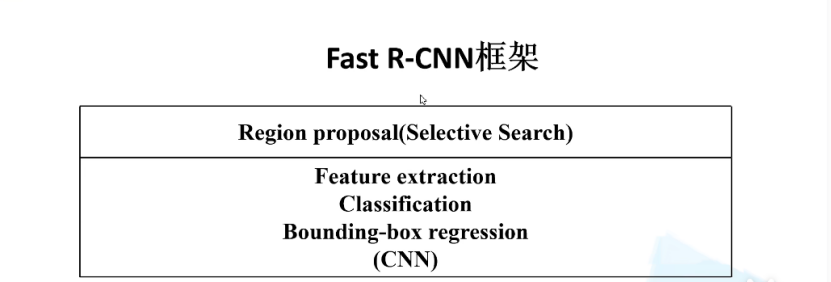
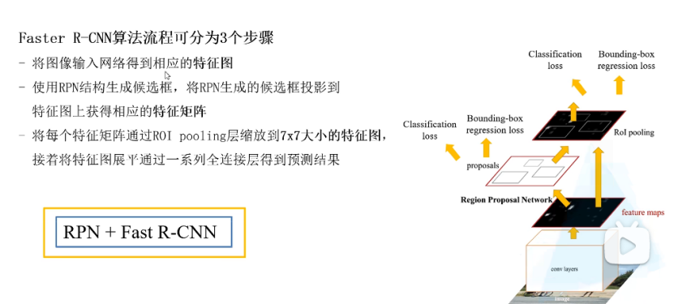
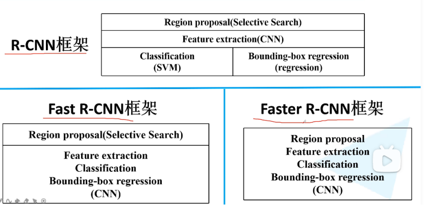
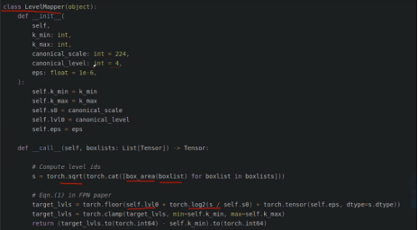
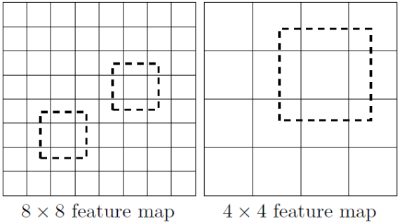
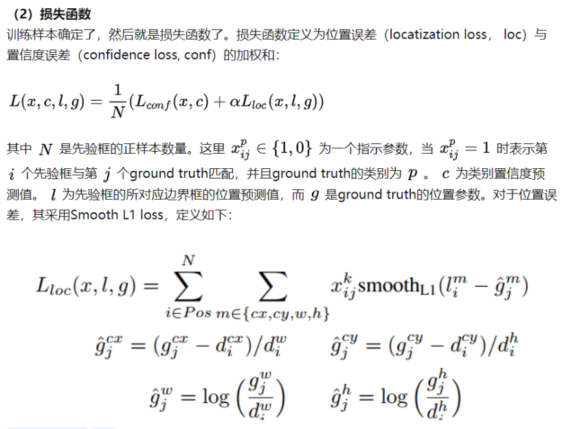

我在学习一种新的**模型/网络**时，喜欢按照**下面步骤**进行探索。

1. 在知乎/CSDN上找相关的（解析）博客，进行初步印象的建立
2. 细读原文paper
3. 开始跑代码，看代码，深入理解

> 卷积层后面加BN层，卷积层中的bias没有作用。
>
> Focal loss CSPNet（CSPDarknet-53） spatial pyramid pooling(spp)
>
> Path Aggregation Netword(PAN)

# 机器学习

## Bagging和boosting

​        本章介绍的两种集成方法是bagging和boosting。在bagging中，是通过随机抽样的替换方式， 得到了与原始数据集规模一样的数据集。而boosting在bagging的思路上更进了一步，它在数据集上顺序应用了多个不同的分类器。另一个成功的集成方法就是随机森林，但是由于随机森林不如AdaBoost流行，所以本书并没有对它进行介绍。

​         本章介绍了boosting方法中流行的一个称为AdaBoost的算法。AdaBoost以弱学习器作为基分类器，并且输入数据，使其通过权重向量进行加权。在第一次迭代当中，所有数据都等权重。但是在后续的迭代当中，前次迭代中分错的数据的权重会增大。这种针对错误的调节能力正是 AdaBoost的长处。

​         本章以单层决策树作为弱学习器构建了AdaBoost分类器。实际上，AdaBoost函数可以应用于 任意分类器，只要该分类器能够处理加权数据即可。AdaBoost算法十分强大，它能够快速处理其 他分类器很难处理的数据集。

​         非均衡分类问题是指在分类器训练时正例数目和反例数目不相等（相差很大）。该问题在错 分正例和反例的代价不同时也存在。本章不仅考察了一种不同分类器的评价方法——ROC曲线， 还介绍了正确率和召回率这两种在类别重要性不同时，度量分类器性能的指标。

​         本章介绍了通过抽样和欠抽样方法来调节数据集中的正例和反例数目。另外一种可能更好 的非均衡问题的处理方法，就是在训练分类器时将错误的代价考虑在内。

## SoftMax和Sigmoid区别

## 防止过拟合

> Cv指南：https://www.pyimagesearch.com/start-here/
>
> 注意力机制：CBAM

# 分割

## MobileNetv1

### 与普通卷积的计算量和参数量对比

## MobileNetv2

**下图左mobilenetv1、右图mobilenetv2**

## shuffleNetv1

## ShuffleNetv2

首先提出了设计轻量化网络的4的通用原则：

**内存访问成本**(memory access cost)和**平台特点**(platform characterics)。

**证明准则一：**

**证明准则二：**

**ShuffleNetv1和ShuffleNetv2对比：**

# 转置卷积

# FCN

**创新点：**

- 不含全连接层(fc)的全卷积(fully conv)网络。可适应任意尺寸输入。 
- 增大数据尺寸的反卷积(deconv)层。能够输出精细的结果。
-  结合不同深度层结果的跳级(skip)结构。同时确保鲁棒性和精确性。

**网络结构图：**

**FCN 的优势在于：** 

- 可以接受任意大小的输入图像（没有全连接层）
- 更加高效，避免了使用邻域带来的重复计算和空间浪费的问题。

**其不足也很突出：** 

- 得到的结果还不够精细 。进行8倍上采样虽然比32倍的效果好了很多，但是上采样的结果还是比较模糊和平滑，对图像中的细节不敏感。
- 是对各个像素进行分类，没有充分考虑像素与像素之间的关系。忽略了在通常的基于像素分类的分割方法中使用的空间规整（spatial regularization）步骤，缺乏空间一致性。

# U-Net

**使用的方法？**

继承FCN的思想，继续进行改进。但是相对于FCN，有几个改变的地方，U-Net是完全对称的，且对解码器（应该自Hinton提出编码器、解码器的概念来，即将图像->高语义feature map的过程看成编码器，高语义->像素级别的分类score map的过程看作解码器）进行了加卷积加深处理，FCN只是单纯的进行了上采样。

Skip connection：两者都用了这样的结构，虽然在现在看来这样的做法比较常见，但是对于当时，这样的结构所带来的明显好处是有目共睹的，因为可以联合高层语义和低层的细粒度表层信息，就很好的符合了分割对这两方面信息的需求。

联合：在FCN中，Skip connection的联合是通过对应像素的求和，而U-Net则是对其的channel的concat过程。

**U-Net结构图**

**U-Net结构的解析**

整体结构就是先编码（下采样），再解码（上采样），回归到跟原始图像一样大小的像素点的分类。

首先是输入图像的大小，这个是根据再高层的大小来进行反推的，最后取的一个比较合适的方便计算的输入大小。

下采样是通过max pool 2x2来进行1/2下采样的，下采样之间是两个conv卷积层，这里的卷积是使用valid卷积。所以在卷积过程中图像的大小是会减小的。这会造成一个问题，就是造成了在skip connection部分concat时候大小不一致，因为在上面有一个copy & crop操作，crop就是为了将大小进行裁剪的操作。

虽然上面有说到crop操作，但若是在卷积的时候使用的是same，就无需这个操作，至于这其中的影响，我觉得应该是不会造成太大的影响的，而且还会方便计算操作。这是same的代码。

上采样，相对于FCN的转置卷积进行上采样，这里是一个up-conv 2x2，具体对应的操作是：对行列进行2倍翻倍。

U-Net和FCN非常的相似，U-Net比FCN稍晚提出来，但都发表在2015年，和FCN相比，U-Net的第一个特点是完全对称，也就是左边和右边是很类似的，而FCN的decoder相对简单，只用了一个deconvolution的操作，之后并没有跟上卷积结构。第二个区别就是skip connection，FCN用的是加操作（summation），U-Net用的是叠操作（concatenation）。这些都是细节，重点是它们的结构用了一个比较经典的思路，也就是编码和解码（encoder-decoder），早在2006年就被Hinton大神提出来发表在了nature上.

当时这个结构提出的主要作用并不是分割，而是压缩图像和去噪声。输入是一幅图，经过下采样的编码，得到一串比原先图像更小的特征，相当于压缩，然后再经过一个解码，理想状况就是能还原到原来的图像。这样的话我们存一幅图的时候就只需要存一个特征和一个解码器即可。这个想法我个人认为是很漂亮了。同理，这个思路也可以用在原图像去噪，做法就是在训练的阶段在原图人为的加上噪声，然后放到这个编码解码器中，目标是可以还原得到原图。

# U-Net++

​    Unet的增强版，灵感来源于DenseNet。但实际上，在此之前有一个思想是一样的工作，可以说是Unet的工作与其如出一辙，根据任务进行了调整而已。

[深度监督](https://arxiv.org/abs/1409.5185)

​       其中的蓝色和绿色部分就是Unet++相对UNet添加的部分。在右侧有L1， L2等，这些是Unet++对网络不同深度的设置。其中绿色的箭头表示上采样，同UNet，黑色的下箭头表示下采样，同UNet。

​       蓝色箭头则表示skip connection，每一个水平层就是非常标准的DenseNet的结构。每个原型单元代表了卷积+激活函数一系列的操作。

​        我们在回来看这个UNet++，对于这个主体结构，我们在论文中给出了一些点评，说白了就是把原来空心的U-Net填满了，优势是可以抓取不同层次的特征，将它们通过特征叠加的方式整合，不同层次的特征，或者说不同大小的感受野，对于大小不一的目标对象的敏感度是不同的，比如，感受野大的特征，可以很容易的识别出大物体的，但是在实际分割中，大物体边缘信息和小物体本身是很容易被深层网络一次次的降采样和一次次升采样给弄丢的，这个时候就可能需要感受野小的特征来帮助。另一个解读就是如果你横着看其中一层的特征叠加过程，就像一个去年很火的DenseNet的结构，非常的巧合，原先的U-Net，横着看就很像是Residual的结构，这个就很有意思了，UNet++对于U-Net分割效果提升可能和DenseNet对于ResNet分类效果的提升，原因如出一辙，因此，在解读中我们也参考了Dense Connection的一些优势，比方说特征的再利用等等。

# 目标检测

Rcnn系列和yolo系列的发表时间线：

​        目标检测技术从阶段上分为两种，一阶段和二阶段。二阶段的核心思想是首先提出proposal框，通过第一阶段的网络回归出目标框的大概位置、大小及是前景的概率，第二阶段是通过另一个网络回归出目标框的位置、大小及类别；而一阶段网络的核心是，对于输入图像，通过网络直接回归出目标大小、位置和类别。

## One-stage和two-stage

1. two-stage方法，如R-CNN系算法，其主要思路是先通过启发式方法（selective search）或者CNN网络（RPN)产生一系列稀疏的候选框，然后对这些候选框进行分类与回归，two-stage方法的优势是准确度高；
2. one-stage方法，如Yolo和SSD，其主要思路是均匀地在图片的不同位置进行密集抽样，抽样时可以采用不同尺度和长宽比，然后利用CNN提取特征后直接进行分类与回归，整个过程只需要一步，所以其优势是速度快，但是均匀的密集采样的一个重要缺点是训练比较困难，这主要是因为正样本与负样本（背景）极其不均衡（参见Focal Loss），导致模型准确度稍低。

## mAP

https://blog.csdn.net/HUAI_BI_TONG/article/details/121212733

计算NMS、矩阵乘法、SVM

## R-CNN

在 R-CNN 中，首先使用选择性搜索算法扫描输入图像，寻找其中的可能对象，从而生成大约 2,000 个区域建议；

然后，在这些区域建议上运行一个 卷积神网络；

最后，将每个卷积神经网络的输出传给支持向量机（ SVM ），使用一个线性回归收紧对象的边界框。

## Fast R-CNN

在建议区域之前进行特征提取，因此在整幅图像上只能运行一次卷积神经网络；

用一个 softmax 层代替支持向量机，对用于预测的神经网络进行扩展，而不是创建一个新的模型。

## Faster R-CNN

1. 该算法用一个快速神经网络代替了运算速度很慢的选择性搜索算法：通过插入区域提议网络（ RPN ），来预测来自特征的建议。 RPN 决定查看“哪里”，这样可以减少整个推理过程的计算量。
2. RPN 快速且高效地扫描每一个位置，来评估在给定的区域内是否需要作进一步处理，其实现方式如下：通过输出k个边界框建议，每个边界框建议都有 2 个值——代表每个位置包含目标对象和不包含目标对象的概率。

## 不同尺度的anchor怎么对应到不同的特征层上

**FPN中的：**

**Pytorch官方的实现代码**

## SSD

> 参考：**https://zhuanlan.zhihu.com/p/33544892**

​       相比Yolo，SSD采用CNN来直接进行检测，而不是像Yolo那样在全连接层之后做检测。其实采用卷积直接做检测只是SSD相比Yolo的其中一个不同点，另外还有两个重要的改变，一是SSD提取了不同尺度的特征图来做检测，大尺度特征图（较靠前的特征图）可以用来检测小物体，而小尺度特征图（较靠后的特征图）用来检测大物体；二是SSD采用了不同尺度和长宽比的先验框（Prior boxes, Default boxes，在Faster R-CNN中叫做锚，Anchors）。Yolo算法缺点是难以检测小目标，而且定位不准，但是这几点重要改进使得SSD在一定程度上克服这些缺点。

​       SSD和Yolo一样都是采用一个CNN网络来进行检测，但是却采用了多尺度的特征图，其基本架构如图3所示。

1. 采用多尺度特征图用于检测

​         所谓多尺度采用大小不同的特征图，CNN网络一般前面的特征图比较大，后面会逐渐采用stride=2的卷积或者pool来降低特征图大小，这正如下图所示，一个比较大的特征图和一个比较小的特征图，它们都用来做检测。这样做的好处是比较大的特征图来用来检测相对较小的目标，而小的特征图负责检测大目标，如图4所示，8x8的特征图可以划分更多的单元，但是其每个单元的先验框尺度比较小。

2. 采用卷积进行检测

​        与Yolo最后采用全连接层不同，SSD直接采用卷积对不同的特征图来进行提取检测结果。对于形状为m*n*p 的特征图，只需要采用3*3*p这样比较小的卷积核得到检测值。

3. 设置先验框

​        在Yolo中，每个单元预测多个边界框，但是其都是相对这个单元本身（正方块），但是真实目标的形状是多变的，Yolo需要在训练过程中自适应目标的形状。而SSD借鉴了Faster R-CNN中anchor的理念，每个单元设置尺度或者长宽比不同的先验框，预测的边界框（bounding boxes）是以这些先验框为基准的，在一定程度上减少训练难度。一般情况下，每个单元会设置多个先验框，其尺度和长宽比存在差异，如图5所示，可以看到每个单元使用了4个不同的先验框，图片中猫和狗分别采用最适合它们形状的先验框来进行训练，后面会详细讲解训练过程中的先验框匹配原则。

**网络结构**

​       SSD采用VGG16作为基础模型，然后在VGG16的基础上新增了卷积层来获得更多的特征图以用于检测。SSD的网络结构如图5所示。上面是SSD模型，下面是Yolo模型，可以明显看到SSD利用了多尺度的特征图做检测。模型的输入图片大小是300*300 （还可以是512*512 ，其与前者网络结构没有差别，只是最后新增一个卷积层，本文不再讨论）。

**训练过程**

1. 先验框匹配

​        在训练过程中，首先要确定训练图片中的ground truth（真实目标）与哪个先验框来进行匹配，与之匹配的先验框所对应的边界框将负责预测它。在Yolo中，ground truth的中心落在哪个单元格，该单元格中与其IOU最大的边界框负责预测它。但是在SSD中却完全不一样，SSD的先验框与ground truth的匹配原则主要有两点。首先，对于图片中每个ground truth，找到与其IOU最大的先验框，该先验框与其匹配，这样，可以保证每个ground truth一定与某个先验框匹配。通常称与ground truth匹配的先验框为正样本（其实应该是先验框对应的预测box，不过由于是一一对应的就这样称呼了），反之，若一个先验框没有与任何ground truth进行匹配，那么该先验框只能与背景匹配，就是负样本。一个图片中ground truth是非常少的，而先验框却很多，如果仅按第一个原则匹配，很多先验框会是负样本，正负样本极其不平衡，所以需要第二个原则。第二个原则是：对于剩余的未匹配先验框，若某个ground truth的IOU 大于某个阈值（一般是0.5），那么该先验框也与这个ground truth进行匹配。这意味着某个ground truth可能与多个先验框匹配，这是可以的。但是反过来却不可以，因为一个先验框只能匹配一个ground truth，如果多个ground truth与某个先验框 IOU大于阈值，那么先验框只与IOU最大的那个ground truth进行匹配。第二个原则一定在第一个原则之后进行，仔细考虑一下这种情况，如果某个ground truth所对应最大 IOU 小于阈值，并且所匹配的先验框却与另外一个ground truth的 IOU 大于阈值，那么该先验框应该匹配谁，答案应该是前者，首先要确保某个ground truth一定有一个先验框与之匹配。但是，这种情况我觉得基本上是不存在的。由于先验框很多，某个ground truth的最大 IOU 肯定大于阈值，所以可能只实施第二个原则既可以了，这里的TensorFlow版本就是只实施了第二个原则，但是这里的Pytorch两个原则都实施了。图8为一个匹配示意图，其中绿色的GT是ground truth，红色为先验框，FP表示负样本，TP表示正样本。

​        尽管一个ground truth可以与多个先验框匹配，但是ground truth相对先验框还是太少了，所以负样本相对正样本会很多。为了保证正负样本尽量平衡，SSD采用了hard negative mining，就是对负样本进行抽样，抽样时按照置信度误差（预测背景的置信度越小，误差越大）进行降序排列，选取误差的较大的top-k作为训练的负样本，以保证正负样本比例接近1:3。

**预测过程**：

​        预测过程比较简单，对于每个预测框，首先根据类别置信度确定其类别（置信度最大者）与置信度值，并过滤掉属于背景的预测框。然后根据置信度阈值（如0.5）过滤掉阈值较低的预测框。对于留下的预测框进行解码，根据先验框得到其真实的位置参数（解码后一般还需要做clip，防止预测框位置超出图片）。解码之后，一般需要根据置信度进行降序排列，然后仅保留top-k（如400）个预测框。最后就是进行NMS算法，过滤掉那些重叠度较大的预测框。最后剩余的预测框就是检测结果了。

## RetinaNet

> https://zhuanlan.zhihu.com/p/410436667
>
> Yolo1-Yolo5
>
> [(23条消息) YOLO系列算法精讲：从yolov1至yolov5的进阶之路（2万字超全整理）_AI 菌的博客-CSDN博客](https://blog.csdn.net/wjinjie/article/details/107509243?ops_request_misc={"request_id"%3A"168819890716800222820979"%2C"scm"%3A"20140713.130102334.."}&request_id=168819890716800222820979&biz_id=0&utm_medium=distribute.pc_search_result.none-task-blog-2~all~top_positive~default-1-107509243-null-null.142^v88^insert_down1,239^v2^insert_chatgpt&utm_term=YOLO&spm=1018.2226.3001.4187)

## Yolov1

**Yolov1网络结构**