我在学习一种新的**模型/网络**时，喜欢按照**下面步骤**进行探索。

1. 在知乎/CSDN上找相关的（解析）博客，进行初步印象的建立
2. 细读原文paper
3. 开始跑代码，看代码，深入理解

> 卷积层后面加BN层，卷积层中的bias没有作用。
>
> Focal loss CSPNet（CSPDarknet-53） spatial pyramid pooling(spp)
>
> Path Aggregation Netword(PAN)

# 机器学习

## Bagging和boosting

​        本章介绍的两种集成方法是bagging和boosting。在bagging中，是通过随机抽样的替换方式， 得到了与原始数据集规模一样的数据集。而boosting在bagging的思路上更进了一步，它在数据集上顺序应用了多个不同的分类器。另一个成功的集成方法就是随机森林，但是由于随机森林不如AdaBoost流行，所以本书并没有对它进行介绍。

​         本章介绍了boosting方法中流行的一个称为AdaBoost的算法。AdaBoost以弱学习器作为基分类器，并且输入数据，使其通过权重向量进行加权。在第一次迭代当中，所有数据都等权重。但是在后续的迭代当中，前次迭代中分错的数据的权重会增大。这种针对错误的调节能力正是 AdaBoost的长处。

​         本章以单层决策树作为弱学习器构建了AdaBoost分类器。实际上，AdaBoost函数可以应用于 任意分类器，只要该分类器能够处理加权数据即可。AdaBoost算法十分强大，它能够快速处理其 他分类器很难处理的数据集。

​         非均衡分类问题是指在分类器训练时正例数目和反例数目不相等（相差很大）。该问题在错 分正例和反例的代价不同时也存在。本章不仅考察了一种不同分类器的评价方法——ROC曲线， 还介绍了正确率和召回率这两种在类别重要性不同时，度量分类器性能的指标。

​         本章介绍了通过抽样和欠抽样方法来调节数据集中的正例和反例数目。另外一种可能更好 的非均衡问题的处理方法，就是在训练分类器时将错误的代价考虑在内。

## SoftMax和Sigmoid区别


## 防止过拟合


> Cv指南：https://www.pyimagesearch.com/start-here/
>
> 注意力机制：CBAM

# 分割


## MobileNetv1


### 与普通卷积的计算量和参数量对比


## MobileNetv2


**下图左mobilenetv1、右图mobilenetv2**


## shuffleNetv1


## ShuffleNetv2

首先提出了设计轻量化网络的4的通用原则：

**内存访问成本**(memory access cost)和**平台特点**(platform characterics)。


**证明准则一：**


**证明准则二：**


**ShuffleNetv1和ShuffleNetv2对比：**


# 转置卷积


# FCN

**创新点：**

- 不含全连接层(fc)的全卷积(fully conv)网络。可适应任意尺寸输入。 
- 增大数据尺寸的反卷积(deconv)层。能够输出精细的结果。
-  结合不同深度层结果的跳级(skip)结构。同时确保鲁棒性和精确性。

**网络结构图：**


**FCN 的优势在于：** 

- 可以接受任意大小的输入图像（没有全连接层）
- 更加高效，避免了使用邻域带来的重复计算和空间浪费的问题。

**其不足也很突出：** 

- 得到的结果还不够精细 。进行8倍上采样虽然比32倍的效果好了很多，但是上采样的结果还是比较模糊和平滑，对图像中的细节不敏感。
- 是对各个像素进行分类，没有充分考虑像素与像素之间的关系。忽略了在通常的基于像素分类的分割方法中使用的空间规整（spatial regularization）步骤，缺乏空间一致性。

# U-Net

**使用的方法？**

继承FCN的思想，继续进行改进。但是相对于FCN，有几个改变的地方，U-Net是完全对称的，且对解码器（应该自Hinton提出编码器、解码器的概念来，即将图像->高语义feature map的过程看成编码器，高语义->像素级别的分类score map的过程看作解码器）进行了加卷积加深处理，FCN只是单纯的进行了上采样。

Skip connection：两者都用了这样的结构，虽然在现在看来这样的做法比较常见，但是对于当时，这样的结构所带来的明显好处是有目共睹的，因为可以联合高层语义和低层的细粒度表层信息，就很好的符合了分割对这两方面信息的需求。

联合：在FCN中，Skip connection的联合是通过对应像素的求和，而U-Net则是对其的channel的concat过程。

**U-Net结构图**


**U-Net结构的解析**

整体结构就是先编码（下采样），再解码（上采样），回归到跟原始图像一样大小的像素点的分类。

首先是输入图像的大小，这个是根据再高层的大小来进行反推的，最后取的一个比较合适的方便计算的输入大小。

下采样是通过max pool 2x2来进行1/2下采样的，下采样之间是两个conv卷积层，这里的卷积是使用valid卷积。所以在卷积过程中图像的大小是会减小的。这会造成一个问题，就是造成了在skip connection部分concat时候大小不一致，因为在上面有一个copy & crop操作，crop就是为了将大小进行裁剪的操作。

虽然上面有说到crop操作，但若是在卷积的时候使用的是same，就无需这个操作，至于这其中的影响，我觉得应该是不会造成太大的影响的，而且还会方便计算操作。这是same的代码。

上采样，相对于FCN的转置卷积进行上采样，这里是一个up-conv 2x2，具体对应的操作是：对行列进行2倍翻倍。

U-Net和FCN非常的相似，U-Net比FCN稍晚提出来，但都发表在2015年，和FCN相比，U-Net的第一个特点是完全对称，也就是左边和右边是很类似的，而FCN的decoder相对简单，只用了一个deconvolution的操作，之后并没有跟上卷积结构。第二个区别就是skip connection，FCN用的是加操作（summation），U-Net用的是叠操作（concatenation）。这些都是细节，重点是它们的结构用了一个比较经典的思路，也就是编码和解码（encoder-decoder），早在2006年就被Hinton大神提出来发表在了nature上.

当时这个结构提出的主要作用并不是分割，而是压缩图像和去噪声。输入是一幅图，经过下采样的编码，得到一串比原先图像更小的特征，相当于压缩，然后再经过一个解码，理想状况就是能还原到原来的图像。这样的话我们存一幅图的时候就只需要存一个特征和一个解码器即可。这个想法我个人认为是很漂亮了。同理，这个思路也可以用在原图像去噪，做法就是在训练的阶段在原图人为的加上噪声，然后放到这个编码解码器中，目标是可以还原得到原图。

# U-Net++

​    Unet的增强版，灵感来源于DenseNet。但实际上，在此之前有一个思想是一样的工作，可以说是Unet的工作与其如出一辙，根据任务进行了调整而已。

[深度监督](https://arxiv.org/abs/1409.5185)


​       其中的蓝色和绿色部分就是Unet++相对UNet添加的部分。在右侧有L1， L2等，这些是Unet++对网络不同深度的设置。其中绿色的箭头表示上采样，同UNet，黑色的下箭头表示下采样，同UNet。

​       蓝色箭头则表示skip connection，每一个水平层就是非常标准的DenseNet的结构。每个原型单元代表了卷积+激活函数一系列的操作。

​        我们在回来看这个UNet++，对于这个主体结构，我们在论文中给出了一些点评，说白了就是把原来空心的U-Net填满了，优势是可以抓取不同层次的特征，将它们通过特征叠加的方式整合，不同层次的特征，或者说不同大小的感受野，对于大小不一的目标对象的敏感度是不同的，比如，感受野大的特征，可以很容易的识别出大物体的，但是在实际分割中，大物体边缘信息和小物体本身是很容易被深层网络一次次的降采样和一次次升采样给弄丢的，这个时候就可能需要感受野小的特征来帮助。另一个解读就是如果你横着看其中一层的特征叠加过程，就像一个去年很火的DenseNet的结构，非常的巧合，原先的U-Net，横着看就很像是Residual的结构，这个就很有意思了，UNet++对于U-Net分割效果提升可能和DenseNet对于ResNet分类效果的提升，原因如出一辙，因此，在解读中我们也参考了Dense Connection的一些优势，比方说特征的再利用等等。

# 目标检测

Rcnn系列和yolo系列的发表时间线：


​        目标检测技术从阶段上分为两种，一阶段和二阶段。二阶段的核心思想是首先提出proposal框，通过第一阶段的网络回归出目标框的大概位置、大小及是前景的概率，第二阶段是通过另一个网络回归出目标框的位置、大小及类别；而一阶段网络的核心是，对于输入图像，通过网络直接回归出目标大小、位置和类别。

## One-stage和two-stage

1. two-stage方法，如R-CNN系算法，其主要思路是先通过启发式方法（selective search）或者CNN网络（RPN)产生一系列稀疏的候选框，然后对这些候选框进行分类与回归，two-stage方法的优势是准确度高；
2. one-stage方法，如Yolo和SSD，其主要思路是均匀地在图片的不同位置进行密集抽样，抽样时可以采用不同尺度和长宽比，然后利用CNN提取特征后直接进行分类与回归，整个过程只需要一步，所以其优势是速度快，但是均匀的密集采样的一个重要缺点是训练比较困难，这主要是因为正样本与负样本（背景）极其不均衡（参见Focal Loss），导致模型准确度稍低。

## mAP

https://blog.csdn.net/HUAI_BI_TONG/article/details/121212733

计算NMS、矩阵乘法、SVM

## R-CNN


在 R-CNN 中，首先使用选择性搜索算法扫描输入图像，寻找其中的可能对象，从而生成大约 2,000 个区域建议；

然后，在这些区域建议上运行一个 卷积神网络；

最后，将每个卷积神经网络的输出传给支持向量机（ SVM ），使用一个线性回归收紧对象的边界框。


## Fast R-CNN


在建议区域之前进行特征提取，因此在整幅图像上只能运行一次卷积神经网络；

用一个 softmax 层代替支持向量机，对用于预测的神经网络进行扩展，而不是创建一个新的模型。


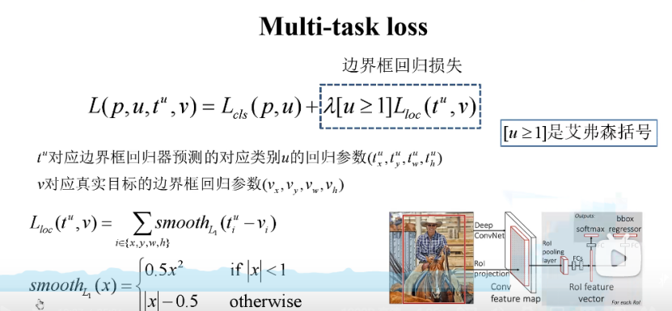


## Faster R-CNN

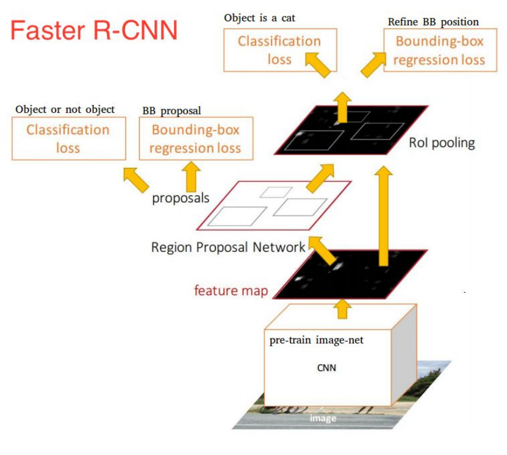

1. 该算法用一个快速神经网络代替了运算速度很慢的选择性搜索算法：通过插入区域提议网络（ RPN ），来预测来自特征的建议。 RPN 决定查看“哪里”，这样可以减少整个推理过程的计算量。
2. RPN 快速且高效地扫描每一个位置，来评估在给定的区域内是否需要作进一步处理，其实现方式如下：通过输出k个边界框建议，每个边界框建议都有 2 个值——代表每个位置包含目标对象和不包含目标对象的概率。


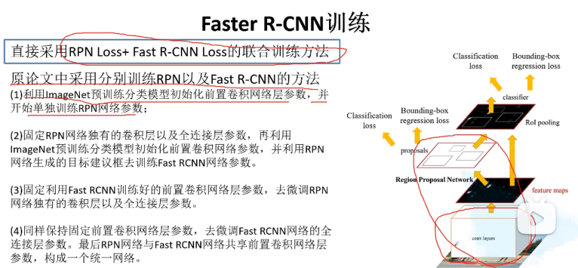

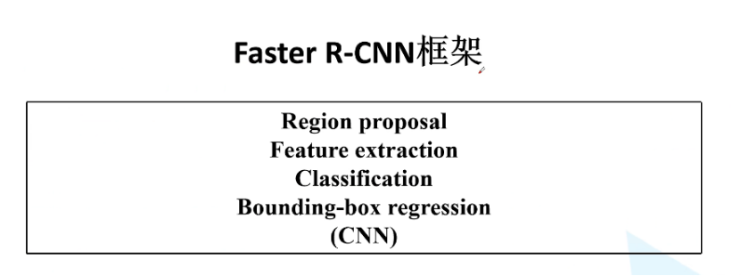


## 不同尺度的anchor怎么对应到不同的特征层上

**FPN中的：**

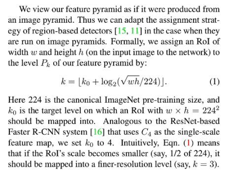

**Pytorch官方的实现代码**


## SSD

> 参考：**https://zhuanlan.zhihu.com/p/33544892**

​       相比Yolo，SSD采用CNN来直接进行检测，而不是像Yolo那样在全连接层之后做检测。其实采用卷积直接做检测只是SSD相比Yolo的其中一个不同点，另外还有两个重要的改变，一是SSD提取了不同尺度的特征图来做检测，大尺度特征图（较靠前的特征图）可以用来检测小物体，而小尺度特征图（较靠后的特征图）用来检测大物体；二是SSD采用了不同尺度和长宽比的先验框（Prior boxes, Default boxes，在Faster R-CNN中叫做锚，Anchors）。Yolo算法缺点是难以检测小目标，而且定位不准，但是这几点重要改进使得SSD在一定程度上克服这些缺点。

​       SSD和Yolo一样都是采用一个CNN网络来进行检测，但是却采用了多尺度的特征图，其基本架构如图3所示。

1. 采用多尺度特征图用于检测

​         所谓多尺度采用大小不同的特征图，CNN网络一般前面的特征图比较大，后面会逐渐采用stride=2的卷积或者pool来降低特征图大小，这正如下图所示，一个比较大的特征图和一个比较小的特征图，它们都用来做检测。这样做的好处是比较大的特征图来用来检测相对较小的目标，而小的特征图负责检测大目标，如图4所示，8x8的特征图可以划分更多的单元，但是其每个单元的先验框尺度比较小。


2. 采用卷积进行检测

​        与Yolo最后采用全连接层不同，SSD直接采用卷积对不同的特征图来进行提取检测结果。对于形状为m*n*p 的特征图，只需要采用3*3*p这样比较小的卷积核得到检测值。

3. 设置先验框

​        在Yolo中，每个单元预测多个边界框，但是其都是相对这个单元本身（正方块），但是真实目标的形状是多变的，Yolo需要在训练过程中自适应目标的形状。而SSD借鉴了Faster R-CNN中anchor的理念，每个单元设置尺度或者长宽比不同的先验框，预测的边界框（bounding boxes）是以这些先验框为基准的，在一定程度上减少训练难度。一般情况下，每个单元会设置多个先验框，其尺度和长宽比存在差异，如图5所示，可以看到每个单元使用了4个不同的先验框，图片中猫和狗分别采用最适合它们形状的先验框来进行训练，后面会详细讲解训练过程中的先验框匹配原则。

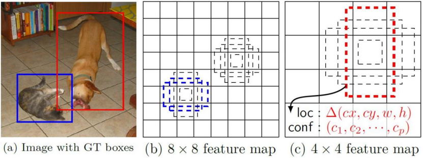

**网络结构**

​       SSD采用VGG16作为基础模型，然后在VGG16的基础上新增了卷积层来获得更多的特征图以用于检测。SSD的网络结构如图5所示。上面是SSD模型，下面是Yolo模型，可以明显看到SSD利用了多尺度的特征图做检测。模型的输入图片大小是300*300 （还可以是512*512 ，其与前者网络结构没有差别，只是最后新增一个卷积层，本文不再讨论）。

**训练过程**

1. 先验框匹配

​        在训练过程中，首先要确定训练图片中的ground truth（真实目标）与哪个先验框来进行匹配，与之匹配的先验框所对应的边界框将负责预测它。在Yolo中，ground truth的中心落在哪个单元格，该单元格中与其IOU最大的边界框负责预测它。但是在SSD中却完全不一样，SSD的先验框与ground truth的匹配原则主要有两点。首先，对于图片中每个ground truth，找到与其IOU最大的先验框，该先验框与其匹配，这样，可以保证每个ground truth一定与某个先验框匹配。通常称与ground truth匹配的先验框为正样本（其实应该是先验框对应的预测box，不过由于是一一对应的就这样称呼了），反之，若一个先验框没有与任何ground truth进行匹配，那么该先验框只能与背景匹配，就是负样本。一个图片中ground truth是非常少的，而先验框却很多，如果仅按第一个原则匹配，很多先验框会是负样本，正负样本极其不平衡，所以需要第二个原则。第二个原则是：对于剩余的未匹配先验框，若某个ground truth的IOU 大于某个阈值（一般是0.5），那么该先验框也与这个ground truth进行匹配。这意味着某个ground truth可能与多个先验框匹配，这是可以的。但是反过来却不可以，因为一个先验框只能匹配一个ground truth，如果多个ground truth与某个先验框 IOU大于阈值，那么先验框只与IOU最大的那个ground truth进行匹配。第二个原则一定在第一个原则之后进行，仔细考虑一下这种情况，如果某个ground truth所对应最大 IOU 小于阈值，并且所匹配的先验框却与另外一个ground truth的 IOU 大于阈值，那么该先验框应该匹配谁，答案应该是前者，首先要确保某个ground truth一定有一个先验框与之匹配。但是，这种情况我觉得基本上是不存在的。由于先验框很多，某个ground truth的最大 IOU 肯定大于阈值，所以可能只实施第二个原则既可以了，这里的TensorFlow版本就是只实施了第二个原则，但是这里的Pytorch两个原则都实施了。图8为一个匹配示意图，其中绿色的GT是ground truth，红色为先验框，FP表示负样本，TP表示正样本。

​        尽管一个ground truth可以与多个先验框匹配，但是ground truth相对先验框还是太少了，所以负样本相对正样本会很多。为了保证正负样本尽量平衡，SSD采用了hard negative mining，就是对负样本进行抽样，抽样时按照置信度误差（预测背景的置信度越小，误差越大）进行降序排列，选取误差的较大的top-k作为训练的负样本，以保证正负样本比例接近1:3。


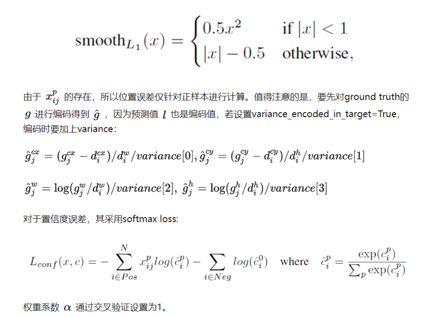

**预测过程**：

​        预测过程比较简单，对于每个预测框，首先根据类别置信度确定其类别（置信度最大者）与置信度值，并过滤掉属于背景的预测框。然后根据置信度阈值（如0.5）过滤掉阈值较低的预测框。对于留下的预测框进行解码，根据先验框得到其真实的位置参数（解码后一般还需要做clip，防止预测框位置超出图片）。解码之后，一般需要根据置信度进行降序排列，然后仅保留top-k（如400）个预测框。最后就是进行NMS算法，过滤掉那些重叠度较大的预测框。最后剩余的预测框就是检测结果了。

## RetinaNet

> https://zhuanlan.zhihu.com/p/410436667
>
> Yolo1-Yolo5
>
> [(23条消息) YOLO系列算法精讲：从yolov1至yolov5的进阶之路（2万字超全整理）_AI 菌的博客-CSDN博客](https://blog.csdn.net/wjinjie/article/details/107509243?ops_request_misc={"request_id"%3A"168819890716800222820979"%2C"scm"%3A"20140713.130102334.."}&request_id=168819890716800222820979&biz_id=0&utm_medium=distribute.pc_search_result.none-task-blog-2~all~top_positive~default-1-107509243-null-null.142^v88^insert_down1,239^v2^insert_chatgpt&utm_term=YOLO&spm=1018.2226.3001.4187)

## Yolov1

**Yolov1网络结构**

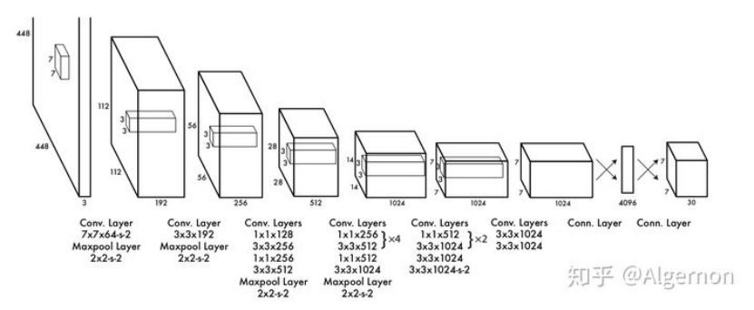

​       直接上结构图，输入图像大小为448*448，经过若干个卷积层与池化层，变为7*7*1024张量（图一中倒数第三个立方体），最后经过两层全连接层，输出张量维度为7*7*30，这就是Yolo v1的整个神经网络结构，和一般的卷积物体分类网络没有太多区别，最大的不同就是：分类网络最后的全连接层，一般连接于一个一维向量，向量的不同位代表不同类别，而这里的输出向量是一个三维的张量（7*7*30）。上图中Yolo的backbone网络结构，受启发于GoogLeNet，也是v2、v3中Darknet的先锋。本质上来说没有什么特别，没有使用BN层，用了一层Dropout。除了最后一层的输出使用了线性激活函数，其他层全部使用Leaky Relu激活函数。网络结构没有特别的东西，不再赘述。

1. 7*7的含义

7*7是指图片被分成了7*7个格子，如下所示：

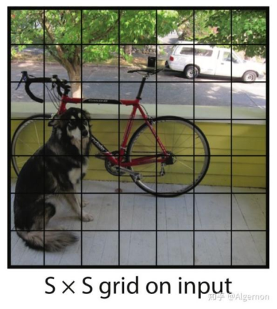

一幅图片分成7x7个网格(grid cell)，某个物体的中心落在这个网格中此网格就负责预测这个物体。

最后一层输出为 （7*7）*30的维度。每个 1*1*30的维度对应原图7*7个cell中的一个，1*1*30中含有类别预测和bbox坐标预测。总得来讲就是让网格负责类别信息，bounding box主要负责坐标信息(部分负责类别信息：confidence也算类别信息)。具体如下：

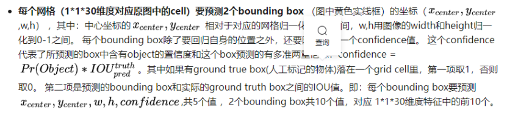

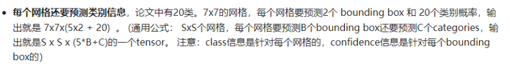

测试时：

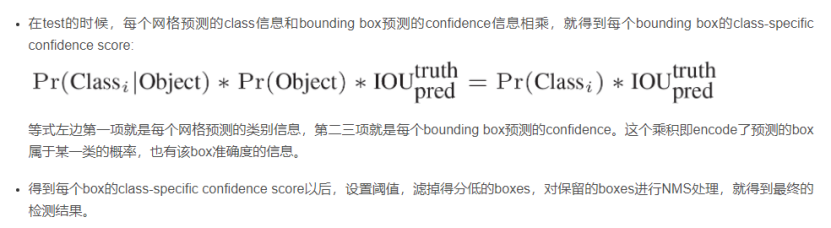

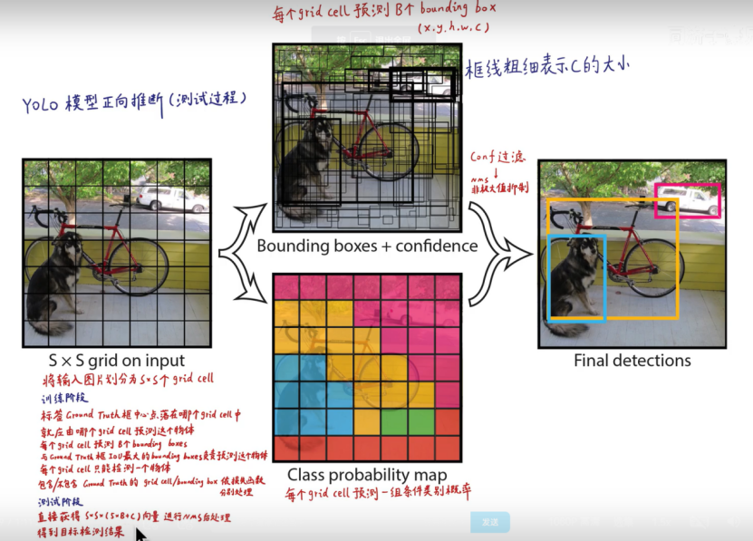

**YOLOv1损失函数**

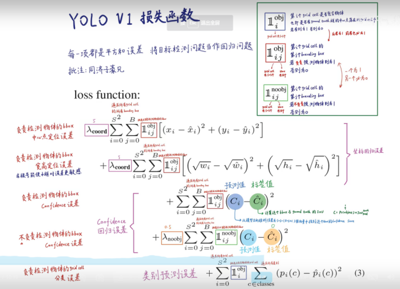

**YOLO主要特点是：**

速度快，能够达到实时的要求。在 Titan X 的 GPU 上 能够达到 45 帧每秒。

使用全图作为 Context 信息，背景错误（把背景错认为物体）比较少。

泛化能力强。

**YOLO的缺点**

YOLO对相互靠的很近的物体，还有很小的群体 检测效果不好，这是因为一个网格中只预测了两个框，并且只属于一类。

对[测试](http://lib.csdn.net/base/softwaretest)图像中，同一类物体出现的新的不常见的长宽比和其他情况是。泛化能力偏弱。

由于损失函数的问题，定位误差是影响检测效果的主要原因。尤其是大小物体的处理上，还有待加强。

## Yolov2（yolo9000）

先解释概念：Yolov2和Yolo9000算法内核相同，区别是训练方式不同：Yolov2用coco数据集训练后，可以识别80个种类。而Yolo9000可以使用coco数据集 + ImageNet数据集联合训练，可以识别9000多个种类。图一为Yolo9000的检测效果图，可以看到图片中的人，被分为了leader、American、skin-diver、athlete。

文首先介绍Yolov2，列举出基于v1所做的改进；之后解读Yolo9000的训练方法。

**Better**

1. Batch Normalization（批归一化）

检测系列的网络结构中，BN逐渐变成了标配。在Yolo的每个卷积层中加入BN之后，mAP提升了2%，并且去除了Dropout。

2. High Resolution Classifier（分类网络高分辨率预训练）

在Yolov1中，网络的backbone部分会在ImageNet数据集上进行预训练，训练时网络输入图像的分辨率为224*224。在v2中，将分类网络在输入图片分辨率为448*448的ImageNet数据集上训练10个epoch，再使用检测数据集（例如coco）进行微调。高分辨率预训练使mAP提高了大约4%。

3. Convolutional With Anchor Boxes（Anchor Box替换全连接层）

第一篇解读v1时提到，每个格点预测两个矩形框，在计算loss时，只让与ground truth最接近的框产生loss数值，而另一个框不做修正。这样规定之后，作者发现两个框在物体的大小、长宽比、类别上逐渐有了分工。在v2中，神经网络不对预测矩形框的宽高的绝对值进行预测，而是预测与Anchor框的偏差（offset），每个格点指定n个Anchor框。在训练时，最接近ground truth的框产生loss，其余框不产生loss。在引入Anchor Box操作后，mAP由69.5下降至69.2，原因在于，每个格点预测的物体变多之后，召回率大幅上升，准确率有所下降，总体mAP略有下降。

v2中移除了v1最后的两层全连接层，全连接层计算量大，耗时久。文中没有详细描述全连接层的替换方案，这里笔者猜测是利用1*1的卷积层代替（欢迎指正），具体的网络结构原文中没有提及，官方代码也被yolo v3替代了。v2主要是各种trick引入后的效果验证，建议不必纠结于v2的网络结构。

4. Dimension Clusters（Anchor Box的宽高由聚类产生）

​        这里算是作者的一个创新点。Faster R-CNN中的九个Anchor Box的宽高是事先设定好的比例大小，一共设定三个面积大小的矩形框，每个矩形框有三个宽高比：1:1，2:1，1:2，总共九个框。而在v2中，Anchor Box的宽高不经过人为获得，而是将训练数据集中的矩形框全部拿出来，用kmeans聚类得到先验框的宽和高。例如使用5个Anchor Box，那么kmeans聚类的类别中心个数设置为5。加入了聚类操作之后，引入Anchor Box之后，mAP上升。

​        需要强调的是，聚类必须要定义聚类点（矩形框（w，h））之间的距离函数，文中使用如下函数：

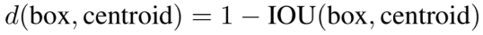

​         使用（1-IOU）数值作为两个矩形框的的距离函数，这里的运用也是非常的巧妙。

5. Direct location prediction（绝对位置预测）

Yolo中的位置预测方法很清晰，就是相对于左上角的格点坐标预测偏移量。这里的Direct具体含义，应该是和其他算法框架对比后得到的。比如其他流行的位置预测公式如下（原文中是减号，应该是加号，无伤大雅）：

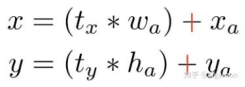

在yolov1中

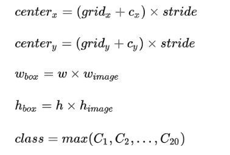

​        神经网络预测 tx，ty而tx，ty又需要与先验框的宽高相乘才能得到相较于 xa ，ya的位置偏移值，在v2中，位置预测公式如下：

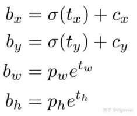

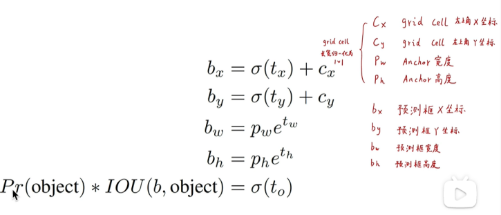

​        Yolo的天然优势，就是格点的坐标可以作为参照点。此时tx，ty通过一个激活函数，直接产生偏移位置数值，与矩形框的宽高独立开，变得更加直接。

6. Fine-Grained Features（细粒度特征）

​        在26**26的特征图，经过卷积层等，变为13*13的特征图后，作者认为损失了很多细粒度的特征，导致小尺寸物体的识别效果不佳，所以在此加入了passthrough层。

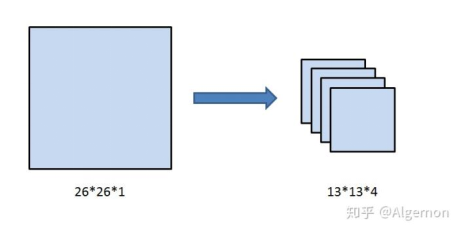

​        如上图所示，passthrough层就是将26*26*1的特征图，变成13*13*4的特征图，在这一次操作中不损失细粒度特征。有人说passthrough层分成四份的具体细节，并不是两刀切成4块，而是在每个2*2的小区域上都选择左上角块。其实这里怎么切都一样，在之后1*1卷积层中，不过是加法交换律的事。

7. Multi-Scale Training（多尺寸训练）

​        很关键的一点是，Yolo v2中只有卷积层与池化层，所以对于网络的输入大小，并没有限制，整个网络的降采样倍数为32，只要输入的特征图尺寸为32的倍数即可，如果网络中有全连接层，就不是这样了。所以Yolo v2可以使用不同尺寸的输入图片训练。

​        作者使用的训练方法是，在每10个batch之后，就将图片resize成{320, 352, ..., 608}中的一种。不同的输入，最后产生的格点数不同，比如输入图片是320*320，那么输出格点是10*10，如果每个格点的先验框个数设置为5，那么总共输出500个预测结果；如果输入图片大小是608*608，输出格点就是19*19，共1805个预测结果。

​         在引入了多尺寸训练方法后，迫使卷积核学习不同比例大小尺寸的特征。当输入设置为544*544甚至更大，Yolo v2的mAP已经超过了其他的物体检测算法。

**Faster——Darknet-19**

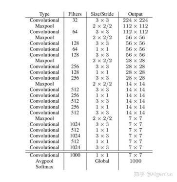

​        v2中作者提出了新的分类网络架构——Darknet-19，该架构的网络参数较VGG-16更少，在ImageNet上，仍然可以达到top-1 72.9%以及top-5 91.2%的精度。

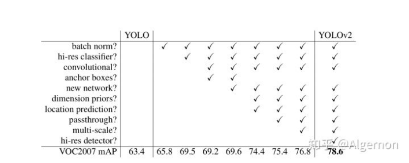

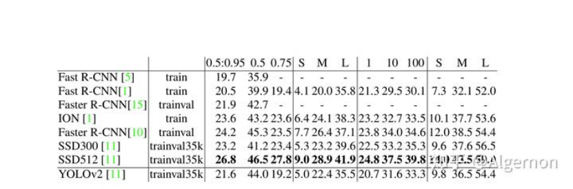

​																			Yolo v2精度对比(on COCO test-dev2015)

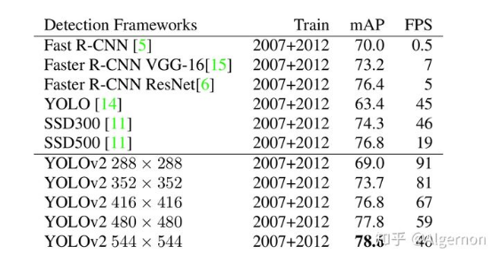

​																				Yolo v2精度与速率对比（on PASCAL VOC）

**Yolo9000: Stronger**

- Joint classification and detection

如果说整个Yolo v2的Better部分，都没有什么大的创新点，这里的分类与检测联合训练，就是Yolo v2的一大亮点，因为这一个技巧，Yolo v2才成为了Yolo9000。

- Dataset combination with WordTree

在文中，作者使用WordTree，解决了ImageNet与coco之间的类别问题。

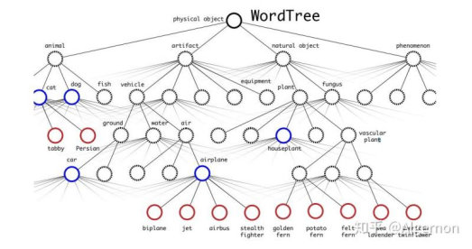

Yolov2的wordtree：[YOLO V2 / 9000: Better, Faster, Stronger 深入理解_目睹闰土刺猹的瓜的博客-CSDN博客](https://blog.csdn.net/weixin_44585583/article/details/103098706)

**小结**

 		Yolo v2将同期业界的很多深度学习技巧结合进来，将Yolo的性能与精度又提升了一个层次。Yolo9000的物体检测分类技巧，可以很好的被运用到工程中，并不需要对所有的物体都进行费时费力的检测标注，而是同时利用分类标签与检测标签达到同样的效果，从而减轻了标注成本与时间。

**YOLOv2损失函数**

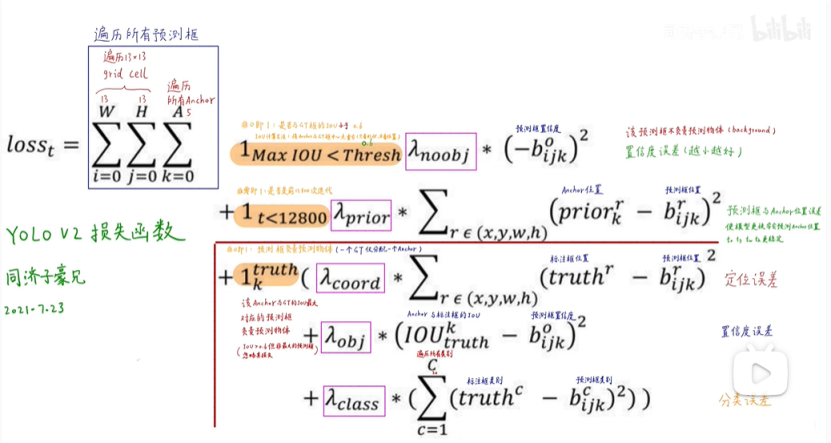

## Yolov3

**这里注意bounding box 与anchor box的区别：**
Bounding box它输出的是框的位置（中心坐标与宽高），confidence以及N个类别。
anchor box只是一个尺度即只有宽高。

**Darknet-53 模型结构**

YOLO V2的darknet-19（特征提取网络）在YOLO V3中变成了darknet-53

YOLO V3也借鉴了FPN层的结构

使用了多级检测（multi-level detection），分别检测大目标和小目标。

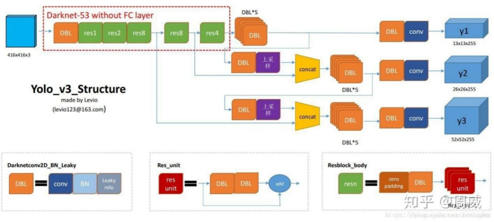

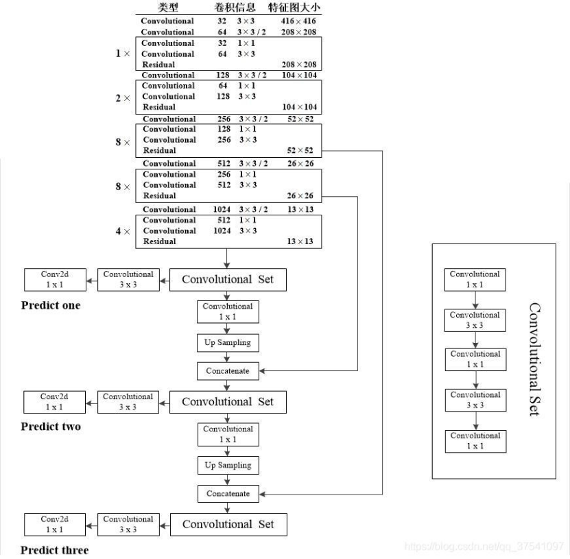

**YOLO V3的损失函数**

​		损失函数看似包含了**五个部分**，实际是***三个部分***：预测框的位置损失+预测框预测的类别损失+预测框置信度损失

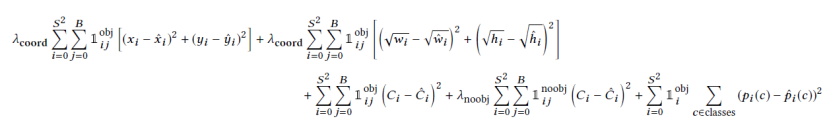

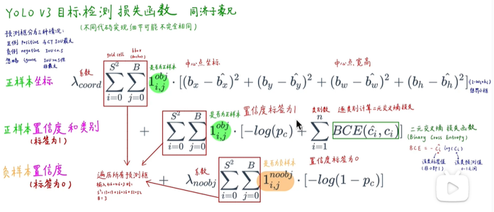

## YOLOv4

​		YOLO V4更像一篇目标检测模型Tricks文献综述, 就是筛选了一些从YOLO V3发布至今，被用在各式各样检测器上，能够提高检测精度的tricks，并以YOLO V3为基础进行改进的目标检测模型。YOLO V4在保证速度的同时，大幅提高模型的检测精度(当然，这是相较于YOLO V3的）。

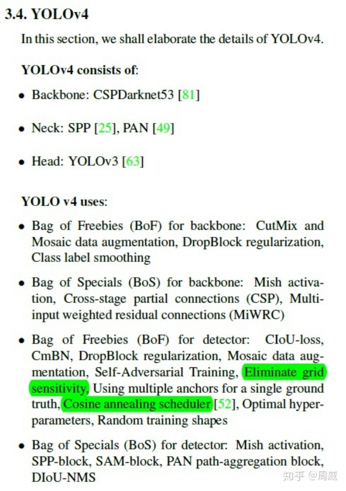

### 1.1 网络结构

- Backbone: CSPDarknet53
- Neck: SPP，PAN
- Head: YOLOv3

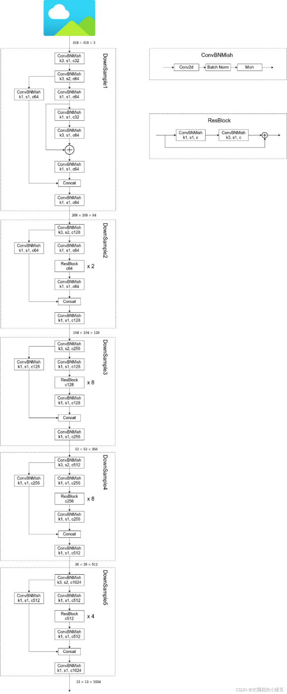

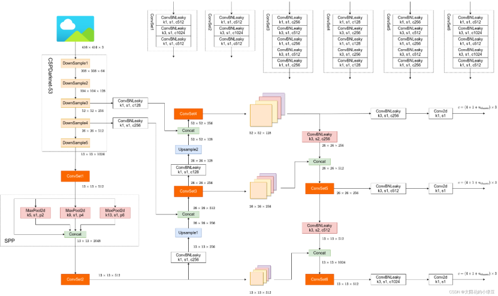

#### 1.1.1 CSP

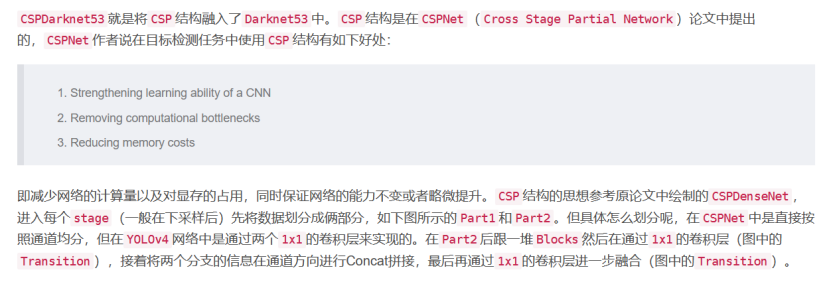

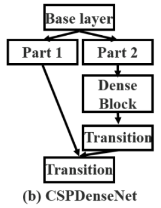

### 1.2 优化策略

1.2.1 Eliminate grid sensitivity

1.2.2 Mosaic data augmentation

1.2.3 IoU threshold（正样本匹配）

### 1.3 损失函数：

​		意思就是MSE损失函数将检测框***\*中心点坐标\****和***\*宽高\****等信息作为***\*独立的变量\****对待的，但是实际上他们之间是有关系的。从直观上来说，框的中心点和宽高的确存在着一定的关系。所以解决方法是使用***\*IOU损失\****代替MSE损失。

- （1）IOU损失

缺点：该损失函数只在bounding box重叠的时候才管用，在他们没有重叠情况下，将不会提供滑动梯度。收敛速度慢，定位不精准。

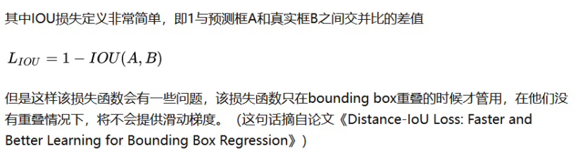

- （2）GIOU损失

缺点：两个框水平或者垂直时，GIoU会退化成IoU。收敛速度慢，定位不精准。

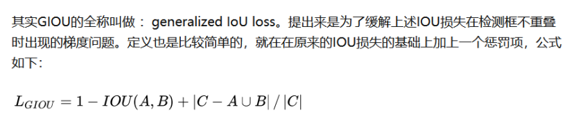

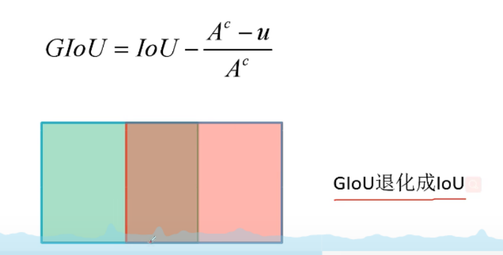

- （3）DIOU损失

缺点：没有考虑到回归框的长宽比。

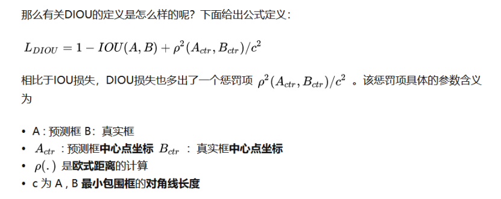

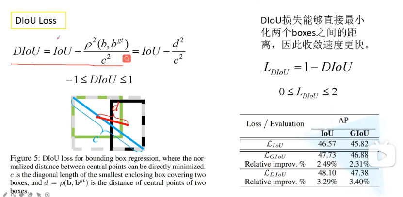

- （4）CIOU损失

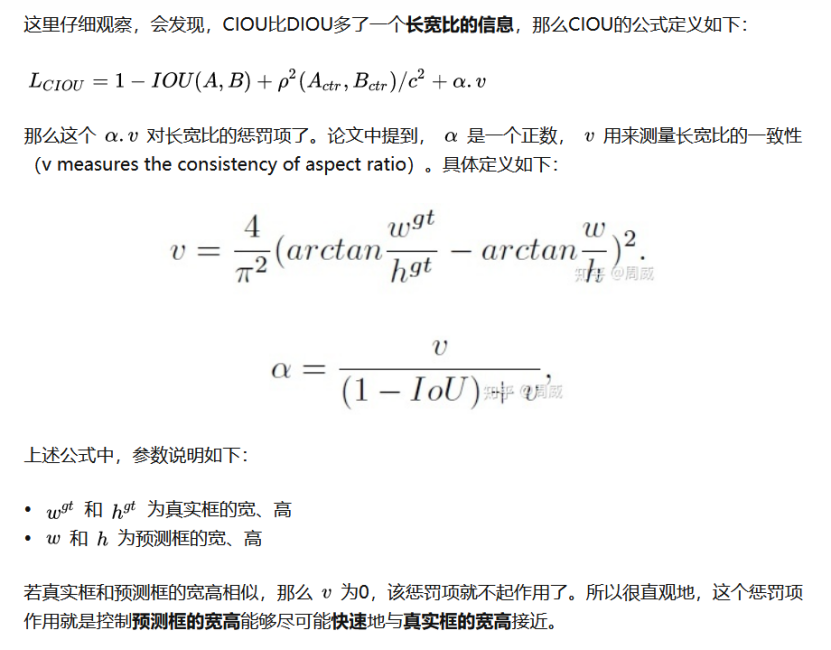


### 1.4 激活函数

**Mish激活函数**

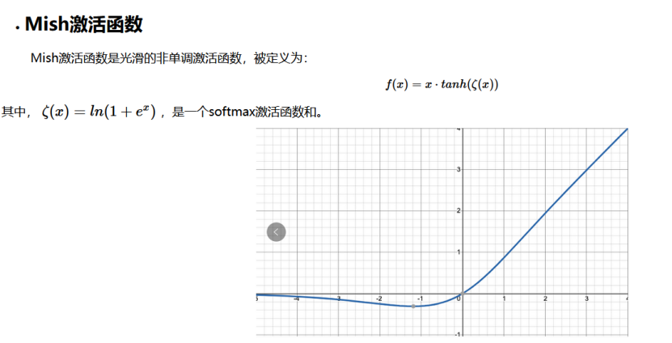

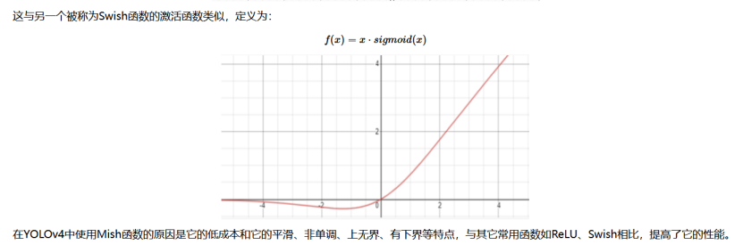

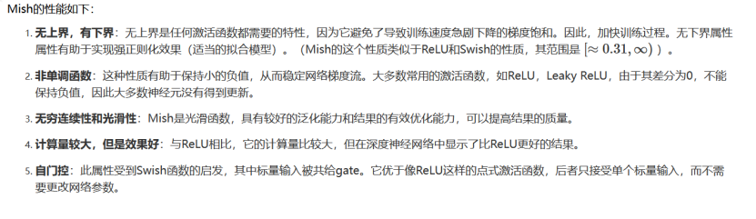

## YOLOv5

### 1 网络结构

- ***Backbone***: New CSP-Darknet53

- ***Neck***: SPPF, New CSP-PAN

- ***Head***: YOLOv3 Head

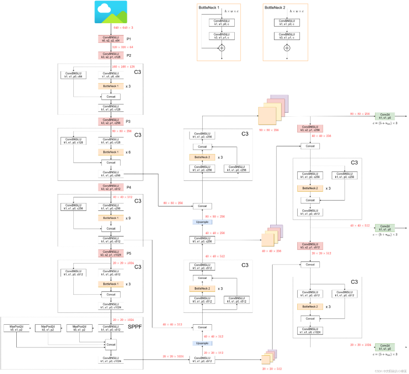

**在Neck部分的变化还是相对较大的，首先是将SPP换成成了SPPF**

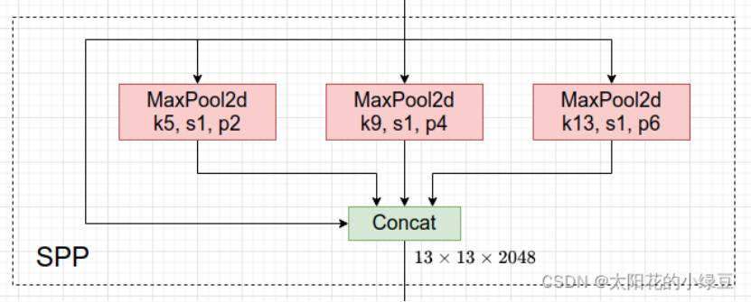

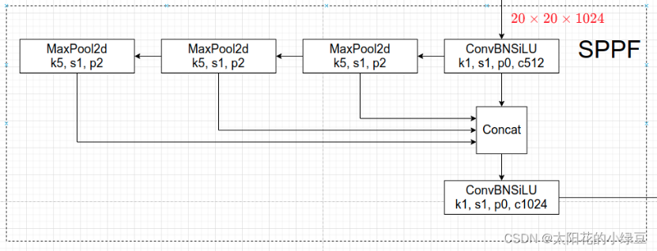

​		而SPPF结构是将输入串行通过多个5x5大小的MaxPool层，这里需要注意的是串行两个5x5大小的MaxPool层是和一个9x9大小的MaxPool层计算结果是一样的，串行三个5x5大小的MaxPool层是和一个13x13大小的MaxPool层计算结果是一样的。

### 2 数据增强

- ***Mosaic***，将四张图片拼成一张图片

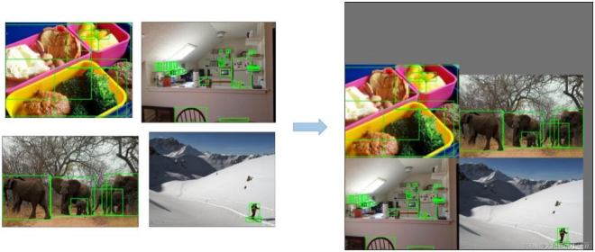

- ***Copy paste***，将部分目标随机的粘贴到图片中，前提是数据要有segments数据才行，即每个目标的实例分割信息。下面是Copy paste原论文中的示意图。

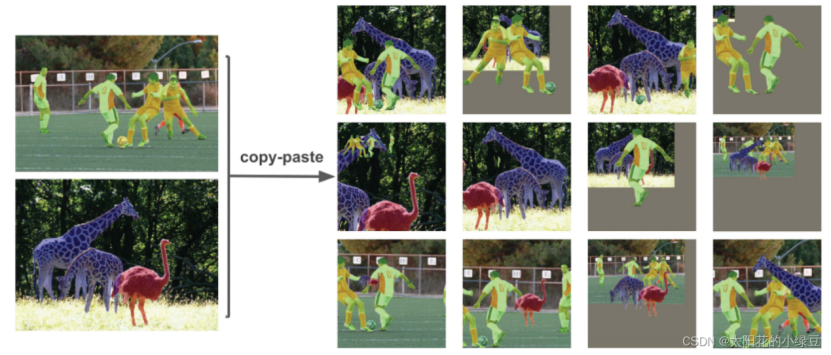

- ***Random affine(Rotation, Scale, Translation and Shear)***，随机进行仿射变换，但根据配置文件里的超参数发现只使用了Scale和Translation即缩放和平移。

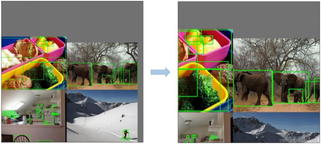

- ***MixUp***，就是将两张图片按照一定的透明度融合在一起，具体有没有用不太清楚，毕竟没有论文，也没有消融实验。代码中只有较大的模型才使用到了MixUp，而且每次只有10%的概率会使用到。


### 3 训练策略

在YOLOv5源码中使用到了很多训练的策略，这里简单总结几个我注意到的点，还有些没注意到的请大家自己看下源码：


### 4 其他


## Yolo系列对比

**Yolov3：**

- ***Backbone:*** DarkNet53

- ***Neck:***FPN

- ***Head:*** YOLOv3

**Yolov4：**

- ***Backbone：***CSPDarkNet53

- ***Neck:*** SPP (Spatial Pyramid Pooling), PAN (Path Aggregation Network)

- ***Head:*** YOLOv3

(CSP: Cross Stage Partial Network)

**Yolov5：**

- ***Backbone ：***New CSP-Darknet53

- ***Neck:*** SPPF, New CSP-PAN

- ***Head:*** YOLOv3

激活函数：SiLU、Swish

**Smooth L1损失函数：**


smooth L1损失函数曲线如下图所示，作者这样设置的目的是想让loss对于离群点更加鲁棒，相比于L2损失函数，其对离群点（指的是距离中心较远的点）、异常值（outlier）不敏感，可控制梯度的量级使训练时不容易跑飞。


## BN层和LN层：


**看源码步骤：**

1. 数据预处理。
2. 网络搭建。
3. 损失函数计算。

卷积网络中flops的计算：


# 算法：

求p和q的最大公约数(欧几里得算法：计算两个非负整数 p 和 q 的最大公约数：若 q 是 0，则最大公约数为 p。否则，将 p 除以 q 得到余数 r，p 和 q 的最大公约数即为 q 和 r 的最大公约数。)

```python
def gcd(p:int， q:int):
	If q == 0:
		Return p
	r = p % q
	return gcd(q, r)
```


## MaxPooling层的作用：

​		简而言之，使用下采样的原因，一是减少需要处理的特征图的元素个数，二是通过让连续 卷积层的观察窗口越来越大（即窗口覆盖原始输入的比例越来越大），从而引入空间过滤器的层 级结构。

## 目标跟踪

