# BPE

> 教程
>
> - B站：[80、Byte Pair Encoding 源码逐行讲解_哔哩哔哩_bilibili](https://www.bilibili.com/video/BV12x4y1t75q/?spm_id_from=333.1007.top_right_bar_window_history.content.click&vd_source=fffd0a55d832fc312ff82010c51836f8)
> - YouTube：https://www.youtube.com/watch?v=zduSFxRajkE&t=1430s
> - github：https://github.com/karpathy/minbpe/tree/master


# RMSNorm

## 1、概述

​		RMSNorm（Root Mean Square Layer Normalization，均方根归一化）是一种用于深度学习模型的归一化技术，特别适用于Transformer等架构。它作为LayerNorm（层归一化）的替代方案，旨在简化归一化过程，降低计算复杂度，同时保持或提升模型的性能。

## 2、RMSNorm的动机

​		在深度学习中，归一化技术被广泛用于稳定和加速模型训练。LayerNorm在Transformer模型中得到了广泛应用，它通过对每个样本的特征维度进行归一化，减少了内部协变量偏移。然而，LayerNorm需要计算输入特征的均值和方差，这增加了计算复杂度和开销。

​		RMSNorm的提出是为了消除对 均值计算 的依赖，仅通过输入特征的 均方根(RMS) 进行归一化，从而简化计算，提高效率。

## 3、RMSNorm的工作原理

​		RMSNorm通过计算输入向量的均方根，对其进行归一化处理。与LayerNorm不同，RMSNorm不进行均值的减法操作。

## 4、数学公式

给定输入向量 x ∈R^d ，其中 d 是特征维度，RMSNorm的计算过程如下：


### 4.1. 计算均方根（RMS）：


### 4.2. 归一化输入向量：

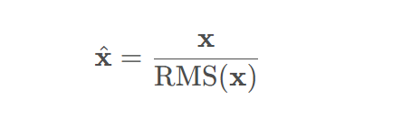

### 4.3. 应用缩放和偏移参数：


其中：

- γ ∈R^d,可学习的缩放参数（与输入维度相同）。
- β∈ R^d：可学习的偏移参数（与输入维度相同）。
- ⊙ ：表示元素级的乘法操作。

## 5、RMSNorm与LayerNorm的比较

- LayerNorm：

  - 计算均值和方差：

  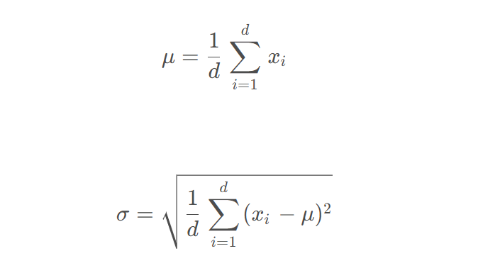

  - 归一化操作：

  

- RMSNorm：
  - 不计算均值，仅计算均方根（RMS）。
  - 归一化操作不减去均值，直接除以均方根。

**比较总结：**

- **计算复杂度**：RMSNorm减少了均值的计算，降低了整体计算量。
- **数值稳定性**：RMSNorm避免了方差接近零的情况，提升了数值稳定性。
- **表现性能**：在某些任务中，RMSNorm可以达到或超过LayerNorm的性能。

## 6、RMSNorm的优势

### 1、计算更高效：

- 由于省略了均值的计算，RMSNorm在计算上更加简单快捷。

### 2、数值稳定性强：

- 避免了在均值较大或较小情况下的数值不稳定问题。

### 3、性能表现优异：

- 在某些模型和任务中，RMSNorm显示出更快的收敛速度和更好的性能。

### 4、易于实现：

- 由于计算过程简单，RMSNorm易于在各类深度学习框架中实现。

### 7、RMSNorm的应用

- Transformer模型：
  - 在Transformer架构中，RMSNorm可以替代LayerNorm，应用于编码器和解码器的各个层。

- 语言模型：
  - 在GPT等大型语言模型中，使用RMSNorm可以提高训练效率和模型性能。

- 其他深度学习模型：
  - 对于需要归一化操作的模型，如RNN、CNN等，RMSNorm也可以作为一种选择。

### 8、实践中的注意事项

- 参数初始化：
  - γ 和 β 参数通常初始化为特定值，例如 γ \gammaγ 初始化为1，β \betaβ 初始化为0。

- 与LayerNorm的替换：
  - 在将LayerNorm替换为RMSNorm时，需要注意模型的整体架构和训练超参数的调整。

- 适用性：
  - 虽然RMSNorm在某些情况下表现良好，但并非在所有任务中都优于LayerNorm，需要根据具体情况选择。

## 9、总结

​       RMSNorm通过简化归一化过程，降低计算复杂度，提供了一种有效的归一化方法。它在保持模型性能的同时，提高了计算效率，是LayerNorm的有力替代方案。对于需要高效归一化操作的深度学习模型，RMSNorm是一个值得考虑的选择。

## 10、Llama中的实现

```python
class RMSNorm(torch.nn.Module):
    def __init__(self, dim: int, eps: float = 1e-6):
        """
        Initialize the RMSNorm normalization layer.

        Args:
            dim (int): The dimension of the input tensor.
            eps (float, optional): A small value added to the denominator for numerical stability. Default is 1e-6.

        Attributes:
            eps (float): A small value added to the denominator for numerical stability.
            weight (nn.Parameter): Learnable scaling parameter.

        """
        super().__init__()
        self.eps = eps
        self.weight = nn.Parameter(torch.ones(dim))

    def _norm(self, x):
        """
        Apply the RMSNorm normalization to the input tensor.

        Args:
            x (torch.Tensor): The input tensor.

        Returns:
            torch.Tensor: The normalized tensor.

        """
        return x * torch.rsqrt(x.pow(2).mean(-1, keepdim=True) + self.eps)

    def forward(self, x):
        """
        Forward pass through the RMSNorm layer.

        Args:
            x (torch.Tensor): The input tensor.

        Returns:
            torch.Tensor: The output tensor after applying RMSNorm.

        """
        output = self._norm(x.float()).type_as(x)
        return output * self.weight
```


# 旋转位置编码（RoPE）

> 参考链接：[解密旋转位置编码：数学基础、代码实现与绝对编码一体化探索_哔哩哔哩_bilibili](https://www.bilibili.com/video/BV1Xi421R7ev/?spm_id_from=333.337.search-card.all.click&vd_source=fffd0a55d832fc312ff82010c51836f8)
>
> 参考博客：[解密旋转位置编码 - 连义江的博客](https://skylyj.github.io/positional_embedding/)


# PPO

​	RLHF技术 OpenAI正式公开资料来源于论文《Training language models to follow instructions with human feedback》，核心包含3个步骤：

- 训练获取SFT模型

- 训练获取RM模型

- PPO训练获取最终的微调模型

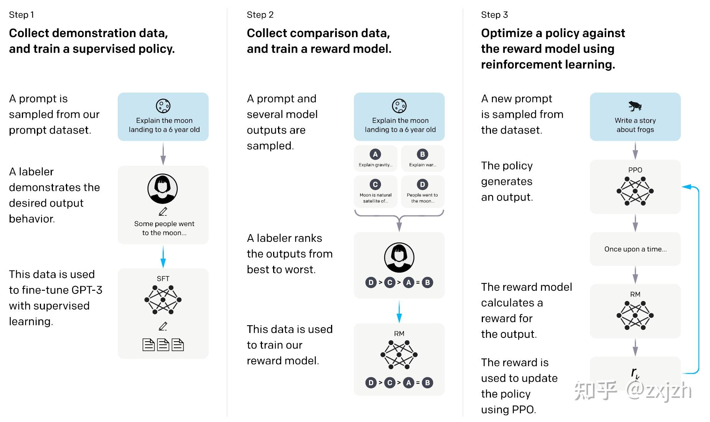

# MHA，GQA，MQA

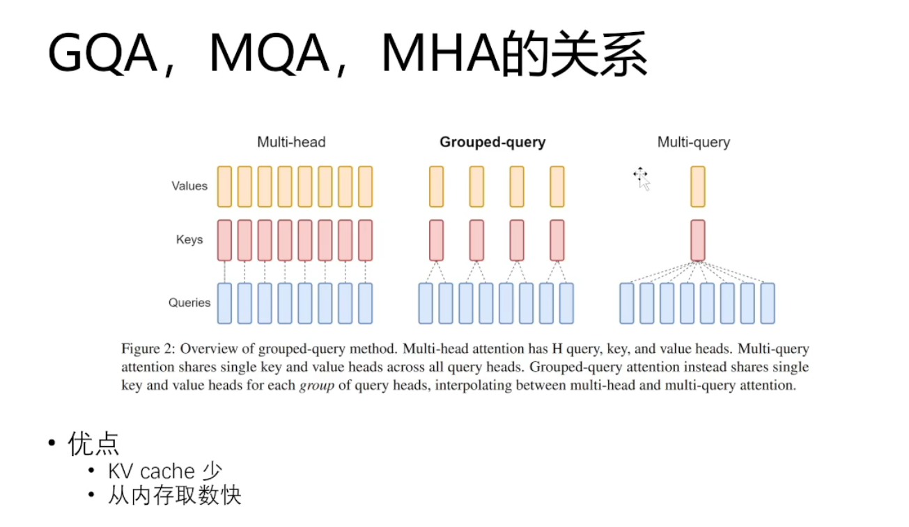

# MLA

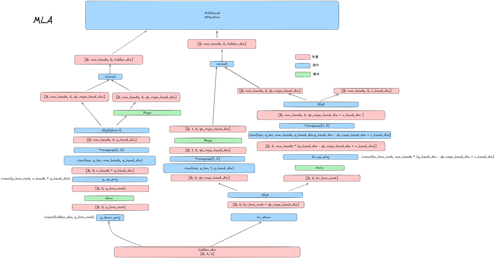


# RAG

**RAG（Retrieval-Augmented Generation，检索增强生成） 是一种结合了信息检索技术与语言生成模型的人工智能技术。****该技术通过从外部知识库中检索相关信息，并将其作为提示（Prompt）输入给大型语言模型（LLMs）****，以增强模型处理知识密集型任务的能力，如问答、文本摘要、内容生成等。

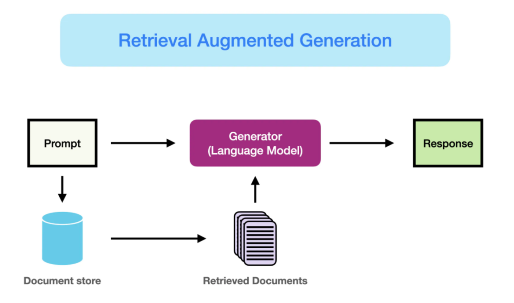

RAG解决的问题：**数据时效性**、**幻觉**和**数据安全问题**。

- **数据时效性问题**：现实世界中的知识是不断更新和变化的，例如科技领域的新发现、社会事件的最新进展、法律法规的修订等。如果模型所依赖的数据不能及时更新，就会导致生成的内容滞后于实际情况，无法准确反映当前的真实信息。数据时效性问题就是确保模型能够获取和利用最新的数据，以便生成符合当下实际情况的准确内容。
- **幻觉问题**：指模型在生成文本时，可能会产生一些没有事实依据或与已知信息相矛盾的内容，就好像出现了 “幻觉”。例如，在回答问题时，模型可能会编造一些不存在的事件、人物或数据来支持其回答。这会降低模型输出内容的可信度和可靠性，影响用户对模型的信任。幻觉问题的存在是由于模型在学习和生成过程中，可能对数据的理解不够准确，或者在生成文本时缺乏足够的事实依据进行约束。
- **数据安全问题**：在处理和使用数据时，需要确保数据的安全性和隐私性。对于一些敏感数据，如个人身份信息、商业机密、医疗记录等，若不能得到妥善保护，可能会导致数据泄露，引发严重的后果，如个人隐私被侵犯、企业商业利益受损等。数据安全问题主要涉及到如何在数据的收集、存储、传输和使用过程中，采取有效的安全措施，防止数据被未经授权的访问、篡改或泄露，同时也要遵循相关的法律法规和道德准则，保护数据所有者的权益。

常见的优化方法：

- **优化内容提取的方法**：从源头解决内容提取的有效性，包括文本内容、表格内容（保留制表符）和图片内容（OCR识别）等，可以参看我之前的文章[《完全指南——使用python提取PDF中的文本信息（包括表格和图片OCR）》](https://www.luxiangdong.com/2023/10/05/extract/)；
- **优化chunking**：从最开始的512固定长度切分，到后面的句切分，再到后面的NLTK和SpaCy，具体可参见我之前写的[《最详细的文本分块(Chunking)方法——可以直接影响基于LLM应用效果》](https://www.luxiangdong.com/2023/09/20/chunk/)；
- **再之后是优化embedding模型**：Embedding模型的选择其实很魔性，我们在优化过程中也会不断否定之前的一些判断。比如我们最开始用m3e，后面用bge，再后面还用了通义千问的embedding模型。总体来说，收费的通义千问还是好一些，但是不明显，有些方面却不如bge。最近一朋友也向我推荐了Jina embedding模型，不过他们的中文模型需要12月份才出来；
- **我们还优化了其他一些过程**：比如prompt模板、关键词摘要、元数据存储等。

# 如何提升RAG的召回质量

## 使用rerank模型

#### 检索阶段的挑战

​		在RAG模型中，检索器负责从大规模的语料库中检索与输入问题相关的文档。然而，由于语料库的广泛性和多样性，检索器可能返回的文档的相关性会有所不同。这种不确定性带来了两个主要挑战：

- **文档相关性差异：** 检索器返回的文档可能在相关性上存在差异，有些文档可能与输入问题高度相关，而有些文档可能相关性较低。这种差异性使得直接使用检索器返回的文档进行生成可能会导致结果的不准确或不相关。
- **信息不完整性：** 检索器返回的文档通常只是初步筛选，其中可能包含了一些噪音或不相关的信息。这使得生成器在生成结果时面临着信息不完整的挑战，需要进一步处理以提高结果的质量。

#### Re-Ranking的定义和目的

​		Re-Ranking是指在RAG模型中对检索器返回的文档进行再排序的过程。其目的是通过重新排列候选文档，使得生成器更好地利用相关信息，并生成与输入问题更加相关和准确的结果。

​		在RAG中，Re-Ranking的关键目标是提高生成结果的相关性和质量。通过对检索器返回的文档进行再排序，Re-Ranking可以将与输入问题更加相关的文档排在前面，从而使得生成器在生成结果时能够更加准确地捕捉到输入问题的语境和要求，进而生成更加合适的答案或文本。

#### Re-Ranking的步骤

Re-Ranking的过程可以分为以下几个步骤：

- 检索文档： 首先，RAG模型通过检索器从大规模语料库中检索相关文档，这些文档被认为可能包含了与输入问题相关的信息。

- 特征提取： 对检索到的文档进行特征提取，通常会使用各种特征，如语义相关性、词频、TF-IDF值等。这些特征能够帮助模型评估文档与输入问题的相关性。

- 排序文档： 根据提取的特征，对检索到的文档进行排序，将与输入问题最相关的文档排在前面，以便后续生成器使用。

- 重新生成： 排序完成后，生成器将重新使用排在前面的文档进行文本生成，以生成最终的输出结果。
  

## 混合搜索

​		检索器增强生成（RAG）中的混合搜索结合了[不同的](https://so.csdn.net/so/search?q=不同的&spm=1001.2101.3001.7020)搜索技术，以提高从数据库或知识库中检索信息的准确性和效率。通常，混合搜索方法利用传统的基于关键字的搜索（稀疏检索）和语义搜索（密集检索），以充分利用这两种方法的优势。以下是对 RAG 中混合搜索的详细介绍。

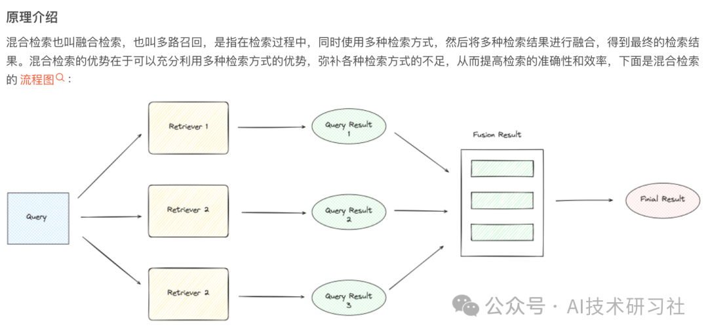

**关键部件**

**稀疏检索**：稀疏检索通过关键字匹配进行，利用TF-IDF、BM25等技术，根据确切的关键字匹配搜索文档。对于已知确切术语的精确查询，这种方法既快速又有效。

**密集检索**: 密集检索利用嵌入（向量表示）来理解查询和文档的上下文和含义，这使得即使查询中不存在确切的关键字，也能检索到相关信息。向量相似度则通过余弦相似度或欧几里得距离等指标来衡量查询和文档向量之间的相似性。

**混合搜索的工作原理**

索引：文档使用稀疏和密集方法进行索引。稀疏索引涉及传统的倒排索引，而密集索引则通过BERT或句子转换器等模型为文档创建嵌入。

查询处理：查询同时使用基于关键字的技术处理，并转换为用于语义搜索的嵌入。

检索：稀疏检索通过执行基于关键字的搜索，检索与查询词匹配的文档；而密集检索则搜索嵌入与查询嵌入相似的文档，捕获语义含义。

分数融合：结合稀疏和密集结果**混合搜索的关键步骤是将稀疏和密集检索结果融合。通过将两种方法的分数归一化并结合，使用参数alpha（α）加权，决定各算法的权重并影响结果的重新排名。混合评分公式为：hybrid_score = (1−α)⋅sparse_score + α⋅dense_score。

α的取值通常介于0和1之间：

α = 1：纯向量搜索

α = 0：纯关键字搜索

这种加权组合确保同时考虑关键字相关性和语义上下文，提供一组平衡且全面的结果。
混合搜索的优点

提高召回率和精确度：通过将关键字匹配与语义理解相结合，混合搜索增加了检索到相关文档的可能性，单独使用这两种方法可能会遗漏这些文档。

处理同义词和上下文：密集检索有助于理解同义词和上下文，确保相关文档不会因词汇不匹配而被忽视。

效率：稀疏检索通常更快，可以快速缩小文档集的范围，而密集检索则可以优化此集以确保语义相关性。

鲁棒性：混合搜索对不同类型的查询更具鲁棒性，无论它们是精确的基于关键字的查询，还是更抽象且依赖于上下文的查询。

## 多向量索引

​		在朴素RAG中通常会对文档、文本进行分块后进行文档嵌入，对所有文件、文本都没有经过采用Chunk方法可能有时候效果不是和好，尽管有着各种分块策略有针对大文件的、针对小文件的策略，但都难免可能会造成上下文语义丢失。
​		分块通常有两个非常重要的参数**chunk_size**、**chunk_overlap**，分别代表块大小与块与块之间的重叠量，并不好确定这两个值的具体数字，只能通过不断实验确定该值。

**基本原理**

   在分块效果不好时或许可以试试**多表示索引（Multi-representation indexing）**，在多表示索引中并不会对整个文档分块后进行文档嵌入。而是通过为每个文档都生成一个**文档摘要**，为每个文档摘要与文档生成一个唯一ID，将摘要与ID关联嵌入到Vectorstore中，将ID与文档关联存储到独立文档存储中。

## Small to Big

​		Small-to-Big Retrieval 技术试图解决这样一个矛盾：更大的 chunk 可以包含更多有用的信息，但其包含的较多无用文本又会掩盖 semantic representation 从而导致检索效果的变差。

​		这篇 blog 提出的思路是：基于更小、更有针对性的 text chunk 进行 embedding 和 retrieval，但仍然使用较大的 text chunk 来为 LLM 提供更多的上下文信息。也就是在检索过程中使用较小的 text chunk，然后将检索到的文本的对应的更大的 text chunk 给 LLM。

其具体实现思路有两种：

- 较小的 child chunk 指向更大的一个 parent chunk：在检索时先获取到较小的 child chunk，然后返回较大的 parent chunk。
- Sentence Window Retrieval：在检索过程中仅获取一个句子，并返回这个句子周围的一段文本。

**其他可能得优化方法：**

1. CRAG
2. Self-RAG

# 模型量化

## QLoRA

**huggingface官方代码**

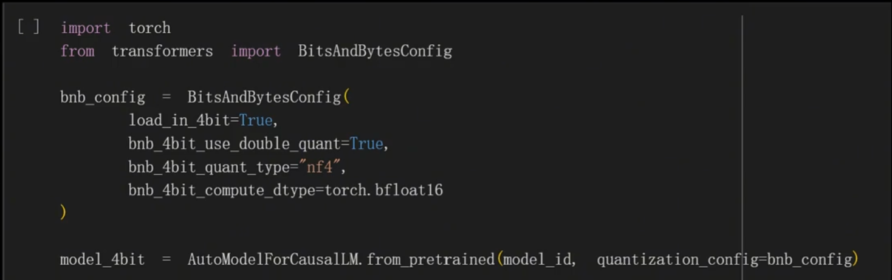

思想：卷积神经网络的参数值是服从正态分布的，分布在0值附近的参数比较多，极大和极小值比较少。所以为了减少量化带来的误差就可以在密度大的地方多分配一些量化后的整数值，少的地方少分配一些量化后的整数值。（正态分布概率密度等分）

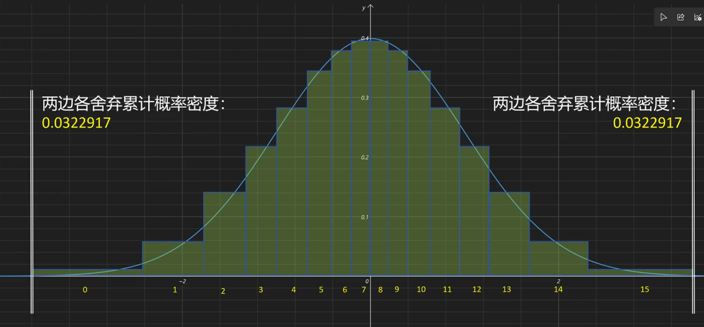

正态分布概率密度等分代码实现：

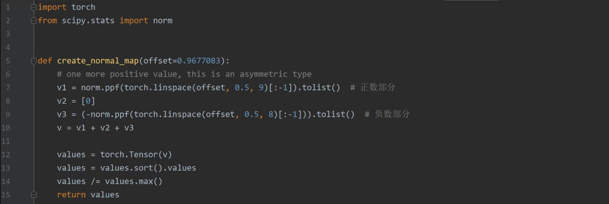

量化和反量化示例：

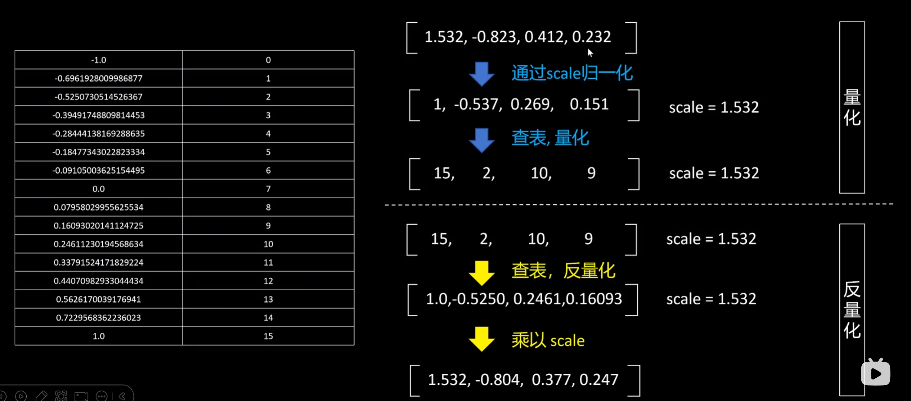

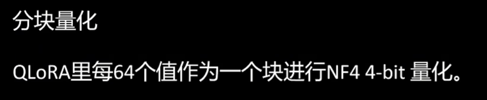

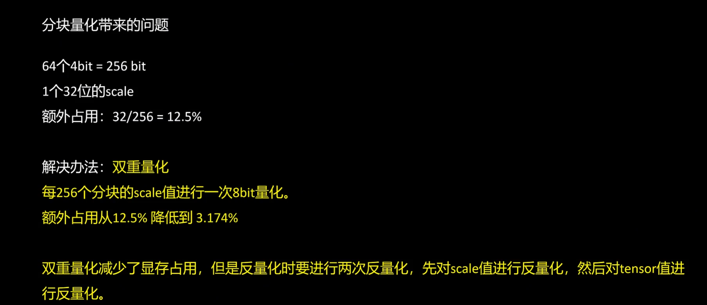

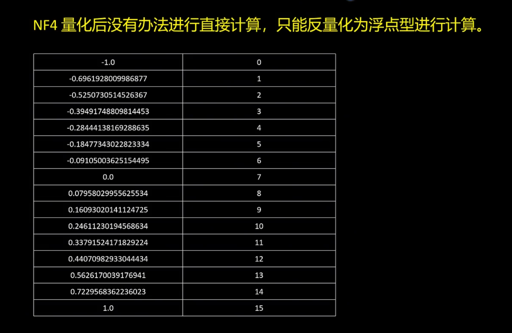

> 上一张图片就是为了说明在代码中为什么要指明计算类型
>
> 参考链接：[模型量化六：QLoRA 4bit 量化 NormalFloat4 量化_哔哩哔哩_bilibili](https://www.bilibili.com/video/BV15y411a7so?spm_id_from=333.788.videopod.sections&vd_source=fffd0a55d832fc312ff82010c51836f8)
