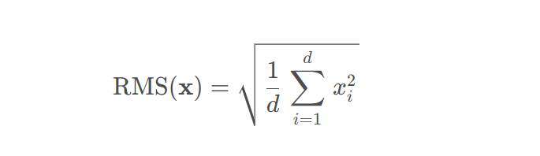
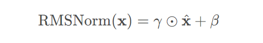

# BPE

> 教程
>
> - B站：[80、Byte Pair Encoding 源码逐行讲解_哔哩哔哩_bilibili](https://www.bilibili.com/video/BV12x4y1t75q/?spm_id_from=333.1007.top_right_bar_window_history.content.click&vd_source=fffd0a55d832fc312ff82010c51836f8)
> - YouTube：https://www.youtube.com/watch?v=zduSFxRajkE&t=1430s
> - github：https://github.com/karpathy/minbpe/tree/master


# RMSNorm

## 1、概述

​		RMSNorm（Root Mean Square Layer Normalization，均方根归一化）是一种用于深度学习模型的归一化技术，特别适用于Transformer等架构。它作为LayerNorm（层归一化）的替代方案，旨在简化归一化过程，降低计算复杂度，同时保持或提升模型的性能。

## 2、RMSNorm的动机

​		在深度学习中，归一化技术被广泛用于稳定和加速模型训练。LayerNorm在Transformer模型中得到了广泛应用，它通过对每个样本的特征维度进行归一化，减少了内部协变量偏移。然而，LayerNorm需要计算输入特征的均值和方差，这增加了计算复杂度和开销。

​		RMSNorm的提出是为了消除对 均值计算 的依赖，仅通过输入特征的 均方根(RMS) 进行归一化，从而简化计算，提高效率。

## 3、RMSNorm的工作原理

​		RMSNorm通过计算输入向量的均方根，对其进行归一化处理。与LayerNorm不同，RMSNorm不进行均值的减法操作。

## 4、数学公式

给定输入向量 x ∈R^d ，其中 d 是特征维度，RMSNorm的计算过程如下：


### 4.1. 计算均方根（RMS）：



### 4.2. 归一化输入向量：


### 4.3. 应用缩放和偏移参数：



其中：

- γ ∈R^d,可学习的缩放参数（与输入维度相同）。
- β∈ R^d：可学习的偏移参数（与输入维度相同）。
- ⊙ ：表示元素级的乘法操作。

## 5、RMSNorm与LayerNorm的比较

- LayerNorm：

  - 计算均值和方差：

  

  - 归一化操作：

  

- RMSNorm：
  - 不计算均值，仅计算均方根（RMS）。
  - 归一化操作不减去均值，直接除以均方根。

**比较总结：**

- **计算复杂度**：RMSNorm减少了均值的计算，降低了整体计算量。
- **数值稳定性**：RMSNorm避免了方差接近零的情况，提升了数值稳定性。
- **表现性能**：在某些任务中，RMSNorm可以达到或超过LayerNorm的性能。

## 6、RMSNorm的优势

### 1、计算更高效：

- 由于省略了均值的计算，RMSNorm在计算上更加简单快捷。

### 2、数值稳定性强：

- 避免了在均值较大或较小情况下的数值不稳定问题。

### 3、性能表现优异：

- 在某些模型和任务中，RMSNorm显示出更快的收敛速度和更好的性能。

### 4、易于实现：

- 由于计算过程简单，RMSNorm易于在各类深度学习框架中实现。

### 7、RMSNorm的应用

- Transformer模型：
  - 在Transformer架构中，RMSNorm可以替代LayerNorm，应用于编码器和解码器的各个层。

- 语言模型：
  - 在GPT等大型语言模型中，使用RMSNorm可以提高训练效率和模型性能。

- 其他深度学习模型：
  - 对于需要归一化操作的模型，如RNN、CNN等，RMSNorm也可以作为一种选择。

### 8、实践中的注意事项

- 参数初始化：
  - γ 和 β 参数通常初始化为特定值，例如 γ \gammaγ 初始化为1，β \betaβ 初始化为0。

- 与LayerNorm的替换：
  - 在将LayerNorm替换为RMSNorm时，需要注意模型的整体架构和训练超参数的调整。

- 适用性：
  - 虽然RMSNorm在某些情况下表现良好，但并非在所有任务中都优于LayerNorm，需要根据具体情况选择。

## 9、总结

​       RMSNorm通过简化归一化过程，降低计算复杂度，提供了一种有效的归一化方法。它在保持模型性能的同时，提高了计算效率，是LayerNorm的有力替代方案。对于需要高效归一化操作的深度学习模型，RMSNorm是一个值得考虑的选择。

## 10、Llama中的实现

```python
class RMSNorm(torch.nn.Module):
    def __init__(self, dim: int, eps: float = 1e-6):
        """
        Initialize the RMSNorm normalization layer.

        Args:
            dim (int): The dimension of the input tensor.
            eps (float, optional): A small value added to the denominator for numerical stability. Default is 1e-6.

        Attributes:
            eps (float): A small value added to the denominator for numerical stability.
            weight (nn.Parameter): Learnable scaling parameter.

        """
        super().__init__()
        self.eps = eps
        self.weight = nn.Parameter(torch.ones(dim))

    def _norm(self, x):
        """
        Apply the RMSNorm normalization to the input tensor.

        Args:
            x (torch.Tensor): The input tensor.

        Returns:
            torch.Tensor: The normalized tensor.

        """
        return x * torch.rsqrt(x.pow(2).mean(-1, keepdim=True) + self.eps)

    def forward(self, x):
        """
        Forward pass through the RMSNorm layer.

        Args:
            x (torch.Tensor): The input tensor.

        Returns:
            torch.Tensor: The output tensor after applying RMSNorm.

        """
        output = self._norm(x.float()).type_as(x)
        return output * self.weight
```


# 旋转位置编码（RoPE）

> 参考链接：[解密旋转位置编码：数学基础、代码实现与绝对编码一体化探索_哔哩哔哩_bilibili](https://www.bilibili.com/video/BV1Xi421R7ev/?spm_id_from=333.337.search-card.all.click&vd_source=fffd0a55d832fc312ff82010c51836f8)
>
> 参考博客：[解密旋转位置编码 - 连义江的博客](https://skylyj.github.io/positional_embedding/)


# PPO

​	RLHF技术 OpenAI正式公开资料来源于论文《Training language models to follow instructions with human feedback》，核心包含3个步骤：

- 训练获取SFT模型

- 训练获取RM模型

- PPO训练获取最终的微调模型


# MHA，MQA，MHA


# MLA


