随机森林  图像锐化  图像转灰度图原理  max pooling的反向传播梯度

其 **L**2 *范数* 是向量元素平方和的平方根：

**L**1 范数，它表示为向量元素的绝对值之和

Lp范数：

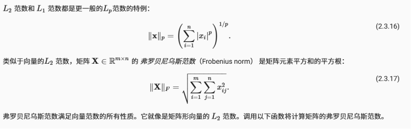

# Sigmoid

激活函数sigmod：

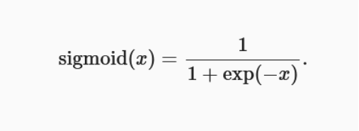

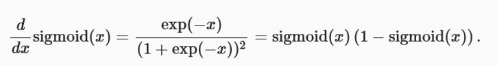

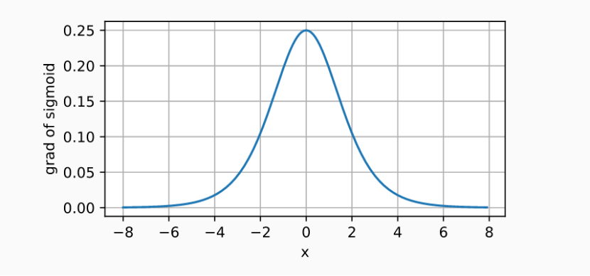

# 训练集、验证集、测试集

三类数据集之间的关系

关于三类数据集之间的关系，常常用一个不恰当的比喻来说明：

(1) 训练集相当于课后的练习题，用于日常的知识巩固。

(2) 验证集相当于周考，用来纠正和强化学到的知识。

(3) 测试集相当于期末考试，用来最终评估学习效果。

根据这个比喻中，我们可以明白以下几点：

（1）训练集在建模过程中会被大量经常使用，验证集用于对模型少量偶尔的调整，而测试集只作为最终模型的评价出现，因此训练集，验证集和测试集所需的数据量也是不一致的，在数据量不是特别大的情况下一般遵循6:2:2的划分比例。

（2）为了使模型“训练”效果能合理泛化至“测试”效果，从而推广应用至现实世界中，因此一般要求训练集，验证集和测试集数据分布近似。但需要注意，三个数据集所用数据是不同的。

（3）由于不同数据集定位不同，因此模型在训练集、验证集和测试集上所反映的预测效果可能存在差异，为了尽可能提高最终的预测效果，增大数据量和变量数会是一个可行的方法。

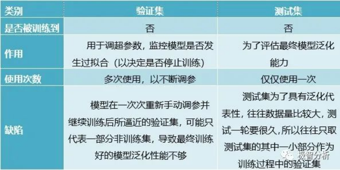

# 激活函数tanh

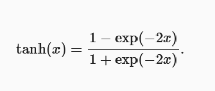

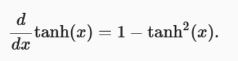

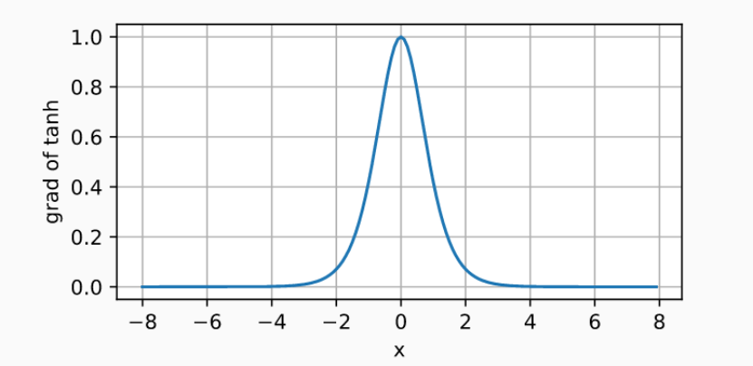

Pca

xg-boost

Adaboost

LR

 Logistic 回归实际上是使用线性回归模型的预测值逼近分类任务真实标记的对数几率

# 正则化

因此 L1 正则的本质其实是为模型增加了“**模型参数服从零均值拉普拉斯分布**”这一先验知识。

因此 L2 正则的本质其实是为模型增加了“模型参数服从零均值正态分布”这一先验知识。

​		给 loss function 加上正则化项，能使新得到的优化目标函数 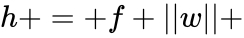 ，需要在 f 和 ||w|| 中做一个权衡，如果还像原来只优化 f 的情况下，那可能得到一组解比较复杂，使得正则项 ||w|| 比较大，那么 h 就不是最优的，因此可以看出加正则项能让解更加简单，符合奥卡姆剃刀理论，同时也比较符合在偏差和方差（方差表示模型的复杂度)分析中，通过降低模型复杂度，得到更小的泛化误差，降低过拟合程度。

​		L1 正则化就是在 loss function 后边所加正则项为 L1 范数，加上 L1 范数容易得到稀疏解（0 比较多）。L2 正则化就是 loss function 后边所加正则项为 L2 范数的平方，加上 L2 正则相比于 L1 正则来说，得到的解比较平滑（不是稀疏），但是同样能够保证解中接近于 0（但不是等于 0，所以相对平滑）的维度比较多，降低模型的复杂度。

# 生成式模型和判别式模型：

​		逻辑回归是判别式模型 p(y|x)，朴素贝叶斯是生成式模型 p(x,y)：判别式模型估计的是条件概率分布，给定观测变量 x 和目标变量 y 的条件模型，由数据直接学习决策函数 y=f(x) 或者条件概率分布 P(y|x) 作为预测的模型。判别方法关心的是对于给定的输入 x，应该预测什么样的输出 y；而生成式模型估计的是联合概率分布，基本思想是首先建立样本的联合概率密度模型 P(x,y)，然后再得到后验概率 P(y|x)，再利用它进行分类，生成式更关心的是对于给定输入 x 和输出 y 的生成关系；

# 感受野的定义如下：

​		卷积神经网络每一层输出的特征图（feature map）上的像素点在原始图像上映射的区域大小；通俗点说，就是图像的最终输出的每一个特征（每一个像素）到底受到原始图像哪一部分的影响。感受野在计算的时候不考虑“边界填充”，因为填充的边界已经不是原始图像本身的内容了，感受野描述的是输出特征到原始图像的映射关系，故而不考虑padding 。

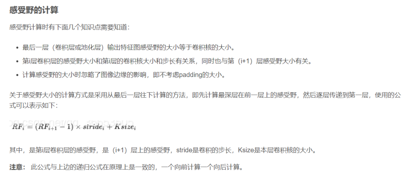

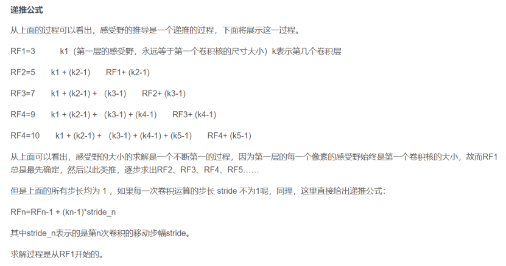

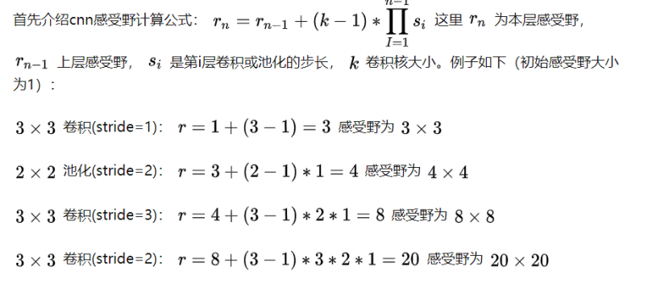

Anchor box 实际上就是用来生成一系列先验框的规则，其生成的先验框有以下三部分构成：

- CNN提取的Feature Map的点，来定位边框的位置。

- Anchor box的**Scale**来表示边框的大小

- Anchor box的**Aspect Ratio**来表示边框的形状

# RPN

RPN全称是Region Proposal Network，Region Proposal的中文意思是“区域选取”，也就是“提取候选框”的意思，所以RPN就是用来提取候选框的网络。

SiamFC, SiamRPN, SiamRPN++，DaSiamRPN，SiamMask

SiamFC：https://www.baidu.com/link?url=w-zBdSRcs5wQlE3lxz06d8EElFOaUytIuRSBubOZBIZlwNGtM_8BEEBVp0FrXqAV&wd=&eqid=89dd4763002e07760000000360cff0a0

SiamRPN：https://www.baidu.com/link?url=XDMCrmdTalmbDH3pUsP_gfe3Zgr2Hov5syywU3FoFAUWKApMPqdqGdcB6_sq0DvvdHzysJ4hQ0lEN3CqknUk1a&wd=&eqid=df3b4edb0005d42f0000000360cda62a

SiamRPN++：

# What is BN

Normalization是数据标准化（归一化，规范化），Batch 可以理解为批量，加起来就是批量标准化。 
先说Batch是怎么确定的。在CNN中，Batch就是训练网络所设定的图片数量batch_size。

Normalization过程，引用论文中的解释：

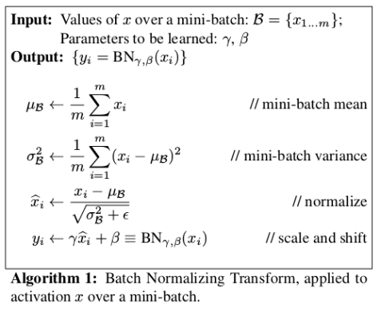

输入：输入数据x1..xm（这些数据是准备进入激活函数的数据） 
计算过程中可以看到, 
1.求数据均值； 
2.求数据方差； 
3.数据进行标准化（个人认为称作正态化也可以） 
4.训练参数γ，β 
5.输出y通过γ与β的线性变换得到新的值 
**在正向传播的时候，通过可学习的γ与β参数求出新的分布值**

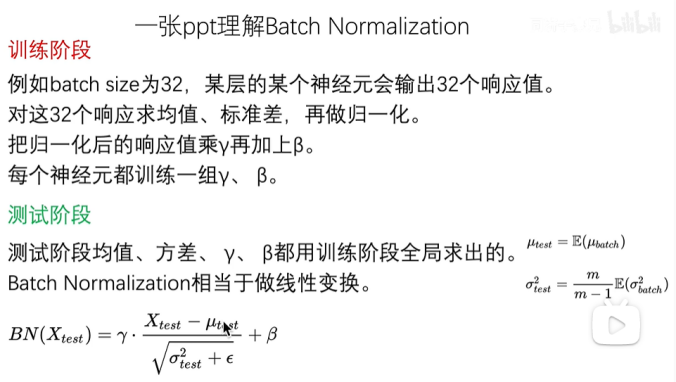

## BN层的作用

**BN层的作用主要有三个：**

1. 加快网络的训练和收敛的速度；

2. 控制梯度爆炸防止梯度消失；

3. 防止过拟合。

**接下来就分析一下为什么BN层有着三个作用。**

1. **加快网络的训练和收敛的速度**

​		在深度神经网络中，如果每层的数据分布都不一样的话，将会导致网络非常难收敛和训练，而如果把 每层的数据都在转换在均值为零，方差为1 的状态下，这样每层数据的分布都是一样的训练会比较容易收敛。

2. **控制梯度爆炸防止梯度消失**

​		梯度消失：在深度神经网络中，如果网络的激活输出很大，其对应的梯度就会很小，导致网络的学习速率就会很慢，假设网络中每层的学习梯度都小于最大值0.25，网络中有n层，因为链式求导的原因，第一层的梯度将会小于0.25的n次方，所以学习速率相对来说会变的很慢，而对于网络的最后一层只需要对自身求导一次，梯度就大，学习速率就会比较快，这就会造成在一个很深的网络中，浅层基本不学习，权值变化小，而后面几层网络一直学习，后面的网络基本可以表征整个网络，这样失去了深度的意义。（使用BN层归一化后，网络的输出就不会很大，梯度就不会很小）

​		梯度爆炸：第一层偏移量的梯度=激活层斜率1x权值1x激活层斜率2x…激活层斜率(n-1)x权值(n-1)x激活层斜率n，假如激活层斜率均为最大值0.25，所有层的权值为100，这样梯度就会指数增加。（使用bn层后权值的更新也不会很大）

3. **防止过拟合**

​		在网络的训练中，BN的使用使得一个minibatch中所有样本都被关联在了一起，因此网络不会从某一个训练样本中生成确定的结果，即同样一个样本的输出不再仅仅取决于样本的本身，也取决于跟这个样本同属一个batch的其他样本，而每次网络都是随机取batch，这样就会使得整个网络不会朝这一个方向使劲学习。一定程度上避免了过拟合。

**为什么BN层一般用在线性层和卷积层后面，而不是放在非线性单元后？**

​		原文中是这样解释的，因为非线性单元的输出分布形状会在训练过程中变化，归一化无法消除他的方差偏移，相反的，全连接和卷积层的输出一般是一个对称,非稀疏的一个分布，更加类似高斯分布，对他们进行归一化会产生更加稳定的分布。其实想想也是的，像relu这样的激活函数，如果你输入的数据是一个高斯分布，经过他变换出来的数据能是一个什么形状？小于0的被抑制了，也就是分布小于0的部分直接变成0了，这样不是很高斯了。

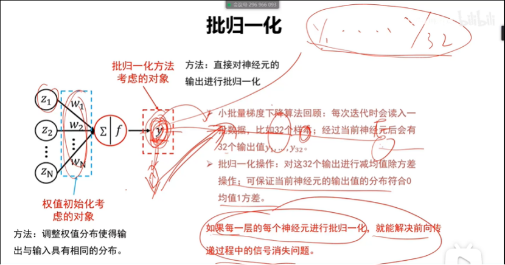

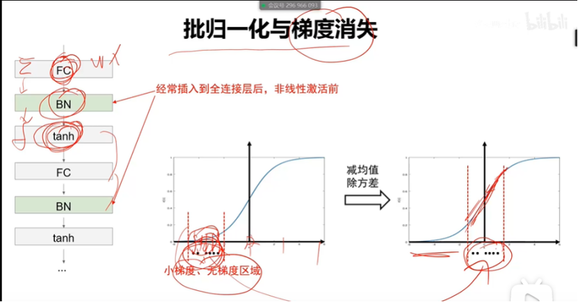

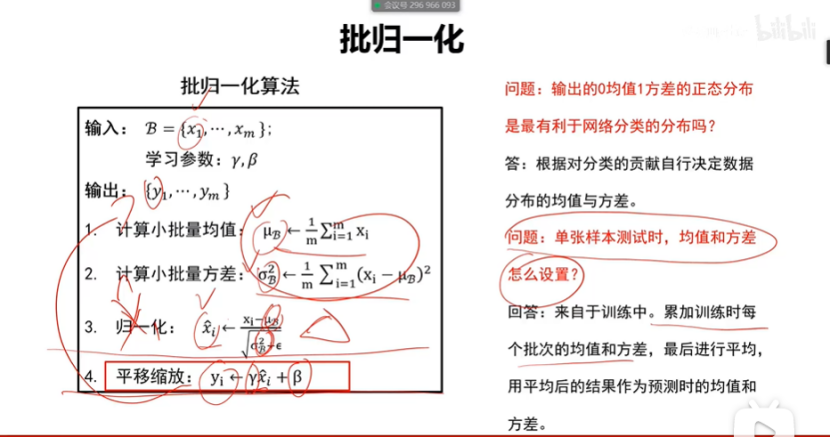

***γ决定分布映射到新的方差上去，β决定了数据映射到新的均值上去。***

# 准确率(Precision)、召回率(Recall)、F值(F-Measure)

数据挖掘、机器学习和推荐系统中的评测指标—准确率(Precision)、召回率(Recall)、F值(F-Measure)

**混淆矩阵**

- True Positive(真正，TP)：将正类预测为正类数

- True Negative(真负，TN)：将负类预测为负类数

- False Positive(假正，FP)：将负类预测为正类数误报 (Type I error)

- False Negative(假负，FN)：将正类预测为负类数→漏报 (Type II error)

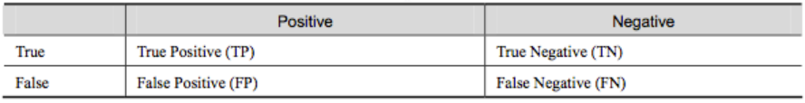

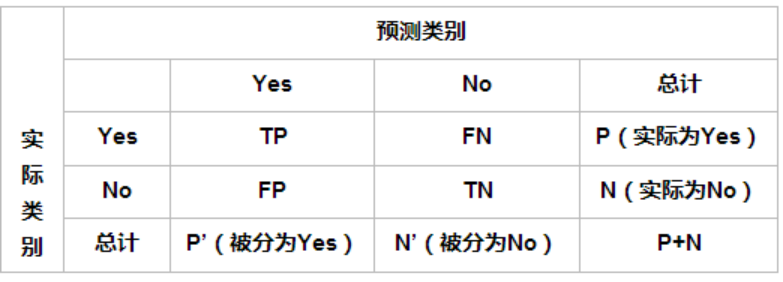

**1. 准确率（Accuracy）**

准确率(accuracy)计算公式为：

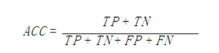

注：准确率是我们最常见的评价指标，而且很容易理解，就是被分对的样本数除以所有的样本数，通常来说，正确率越高，分类器越好。
准确率确实是一个很好很直观的评价指标，但是有时候准确率高并不能代表一个算法就好。比如某个地区某天地震的预测，假设我们有一堆的特征作为地震分类的属性，类别只有两个：0：不发生地震、1：发生地震。一个不加思考的分类器，对每一个测试用例都将类别划分为0，那那么它就可能达到99%的准确率，但真的地震来临时，这个分类器毫无察觉，这个分类带来的损失是巨大的。为什么99%的准确率的分类器却不是我们想要的，因为这里数据分布不均衡，类别1的数据太少，完全错分类别1依然可以达到很高的准确率却忽视了我们关注的东西。再举个例子说明下。在正负样本不平衡的情况下，准确率这个评价指标有很大的缺陷。比如在互联网广告里面，点击的数量是很少的，一般只有千分之几，如果用acc，即使全部预测成负类（不点击）acc也有 99% 以上，没有意义。因此，单纯靠准确率来评价一个算法模型是远远不够科学全面的。

**2. 错误率（Error rate）**

错误率则与准确率相反，描述被分类器错分的比例，error rate = (FP+FN)/(TP+TN+FP+FN)，对某一个实例来说，分对与分错是互斥事件，所以accuracy =1 - error rate。

**3. 灵敏度（sensitive）**

sensitive = TP/P，表示的是所有正例中被分对的比例，衡量了分类器对正例的识别能力。

**4. 特效度（sensitive）**

specificity = TN/N，表示的是所有负例中被分对的比例，衡量了分类器对负例的识别能力。

**5. 精确率、精度（Precision）**

精确率(precision)定义为：

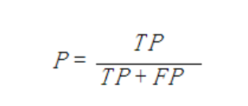

表示被分为正例的示例中实际为正例的比例。

**6. 召回率（recall）**

召回率是覆盖面的度量，度量有多个正例被分为正例，recall=TP/(TP+FN)=TP/P=sensitive，可以看到召回率与灵敏度是一样的。

**7. 综合评价指标（F-Measure）**

P和R指标有时候会出现的矛盾的情况，这样就需要综合考虑他们，最常见的方法就是F-Measure（又称为F-Score）。
F-Measure是Precision和Recall加权调和平均：

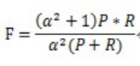

当参数α=1时，就是最常见的F1，也即

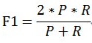

可知F1综合了P和R的结果，当F1较高时则能说明试验方法比较有效。

**8. 其他评价指标**

计算速度：分类器训练和预测需要的时间；

鲁棒性：处理缺失值和异常值的能力；

可扩展性：处理大数据集的能力；

可解释性：分类器的预测标准的可理解性，像决策树产生的规则就是很容易理解的，而神经网络的一堆参数就不好理解，我们只好把它看成一个黑盒子。

下面来看一下ROC和PR曲线（以下内容为自己总结）：

**1、ROC曲线：**

ROC（Receiver Operating Characteristic）曲线是以假正率（FP_rate）和假负率（TP_rate）为轴的曲线，ROC曲线下面的面积我们叫做AUC，如下图所示：

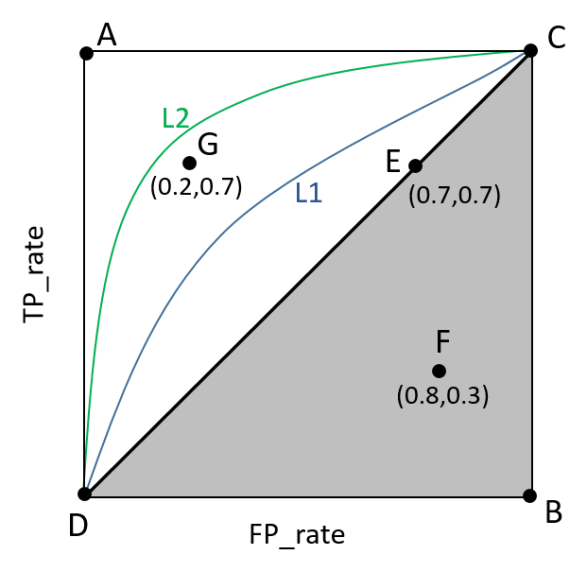

图片根据Paper：Learning from eImbalanced Data画出

其中：

（1）曲线与FP_rate轴围成的面积（记作AUC）越大，说明性能越好，即图上L2曲线对应的性能优于曲线L1对应的性能。即：曲线越靠近A点（左上方）性能越好，曲线越靠近B点（右下方）曲线性能越差。
（2）A点是最完美的performance点，B处是性能最差点。
（3）位于C-D线上的点说明算法性能和random猜测是一样的–如C、D、E点。位于C-D之上（即曲线位于白色的三角形内）说明算法性能优于随机猜测–如G点，位于C-D之下（即曲线位于灰色的三角形内）说明算法性能差于随机猜测–如F点。
（4）虽然ROC曲线相比较于Precision和Recall等衡量指标更加合理，但是其在高不平衡数据条件下的的表现仍然过于理想，不能够很好的展示实际情况。

**2、PR曲线：**

即，PR（Precision-Recall）曲线。
举个例子（例子来自Paper：Learning from eImbalanced Data）：
假设N_c>>P_c（即Negative的数量远远大于Positive的数量），若FP很大，即有很多N的sample被预测为P，因为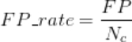，因此FP_rate的值仍然很小（如果利用ROC曲线则会判断其性能很好，但是实际上其性能并不好），但是如果利用PR，因为Precision综合考虑了TP和FP的值，因此在极度不平衡的数据下（Positive的样本较少)，PR曲线可能比ROC曲线更实用。

# 多类支持向量机（SVM）损失函数

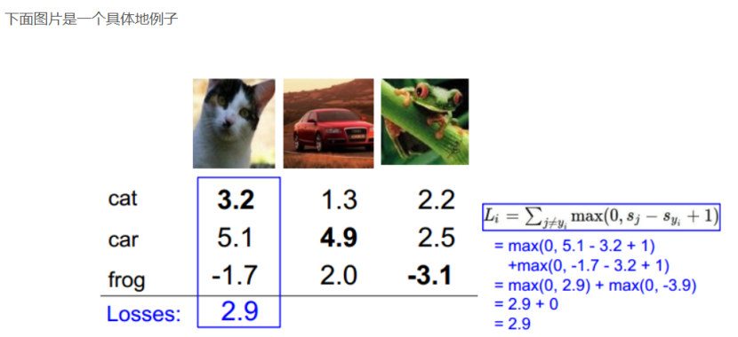

# 交叉熵损失函数：

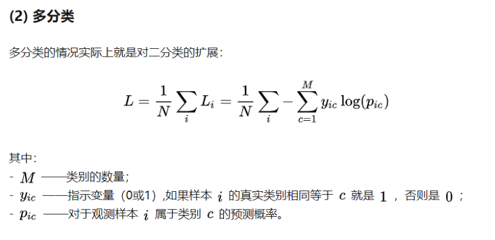

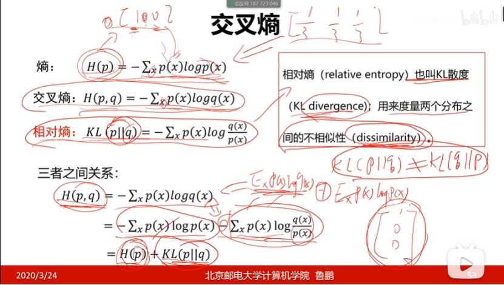

# 动态规划：

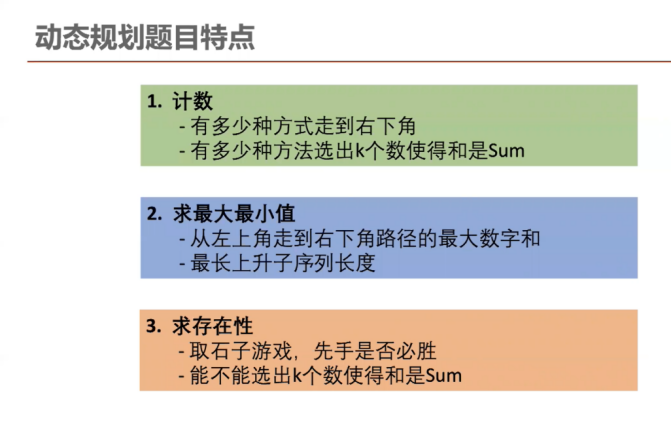

损失函数的优缺点、优化器的优缺点

计算图和反向传播

计算图就是用来计算反向传播的。

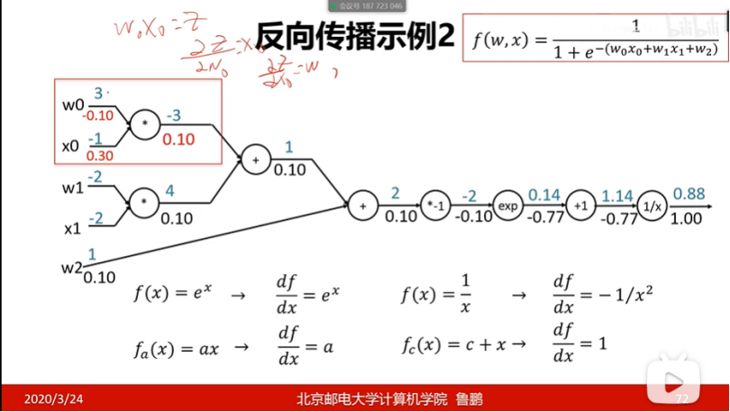

1. 为何引入非线性的激活函数？

如果不用激活函数，在这种情况下每一层输出都是上层输入的线性函数。容易验证，无论神经网络有多少层，输出都是输入的线性组合，与没有隐藏层效果相当，这种情况就是最原始的感知机（Perceptron）了。因此引入非线性函数作为激活函数，这样深层神经网络就有意义了（不再是输入的线性组合，可以逼近任意函数）。最早的想法是sigmoid函数或者tanh函数，输出有界，很容易充当下一层输入。

2. 引入ReLu的原因

第一，采用sigmoid等函数，算激活函数时（指数运算），计算量大，反向传播求误差梯度时，求导涉及除法，计算量相对大，而采用Relu激活函数，整个过程的计算量节省很多。

第二，对于深层网络，sigmoid函数反向传播时，很容易就会出现 梯度消失 的情况（在sigmoid接近饱和区时，变换太缓慢，导数趋于0，这种情况会造成信息丢失），从而无法完成深层网络的训练。

第三，ReLu会使一部分神经元的输出为0，这样就造成了 网络的稀疏性，并且减少了参数的相互依存关系，缓解了过拟合问题的发生。

# 优化器

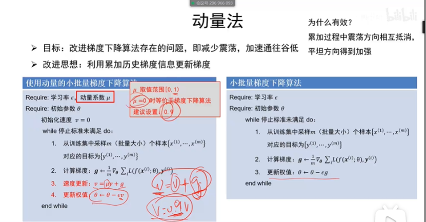

**优点：**

1、加快收敛速度。

2、可以防止震荡。

3、帮助越过局部极小值。

4、解决在鞍点参数不更新的问题。

基本的mini-batch SGD优化算法在深度学习取得很多不错的成绩。然而也存在一些问题需解决：

1.  选择恰当的初始学习率很困难。
2.  学习率调整策略受限于预先指定的调整规则。
3.  相同的学习率被应用于各个参数。
4.  高度非凸的误差函数的优化过程，如何避免陷入大量的局部次优解或鞍点。

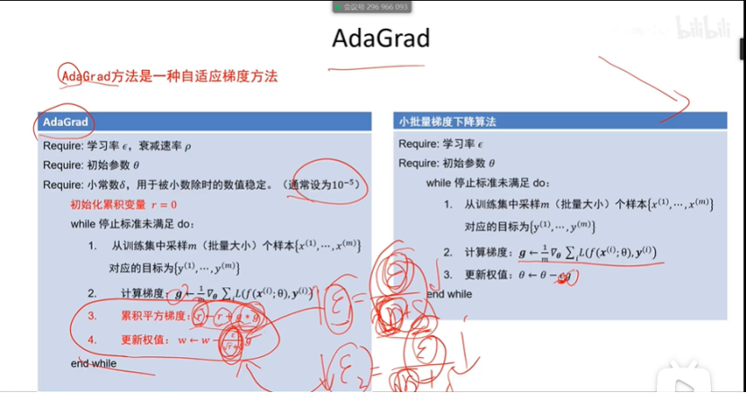

**缺点：**随着时间的累计，r会变得非常大，导致学习率非常小。

**优势：**在数据分布稀疏的场景，能更好利用稀疏梯度的信息，比标准的SGD算法更有效地收敛。

**缺点：**主要缺陷来自分母项的对梯度平方不断累积，随之时间步地增加，分母项越来越大，最终导致学习率收缩到太小无法进行有效更新。

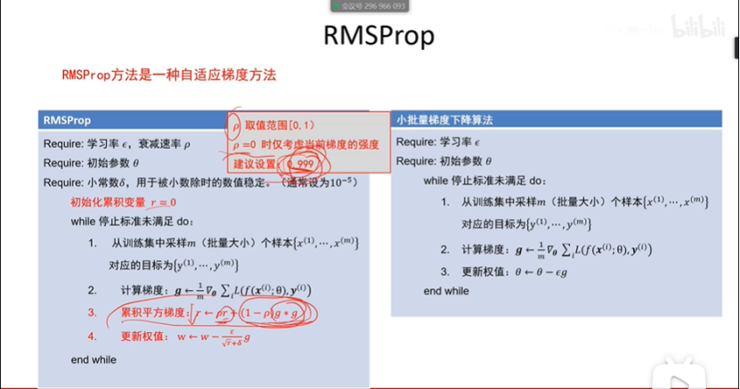

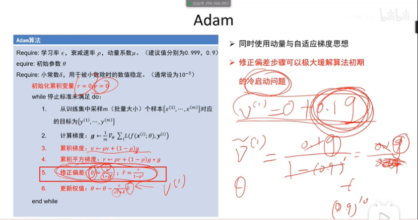

主要包含以下几个显著的优点：

1. 实现简单，计算高效，对内存需求少
2. 参数的更新不受梯度的伸缩变换影响
3. 超参数具有很好的解释性，且通常无需调整或仅需很少的微调
4. 更新的步长能够被限制在大致的范围内（初始学习率）
5. 能自然地实现步长退火过程（自动调整学习率）
6. 很适合应用于大规模的数据及参数的场景
7. 适用于不稳定目标函数
8. 适用于梯度稀疏或梯度存在很大噪声的问题

结论：一般使用Adam，搞不动的时候采用动量法+SGD，手动调学习率，效果最好。

# 权重初始化