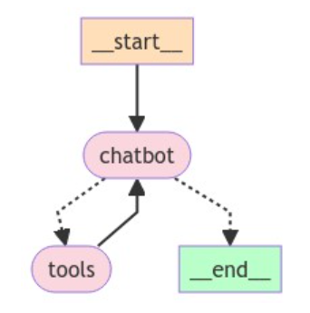

# 快速入门

在这个全面的快速入门中，我们将在 LangGraph 中构建一个支持聊天机器人，它可以：

- 通过搜索网络来回答常见问题
- 保持通话过程中的对话状态
- 将复杂的查询发送给人工进行审核
- 使用自定义状态控制其行为
- 回顾并探索替代对话路径

我们将从一个基本的聊天机器人开始，逐步添加更复杂的功能，并在此过程中介绍关键的 LangGraph 概念。

## 设置

首先，安装所需的软件包：

```bash
%%capture --no-stderr 
%pip install -U langgraph langsmith 
# 用于本教程；不是 LangGraph 的要求 
%pip install -U langchain_anthropic
```

接下来，设置您的 API 密钥：

```python
import getpass
import os


def _set_env(var: str):
    if not os.environ.get(var):
        os.environ[var] = getpass.getpass(f"{var}: ")


_set_env("ANTHROPIC_API_KEY")
```

> 设置[LangSmith](https://smith.langchain.com/)进行 LangGraph 开发
>
> 注册 LangSmith 以快速发现问题并提高 LangGraph 项目的性能。LangSmith 可让您使用跟踪数据来调试、测试和监控使用 LangGraph 构建的 LLM 应用程序 —[在此处](https://docs.smith.langchain.com/)了解有关如何开始的更多信息。

## 第 1 部分：构建基本聊天机器人

我们首先使用 LangGraph 创建一个简单的聊天机器人。这个聊天机器人将直接响应用户消息。虽然很简单，但它将说明使用 LangGraph 构建的核心概念。在本节结束时，您将拥有一个构建好的初级聊天机器人。

```python
from typing import Annotated

from typing_extensions import TypedDict

from langgraph.graph import StateGraph, START, END
from langgraph.graph.message import add_messages


class State(TypedDict):
    # Messages have the type "list". The `add_messages` function
    # in the annotation defines how this state key should be updated
    # (in this case, it appends messages to the list, rather than overwriting them)
    messages: Annotated[list, add_messages]


graph_builder = StateGraph(State)
```

> 笔记
>
> 定义图时要做的第一件事是定义`State`图的。`State`由图的模式以及指定如何将更新应用于状态的 Reducer 函数组成。在我们的示例中，`State`是`TypedDict`具有单个键的：`messages`。该`messages`键使用 Reducer 函数注释[`add_messages`](https://langchain-ai.github.io/langgraph/reference/graphs/?h=add+messages#add_messages)，它告诉 LangGraph 将新消息附加到现有列表，而不是覆盖它。没有注释的状态键将被每次更新覆盖，存储最新值。查看[此概念指南](https://langchain-ai.github.io/langgraph/reference/graphs/?h=add+messages#add_messages)以了解有关状态、Reducer 和其他低级概念的更多信息。

所以现在我们的图表知道两件事：

1. 我们定义的每个都`node`将接收当前`State`作为输入并返回更新该状态的值。
2. `messages`将被*附加*到当前列表，而不是直接覆盖。这是通过语法[`add_messages`](https://langchain-ai.github.io/langgraph/reference/graphs/?h=add+messages#add_messages)中的预建函数传达的`Annotated`。

接下来，添加一个“ `chatbot`”节点。节点代表工作单元。它们通常是常规的 Python 函数。

```python
from langchain_anthropic import ChatAnthropic

llm = ChatAnthropic(model="claude-3-haiku-20240307")


def chatbot(state: State):
    return {"messages": [llm.invoke(state["messages"])]}


# The first argument is the unique node name
# The second argument is the function or object that will be called whenever
# the node is used.
graph_builder.add_node("chatbot", chatbot)
```

**注意**节点函数如何`chatbot`将当前`State`作为输入并返回一个包含`messages`键“messages”下更新列表的字典。这是所有 LangGraph 节点函数的基本模式。

`add_messages`我们的函数会将`State`llm 的响应消息附加到状态中已有的任何消息中。

接下来，添加一个`entry`点。这将告诉我们的图表每次运行时**从哪里开始工作。**

```python
graph_builder.add_edge(START, "chatbot")
```

同样，设置一个`finish`点。这将指示图表**“任何时候运行此节点，您都可以退出。”**

```python
graph_builder.add_edge("chatbot", END)
```

最后，我们希望能够运行我们的图表。为此，请`compile()`在图表构建器上调用“”。这将创建一个“ `CompiledGraph`”，我们可以在状态上使用“调用”。

```python
graph = graph_builder.compile()
```

`get_graph`您可以使用方法和其中一种“绘制”方法（例如`draw_ascii`或 ）来可视化图形`draw_png`。`draw`每个方法都需要额外的依赖项。

```python
from IPython.display import Image, display

try:
    display(Image(graph.get_graph().draw_mermaid_png()))
except Exception:
    # This requires some extra dependencies and is optional
    pass
```


现在让我们运行聊天机器人！

**提示：**您可以随时输入“quit”、“exit”或“q”退出聊天循环。

```python
while True:
    user_input = input("User: ")
    if user_input.lower() in ["quit", "exit", "q"]:
        print("Goodbye!")
        break
    for event in graph.stream({"messages": ("user", user_input)}):
        for value in event.values():
            print("Assistant:", value["messages"][-1].content)
```

```
User:  what's langgraph all about?
Assistant: LangGraph is a new open-source deep learning framework that focuses on enabling efficient training and deployment of large language models. Some key things to know about LangGraph:

1. Efficient Training: LangGraph is designed to accelerate the training of large language models by leveraging advanced optimization techniques and parallelization strategies.

2. Modular Architecture: LangGraph has a modular architecture that allows for easy customization and extension of language models, making it flexible for a variety of NLP tasks.

3. Hardware Acceleration: The framework is optimized for both CPU and GPU hardware, allowing for efficient model deployment on a wide range of devices.

4. Scalability: LangGraph is designed to handle large-scale language models with billions of parameters, enabling the development of state-of-the-art NLP applications.

5. Open-Source: LangGraph is an open-source project, allowing developers and researchers to collaborate, contribute, and build upon the framework.

6. Performance: The goal of LangGraph is to provide superior performance and efficiency compared to existing deep learning frameworks, particularly for training and deploying large language models.

Overall, LangGraph is a promising new deep learning framework that aims to address the challenges of building and deploying advanced natural language processing models at scale. It is an active area of research and development, with the potential to drive further advancements in the field of language AI.
User:  hm that doesn't seem right...
Assistant: I'm sorry, I don't have enough context to determine what doesn't seem right. Could you please provide more details about what you're referring to? That would help me better understand and respond appropriately.
User:  q
Goodbye!
```

**恭喜！**您已使用 LangGraph 构建了第一个聊天机器人。该机器人可以通过接收用户输入并使用 LLM 生成响应来进行基本对话。您可以在提供的链接处检查上述调用的[LangSmith Trace 。](https://smith.langchain.com/public/29ab0177-1177-4d25-9341-17ae7d94e0e0/r)

但是，您可能已经注意到，机器人的知识仅限于其训练数据中的内容。在下一部分中，我们将添加一个网络搜索工具来扩展机器人的知识并使其更强大。

以下是本节的完整代码，供您参考：

```python
from typing import Annotated

from langchain_anthropic import ChatAnthropic
from typing_extensions import TypedDict

from langgraph.graph import StateGraph
from langgraph.graph.message import add_messages


class State(TypedDict):
    messages: Annotated[list, add_messages]


graph_builder = StateGraph(State)


llm = ChatAnthropic(model="claude-3-haiku-20240307")


def chatbot(state: State):
    return {"messages": [llm.invoke(state["messages"])]}


# The first argument is the unique node name
# The second argument is the function or object that will be called whenever
# the node is used.
graph_builder.add_node("chatbot", chatbot)
graph_builder.set_entry_point("chatbot")
graph_builder.set_finish_point("chatbot")
graph = graph_builder.compile()
```

## 第 2 部分：使用工具增强聊天机器人

为了处理我们的聊天机器人无法“凭记忆”回答的问题，我们将集成一个网络搜索工具。我们的机器人可以使用此工具查找相关信息并提供更好的响应。

#### 要求

在开始之前，请确保您已安装必要的软件包并设置了 API 密钥：

[首先，安装使用Tavily 搜索引擎](https://python.langchain.com/v0.2/docs/integrations/tools/tavily_search/)的要求，并设置您的[TAVILY_API_KEY](https://tavily.com/)。

```bash
%%capture --no-stderr
%pip install -U tavily-python
%pip install -U langchain_community
```

```sh
_set_env(“TAVILY_API_KEY”)
```

接下来定义工具：

```python
from langchain_community.tools.tavily_search import TavilySearchResults

tool = TavilySearchResults(max_results=2)
tools = [tool]
tool.invoke("What's a 'node' in LangGraph?")
```

```
[{'url': 'https://medium.com/@cplog/introduction-to-langgraph-a-beginners-guide-14f9be027141',
  'content': 'Nodes: Nodes are the building blocks of your LangGraph. Each node represents a function or a computation step. You define nodes to perform specific tasks, such as processing input, making ...'},
 {'url': 'https://js.langchain.com/docs/langgraph',
  'content': "Assuming you have done the above Quick Start, you can build off it like:\nHere, we manually define the first tool call that we will make.\nNotice that it does that same thing as agent would have done (adds the agentOutcome key).\n LangGraph\n🦜🕸️LangGraph.js\n⚡ Building language agents as graphs ⚡\nOverview\u200b\nLangGraph is a library for building stateful, multi-actor applications with LLMs, built on top of (and intended to be used with) LangChain.js.\n Therefore, we will use an object with one key (messages) with the value as an object: { value: Function, default?: () => any }\nThe default key must be a factory that returns the default value for that attribute.\n Streaming Node Output\u200b\nOne of the benefits of using LangGraph is that it is easy to stream output as it's produced by each node.\n What this means is that only one of the downstream edges will be taken, and which one that is depends on the results of the start node.\n"}]
```

结果是我们的聊天机器人可以用来回答问题的页面摘要。

接下来，我们将开始定义我们的图表。以下内容**与第 1 部分相同**，只是我们添加了`bind_tools`LLM。这让 LLM 知道如果要使用我们的搜索引擎，应该使用正确的 JSON 格式.

```python
from typing import Annotated

from langchain_anthropic import ChatAnthropic
from typing_extensions import TypedDict

from langgraph.graph import StateGraph, START
from langgraph.graph.message import add_messages


class State(TypedDict):
    messages: Annotated[list, add_messages]


graph_builder = StateGraph(State)


llm = ChatAnthropic(model="claude-3-haiku-20240307")
# Modification: tell the LLM which tools it can call
llm_with_tools = llm.bind_tools(tools)


def chatbot(state: State):
    return {"messages": [llm_with_tools.invoke(state["messages"])]}


graph_builder.add_node("chatbot", chatbot)
```

接下来，我们需要创建一个函数来实际运行这些工具（如果它们被调用）。我们将通过将工具添加到新节点来实现这一点。

下面，实现一个`BasicToolNode`，检查状态中最新消息，如果消息包含，则调用工具`tool_calls`。它依赖于 LLM 的`tool_calling`支持，该支持可在 Anthropic、OpenAI、Google Gemini 和许多其他 LLM 提供商中使用。

稍后我们将用 LangGraph 预构建的[ToolNode](https://langchain-ai.github.io/langgraph/reference/prebuilt/#toolnode)替换它以加快速度，但首先自己构建它是有启发性的。

```python
import json

from langchain_core.messages import ToolMessage


class BasicToolNode:
    """A node that runs the tools requested in the last AIMessage."""

    def __init__(self, tools: list) -> None:
        self.tools_by_name = {tool.name: tool for tool in tools}

    def __call__(self, inputs: dict):
        if messages := inputs.get("messages", []):
            message = messages[-1]
        else:
            raise ValueError("No message found in input")
        outputs = []
        for tool_call in message.tool_calls:
            tool_result = self.tools_by_name[tool_call["name"]].invoke(
                tool_call["args"]
            )
            outputs.append(
                ToolMessage(
                    content=json.dumps(tool_result),
                    name=tool_call["name"],
                    tool_call_id=tool_call["id"],
                )
            )
        return {"messages": outputs}


tool_node = BasicToolNode(tools=[tool])
graph_builder.add_node("tools", tool_node)
```

添加工具节点后，我们就可以定义`conditional_edges`。

回想一下，**边**将控制流从一个节点路由到下一个节点。**条件边**通常包含“if”语句，以根据当前图形状态路由到不同的节点。这些函数接收当前图形`state`并返回一个字符串或字符串列表，指示接下来要调用哪个节点。

下面，定义一个名为 的路由器函数`route_tools`，用于检查聊天机器人输出中的 tool_calls。通过调用 将此函数提供给图表`add_conditional_edges`，这会告诉图表，每当`chatbot`节点完成时检查此函数以查看下一步要去哪里。

`tools`如果存在工具调用，则条件将路由到，`__end__`如果不存在，则路由到“ ”。

[稍后，我们将用预先构建的tools_condition](https://langchain-ai.github.io/langgraph/reference/prebuilt/#tools_condition)替换它，以使其更加简洁，但首先自己实现它会使事情变得更加清晰。

```python
from typing import Literal


def route_tools(
    state: State,
) -> Literal["tools", "__end__"]:
    """
    Use in the conditional_edge to route to the ToolNode if the last message
    has tool calls. Otherwise, route to the end.
    """
    if isinstance(state, list):
        ai_message = state[-1]
    elif messages := state.get("messages", []):
        ai_message = messages[-1]
    else:
        raise ValueError(f"No messages found in input state to tool_edge: {state}")
    if hasattr(ai_message, "tool_calls") and len(ai_message.tool_calls) > 0:
        return "tools"
    return "__end__"


# The `tools_condition` function returns "tools" if the chatbot asks to use a tool, and "__end__" if
# it is fine directly responding. This conditional routing defines the main agent loop.
graph_builder.add_conditional_edges(
    "chatbot",
    route_tools,
    # The following dictionary lets you tell the graph to interpret the condition's outputs as a specific node
    # It defaults to the identity function, but if you
    # want to use a node named something else apart from "tools",
    # You can update the value of the dictionary to something else
    # e.g., "tools": "my_tools"
    {"tools": "tools", "__end__": "__end__"},
)
# Any time a tool is called, we return to the chatbot to decide the next step
graph_builder.add_edge("tools", "chatbot")
graph_builder.add_edge(START, "chatbot")
graph = graph_builder.compile()
```

**请注意**，条件边从单个节点开始。这告诉图表“任何时候‘ `chatbot`’节点运行时，如果它调用工具，则转到‘工具’，如果它直接响应，则结束循环。”

与预构建的 一样`tools_condition`，`__end__`如果没有进行任何工具调用，我们的函数将返回“ ”字符串。当图表转换为 时`__end__`，它没有更多任务要完成并停止执行。由于条件可以返回`__end__`，因此我们这次不需要明确设置`finish_point`。我们的图表已经有完成的方法了！

让我们将构建的图表可视化。以下函数需要运行一些额外的依赖项，但对于本教程来说并不重要。

```python
from IPython.display import Image, display

try:
    display(Image(graph.get_graph().draw_mermaid_png()))
except Exception:
    # This requires some extra dependencies and is optional
    pass
```



现在我们可以向机器人询问其训练数据之外的问题。

```python
from langchain_core.messages import BaseMessage

while True:
    user_input = input("User: ")
    if user_input.lower() in ["quit", "exit", "q"]:
        print("Goodbye!")
        break
    for event in graph.stream({"messages": [("user", user_input)]}):
        for value in event.values():
            if isinstance(value["messages"][-1], BaseMessage):
                print("Assistant:", value["messages"][-1].content)
```

```
User:  what's langgraph all about?
Assistant: [{'id': 'toolu_01L1TABSBXsHPsebWiMPNqf1', 'input': {'query': 'langgraph'}, 'name': 'tavily_search_results_json', 'type': 'tool_use'}]
Assistant: [{"url": "https://langchain-ai.github.io/langgraph/", "content": "LangGraph is framework agnostic (each node is a regular python function). It extends the core Runnable API (shared interface for streaming, async, and batch calls) to make it easy to: Seamless state management across multiple turns of conversation or tool usage. The ability to flexibly route between nodes based on dynamic criteria."}, {"url": "https://blog.langchain.dev/langgraph-multi-agent-workflows/", "content": "As a part of the launch, we highlighted two simple runtimes: one that is the equivalent of the AgentExecutor in langchain, and a second that was a version of that aimed at message passing and chat models.\n It's important to note that these three examples are only a few of the possible examples we could highlight - there are almost assuredly other examples out there and we look forward to seeing what the community comes up with!\n LangGraph: Multi-Agent Workflows\nLinks\nLast week we highlighted LangGraph - a new package (available in both Python and JS) to better enable creation of LLM workflows containing cycles, which are a critical component of most agent runtimes. \"\nAnother key difference between Autogen and LangGraph is that LangGraph is fully integrated into the LangChain ecosystem, meaning you take fully advantage of all the LangChain integrations and LangSmith observability.\n As part of this launch, we're also excited to highlight a few applications built on top of LangGraph that utilize the concept of multiple agents.\n"}]
Assistant: Based on the search results, LangGraph is a framework-agnostic Python and JavaScript library that extends the core Runnable API from the LangChain project to enable the creation of more complex workflows involving multiple agents or components. Some key things about LangGraph:

- It makes it easier to manage state across multiple turns of conversation or tool usage, and to dynamically route between different nodes/components based on criteria.

- It is integrated with the LangChain ecosystem, allowing you to take advantage of LangChain integrations and observability features.

- It enables the creation of multi-agent workflows, where different components or agents can be chained together in more flexible and complex ways than the standard LangChain AgentExecutor.

- The core idea is to provide a more powerful and flexible framework for building LLM-powered applications and workflows, beyond what is possible with just the core LangChain tools.

Overall, LangGraph seems to be a useful addition to the LangChain toolkit, focused on enabling more advanced, multi-agent style applications and workflows powered by large language models.
User:  neat!
Assistant: I'm afraid I don't have enough context to provide a substantive response to "neat!". As an AI assistant, I'm designed to have conversations and provide information to users, but I need more details or a specific question from you in order to give a helpful reply. Could you please rephrase your request or provide some additional context? I'd be happy to assist further once I understand what you're looking for.
User:  what?
Assistant: I'm afraid I don't have enough context to provide a meaningful response to "what?". Could you please rephrase your request or provide more details about what you are asking? I'd be happy to try to assist you further once I have a clearer understanding of your query.
User:  q
Goodbye!
```

**恭喜！**您已在 langgraph 中创建了一个对话代理，该代理可以在需要时使用搜索引擎检索更新的信息。现在它可以处理更广泛的用户查询。要检查您的代理刚刚采取的所有步骤，请查看此[LangSmith 跟踪](https://smith.langchain.com/public/24b94adc-3356-4d9f-8f94-813f8004fdbe/r)。

我们的聊天机器人仍然无法自己记住过去的互动，这限制了它进行连贯、多轮对话的能力。在下一部分中，我们将添加**内存**来解决这个问题。

我们在本节中创建的图表的完整代码如下所示，`BasicToolNode`用预构建的[ToolNode](https://langchain-ai.github.io/langgraph/reference/prebuilt/#toolnode)替换我们的代码，用预构建的[tools_condition](https://langchain-ai.github.io/langgraph/reference/prebuilt/#tools_condition)`route_tools`替换我们的条件,完整代码如下：

```python
from typing import Annotated

from langchain_anthropic import ChatAnthropic
from langchain_community.tools.tavily_search import TavilySearchResults
from langchain_core.messages import BaseMessage
from typing_extensions import TypedDict

from langgraph.graph import StateGraph
from langgraph.graph.message import add_messages
from langgraph.prebuilt import ToolNode, tools_condition


class State(TypedDict):
    messages: Annotated[list, add_messages]


graph_builder = StateGraph(State)


tool = TavilySearchResults(max_results=2)
tools = [tool]
llm = ChatAnthropic(model="claude-3-haiku-20240307")
llm_with_tools = llm.bind_tools(tools)


def chatbot(state: State):
    return {"messages": [llm_with_tools.invoke(state["messages"])]}


graph_builder.add_node("chatbot", chatbot)

tool_node = ToolNode(tools=[tool])
graph_builder.add_node("tools", tool_node)

graph_builder.add_conditional_edges(
    "chatbot",
    tools_condition,
)
# Any time a tool is called, we return to the chatbot to decide the next step
graph_builder.add_edge("tools", "chatbot")
graph_builder.set_entry_point("chatbot")
graph = graph_builder.compile()
```

