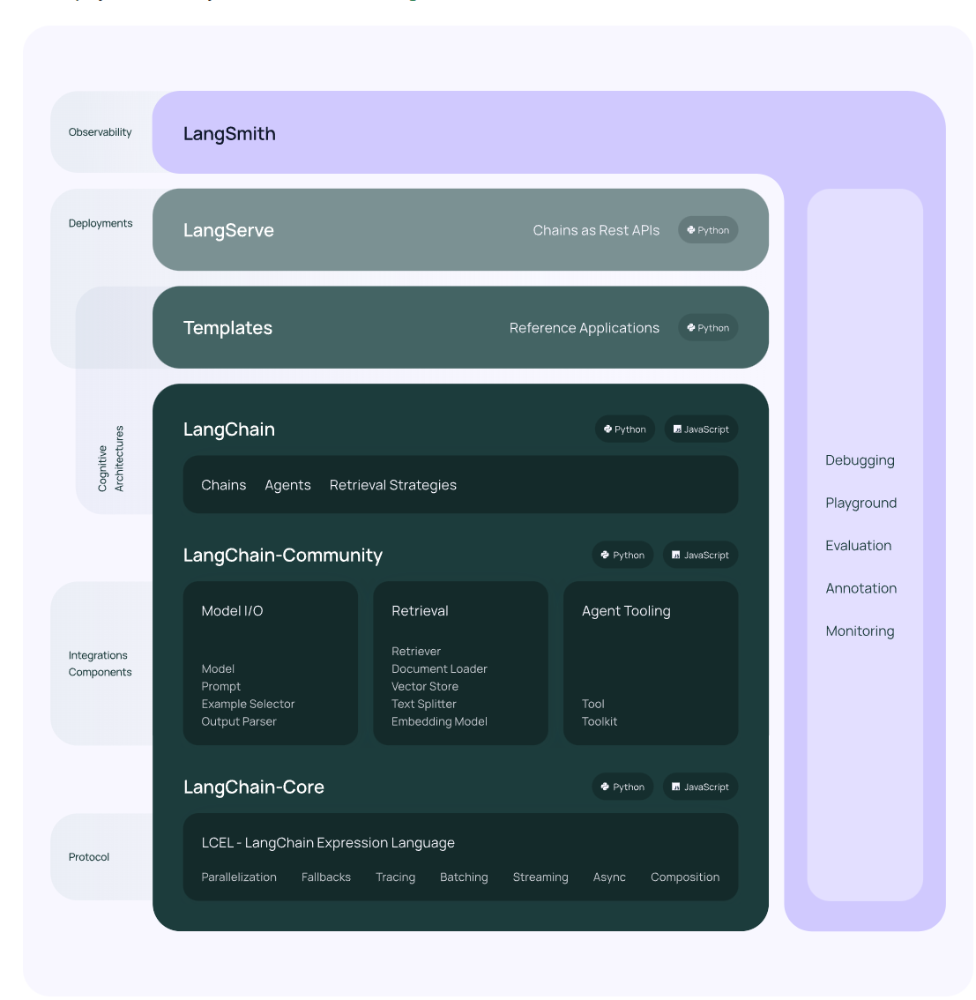

# Introduction

**LangChain** is a framework for developing applications powered by large language models (LLMs).

LangChain simplifies every stage of the LLM application lifecycle:

- **Development**: Build your applications using LangChain's open-source [building blocks](https://python.langchain.com/v0.1/docs/expression_language/) and [components](https://python.langchain.com/v0.1/docs/modules/). Hit the ground running using [third-party integrations](https://python.langchain.com/v0.1/docs/integrations/platforms/) and [Templates](https://python.langchain.com/v0.1/docs/templates/).
- **Productionization**: Use [LangSmith](https://python.langchain.com/v0.1/docs/langsmith/) to inspect, monitor and evaluate your chains, so that you can continuously optimize and deploy with confidence.
- **Deployment**: Turn any chain into an API with [LangServe](https://python.langchain.com/v0.1/docs/langserve/).

Concretely, the framework consists of the following open-source libraries:

- **`langchain-core`**: Base abstractions and LangChain Expression Language.
- `langchain-community`: Third party integrations.
  - Partner packages (e.g. **`langchain-openai`**, **`langchain-anthropic`**, etc.): Some integrations have been further split into their own lightweight packages that only depend on **`langchain-core`**.
- **`langchain`**: Chains, agents, and retrieval strategies that make up an application's cognitive architecture.
- **[langgraph](https://langchain-ai.github.io/langgraph/)**: Build robust and stateful multi-actor applications with LLMs by modeling steps as edges and nodes in a graph.
- **[langserve](https://python.langchain.com/v0.1/docs/langserve/)**: Deploy LangChain chains as REST APIs.

The broader ecosystem includes:

- **[LangSmith](https://python.langchain.com/v0.1/docs/langsmith/)**: A developer platform that lets you debug, test, evaluate, and monitor LLM applications and seamlessly integrates with LangChain.

## Get started

We recommend following our [Quickstart](https://python.langchain.com/v0.1/docs/get_started/quickstart/) guide to familiarize yourself with the framework by building your first LangChain application.

[See here](https://python.langchain.com/v0.1/docs/get_started/installation/) for instructions on how to install LangChain, set up your environment, and start building.

> note
>
> These docs focus on the Python LangChain library. [Head here](https://js.langchain.com/) for docs on the JavaScript LangChain library.

## Use cases

If you're looking to build something specific or are more of a hands-on learner, check out our [use-cases](https://python.langchain.com/v0.1/docs/use_cases/). They're walkthroughs and techniques for common end-to-end tasks, such as:

- [Question answering with RAG](https://python.langchain.com/v0.1/docs/use_cases/question_answering/)
- [Extracting structured output](https://python.langchain.com/v0.1/docs/use_cases/extraction/)
- [Chatbots](https://python.langchain.com/v0.1/docs/use_cases/chatbots/)
- and more!

## Expression Language

LangChain Expression Language (LCEL) is the foundation of many of LangChain's components, and is a declarative way to compose chains. LCEL was designed from day 1 to support putting prototypes in production, with no code changes, from the simplest “prompt + LLM” chain to the most complex chains.

- **[Get started](https://python.langchain.com/v0.1/docs/expression_language/)**: LCEL and its benefits
- **[Runnable interface](https://python.langchain.com/v0.1/docs/expression_language/interface/)**: The standard interface for LCEL objects
- **[Primitives](https://python.langchain.com/v0.1/docs/expression_language/primitives/)**: More on the primitives LCEL includes
- and more!

## Ecosystem

### [🦜🛠️ LangSmith](https://python.langchain.com/v0.1/docs/langsmith/)

Trace and evaluate your language model applications and intelligent agents to help you move from prototype to production.

### [🦜🕸️ LangGraph](https://langchain-ai.github.io/langgraph/)

Build stateful, multi-actor applications with LLMs, built on top of (and intended to be used with) LangChain primitives.

### [🦜🏓 LangServe](https://python.langchain.com/v0.1/docs/langserve/)

Deploy LangChain runnables and chains as REST APIs.

## [Security](https://python.langchain.com/v0.1/docs/security/)

Read up on our [Security](https://python.langchain.com/v0.1/docs/security/) best practices to make sure you're developing safely with LangChain.

## Additional resources

### [Components](https://python.langchain.com/v0.1/docs/modules/)

LangChain provides standard, extendable interfaces and integrations for many different components, including:

### [Integrations](https://python.langchain.com/v0.1/docs/integrations/providers/)

LangChain is part of a rich ecosystem of tools that integrate with our framework and build on top of it. Check out our growing list of [integrations](https://python.langchain.com/v0.1/docs/integrations/providers/).

### [Guides](https://python.langchain.com/v0.1/docs/guides/)

Best practices for developing with LangChain.

### [API reference](https://api.python.langchain.com/)

Head to the reference section for full documentation of all classes and methods in the LangChain and LangChain Experimental Python packages.

### [Contributing](https://python.langchain.com/v0.1/docs/contributing/)

Check out the developer's guide for guidelines on contributing and help getting your dev environment set up.
