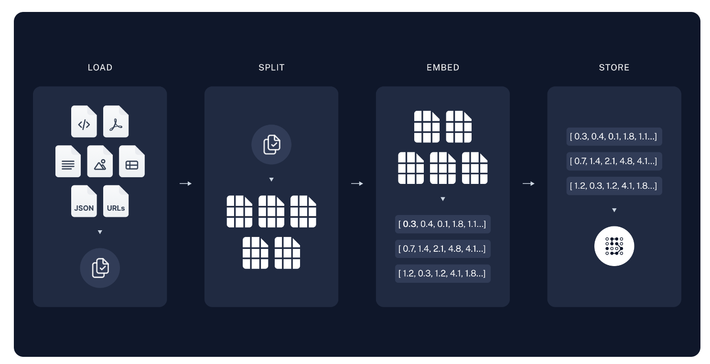
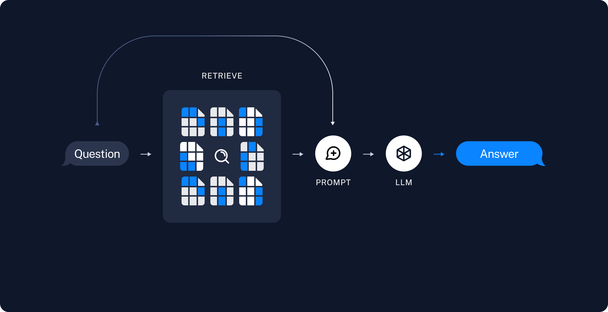

# Q&A with RAG

## Overview

One of the most powerful applications enabled by LLMs is sophisticated question-answering (Q&A) chatbots. These are applications that can answer questions about specific source information. These applications use a technique known as Retrieval Augmented Generation, or RAG.

### What is RAG?

RAG is a technique for augmenting LLM knowledge with additional data.

LLMs can reason about wide-ranging topics, but their knowledge is limited to the public data up to a specific point in time that they were trained on. If you want to build AI applications that can reason about private data or data introduced after a model's cutoff date, you need to augment the knowledge of the model with the specific information it needs. The process of bringing the appropriate information and inserting it into the model prompt is known as Retrieval Augmented Generation (RAG).

LangChain has a number of components designed to help build Q&A applications, and RAG applications more generally.

**Note**: Here we focus on Q&A for unstructured data. Two RAG use cases which we cover elsewhere are:

- [Q&A over SQL data](https://python.langchain.com/v0.1/docs/use_cases/sql/)
- [Q&A over code](https://python.langchain.com/v0.1/docs/use_cases/code_understanding/) (e.g., Python)

## RAG Architecture

A typical RAG application has two main components:

**Indexing**: a pipeline for ingesting data from a source and indexing it. *This usually happens offline.*

**Retrieval and generation**: the actual RAG chain, which takes the user query at run time and retrieves the relevant data from the index, then passes that to the model.

The most common full sequence from raw data to answer looks like:

#### Indexing

1. **Load**: First we need to load our data. This is done with [DocumentLoaders](https://python.langchain.com/v0.1/docs/modules/data_connection/document_loaders/).
2. **Split**: [Text splitters](https://python.langchain.com/v0.1/docs/modules/data_connection/document_transformers/) break large `Documents` into smaller chunks. This is useful both for indexing data and for passing it in to a model, since large chunks are harder to search over and won't fit in a model's finite context window.
3. **Store**: We need somewhere to store and index our splits, so that they can later be searched over. This is often done using a [VectorStore](https://python.langchain.com/v0.1/docs/modules/data_connection/vectorstores/) and [Embeddings](https://python.langchain.com/v0.1/docs/modules/data_connection/text_embedding/) model.

#### Retrieval and generation

1. **Retrieve**: Given a user input, relevant splits are retrieved from storage using a [Retriever](https://python.langchain.com/v0.1/docs/modules/data_connection/retrievers/).
2. **Generate**: A [ChatModel](https://python.langchain.com/v0.1/docs/modules/model_io/chat/) / [LLM](https://python.langchain.com/v0.1/docs/modules/model_io/llms/) produces an answer using a prompt that includes the question and the retrieved data

## Table of contents

- [Quickstart](https://python.langchain.com/v0.1/docs/use_cases/question_answering/quickstart/): We recommend starting here. Many of the following guides assume you fully understand the architecture shown in the Quickstart.
- [Returning sources](https://python.langchain.com/v0.1/docs/use_cases/question_answering/sources/): How to return the source documents used in a particular generation.
- [Streaming](https://python.langchain.com/v0.1/docs/use_cases/question_answering/streaming/): How to stream final answers as well as intermediate steps.
- [Adding chat history](https://python.langchain.com/v0.1/docs/use_cases/question_answering/chat_history/): How to add chat history to a Q&A app.
- [Hybrid search](https://python.langchain.com/v0.1/docs/use_cases/question_answering/hybrid/): How to do hybrid search.
- [Per-user retrieval](https://python.langchain.com/v0.1/docs/use_cases/question_answering/per_user/): How to do retrieval when each user has their own private data.
- [Using agents](https://python.langchain.com/v0.1/docs/use_cases/question_answering/conversational_retrieval_agents/): How to use agents for Q&A.
- [Using local models](https://python.langchain.com/v0.1/docs/use_cases/question_answering/local_retrieval_qa/): How to use local models for Q&A.
