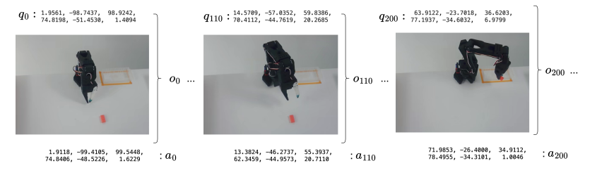

# 4 Robot (Imitation) Learning

```text
行为克隆（Behavioral Cloning）提供了一个天然的平台，可以基于真实环境交互数据进行学习，而无需设计任何奖励函数（reward function）；同时在处理多模态演示数据集（multimodal demonstration datasets）时，生成式模型（generative models）相比逐点策略（point-wise policies）具备更优的效果。
```


从人类演示（human demonstrations）中学习，是第 3 节所讨论的强化学习（RL）流程一套具备实用性的替代方案。事实上，尤其是在现实机器人领域，在线探索（online exploration）通常成本高昂，并且存在潜在安全风险；而设计（稠密）奖励信号（dense reward signals）是一项稳定性差、高度依赖特定任务的工作。此外，就连任务成功检测本身，往往都需要定制化的测量设备；同时回合式训练（episodic training）要求能够可靠地重置环境——以上这些因素，都加大了在实体硬件上大规模训练强化学习算法的难度。行为克隆（Behavioral Cloning, BC）把控制问题转化为一个模仿学习（imitation learning）问题，从而避开了上述限制：它利用预先采集的专家演示数据，为学到的自主行为提供基准约束。最为重要的一点是，通过学习模仿，自主系统能够自然而然地遵循隐含编码在中的目标、偏好以及成功判定标准。

形式化地，设 $D = \{\tau^{(i)}\}_{i=1}^{N}$ 为一组专家轨迹（expert trajectories）集合，其中 $\tau^{(i)} = \{(o_t, a_t)\}_{t=0}^{T_i}$ 代表集合 $D$ 中第 $i$ 条长度为 $T_i$ 的轨迹；$o_t \in \mathcal{O}$ 表示观测（observations，例如图像与本体感知信息的组合），$a_t \in \mathcal{A}$ 为专家动作（expert actions）。

一般而言，观测 $o \in \mathcal{O}$ 同时包含图像信息与本体感知（proprioceptive）信息；而动作 $a \in \mathcal{A}$ 代表机器人需要执行的控制指令，例如关节位形（joint configuration）。请注意，与第 3 节不同：在模仿学习（imitation learning）语境下，$D$ 指代一个离线数据集，它收集了 $N$ 条长度为 $T_i$、不含奖励的人类专家轨迹 $\tau^{(i)}$，而非环境动力学（environment dynamics）。同样，本节中的 $\tau^{(i)}$ 是由观测–动作对构成、长度为 $T_i$ 的轨迹，关键特点是完全不包含任何奖励信息。图 18 以图像形式展示了遥操作 SO‑100 机械臂六条关节驱动量的平均变化趋势。可以看到，在录制回合（episodes）过程中，本体感知状态与相机画面同步采集，得到一套统一、高帧率的图像与关节遥操作混合数据。图 19 展示了同一数据集里的 $(o_t, a_t)$ 对，同时给出人类专家执行的动作以及与之对应的观测。原则上，各条专家轨迹 $\tau^{(i)}$ 的长度可以互不相同：为达成同一个目标，演示过程可能呈现多模态策略（multi-modal strategies），由此产生多种截然不同的行为。

行为克隆（Behavioral Cloning, BC）（Pomerleau, 1988）旨在通过学习从观测到动作的映射来生成合成行为；在最直观的形式化定义下，该问题可以当作一个监督学习（supervised learning）问题高效求解：给定任意风险函数 $L: \mathcal{A} \times \mathcal{A} \mapsto \mathbb{R},\; L(a, a')$，学习（确定性）映射 $f: \mathcal{O} \mapsto \mathcal{A}$，满足 $a_t = f(o_t)$。

$$
\min_{f}\; \mathbb{E}_{(o_t,a_t)\sim p(\cdot)} \, L\big(a_t,\, f(o_t)\big), \tag{18}
$$


通常我们假设专家的观测‑动作联合分布（joint observation-action distribution）$p: \mathcal{O} \times \mathcal{A} \mapsto [0,1]$ 是未知的，这一点与经典监督学习（Supervised Learning, SL）框架保持一致<sup>3</sup>。但与标准监督学习的假设不同：数据集 $D$ 中的采样（也就是底层分布 $p$ 的实现样本）并不满足独立同分布（i.i.d.），因为专家演示是以轨迹形式依次采集得到的。在实际操作中，可以通过打乱顺序、非序列化地取用样本，也就是对数据集 $D$ 内样本做混洗（shuffling），在一定程度上缓解该问题；借此可以利用蒙特卡洛估计（MC estimates）近似得到分布 $p$ 下的期望风险，不过这类估计一般而言精度会有所下降。另一种降低在非独立同分布样本上做回归所带来负面影响的方案，是交替执行行为克隆与数据采集（Ross 等人，2011，DAgger），通过迭代方式合并多份数据集。但本文仅考虑仅有一份离线轨迹数据集 $D$、无法继续采集新数据的场景，因此 DAgger 不在我们的讨论范围内。


