# 4 Robot (Imitation) Learning

```text
行为克隆（Behavioral Cloning）提供了一个天然的平台，可以基于真实环境交互数据进行学习，而无需设计任何奖励函数（reward function）；同时在处理多模态演示数据集（multimodal demonstration datasets）时，生成式模型（generative models）相比逐点策略（point-wise policies）具备更优的效果。
```


从人类演示（human demonstrations）中学习，是第 3 节所讨论的强化学习（RL）流程一套具备实用性的替代方案。事实上，尤其是在现实机器人领域，在线探索（online exploration）通常成本高昂，并且存在潜在安全风险；而设计（稠密）奖励信号（dense reward signals）是一项稳定性差、高度依赖特定任务的工作。此外，就连任务成功检测本身，往往都需要定制化的测量设备；同时回合式训练（episodic training）要求能够可靠地重置环境——以上这些因素，都加大了在实体硬件上大规模训练强化学习算法的难度。行为克隆（Behavioral Cloning, BC）把控制问题转化为一个模仿学习（imitation learning）问题，从而避开了上述限制：它利用预先采集的专家演示数据，为学到的自主行为提供基准约束。最为重要的一点是，通过学习模仿，自主系统能够自然而然地遵循隐含编码在中的目标、偏好以及成功判定标准。

形式化地，设 $D = \{\tau^{(i)}\}_{i=1}^{N}$ 为一组专家轨迹（expert trajectories）集合，其中 $\tau^{(i)} = \{(o_t, a_t)\}_{t=0}^{T_i}$ 代表集合 $D$ 中第 $i$ 条长度为 $T_i$ 的轨迹；$o_t \in \mathcal{O}$ 表示观测（observations，例如图像与本体感知信息的组合），$a_t \in \mathcal{A}$ 为专家动作（expert actions）。

一般而言，观测 $o \in \mathcal{O}$ 同时包含图像信息与本体感知（proprioceptive）信息；而动作 $a \in \mathcal{A}$ 代表机器人需要执行的控制指令，例如关节位形（joint configuration）。请注意，与第 3 节不同：在模仿学习（imitation learning）语境下，$D$ 指代一个离线数据集，它收集了 $N$ 条长度为 $T_i$、不含奖励的人类专家轨迹 $\tau^{(i)}$，而非环境动力学（environment dynamics）。同样，本节中的 $\tau^{(i)}$ 是由观测–动作对构成、长度为 $T_i$ 的轨迹，关键特点是完全不包含任何奖励信息。图 18 以图像形式展示了遥操作 SO‑100 机械臂六条关节驱动量的平均变化趋势。可以看到，在录制回合（episodes）过程中，本体感知状态与相机画面同步采集，得到一套统一、高帧率的图像与关节遥操作混合数据。图 19 展示了同一数据集里的 $(o_t, a_t)$ 对，同时给出人类专家执行的动作以及与之对应的观测。原则上，各条专家轨迹 $\tau^{(i)}$ 的长度可以互不相同：为达成同一个目标，演示过程可能呈现多模态策略（multi-modal strategies），由此产生多种截然不同的行为。

<p align="center">
  
</p>

<p align="center">
  <strong>图 19</strong>｜在数据集 <code>lerobot/svla_so101_pickplace</code> 内某条录制轨迹上采样得到的观测与动作对。观测同时包含本体感知（proprioceptive）与视觉信息，并与由人类专家操控的主机器人（leader robot）的位形同步记录；这为基于观测回归动作提供了完整信息。
</p>

行为克隆（Behavioral Cloning, BC）（Pomerleau, 1988）旨在通过学习从观测到动作的映射来生成合成行为；在最直观的形式化定义下，该问题可以当作一个监督学习（supervised learning）问题高效求解：给定任意风险函数 $L: \mathcal{A} \times \mathcal{A} \mapsto \mathbb{R},\; L(a, a')$，学习（确定性）映射 $f: \mathcal{O} \mapsto \mathcal{A}$，满足 $a_t = f(o_t)$。

$$
\min_{f}\; \mathbb{E}_{(o_t,a_t)\sim p(\cdot)} \, L\big(a_t,\, f(o_t)\big), \tag{18}
$$


通常我们假设专家的观测‑动作联合分布（joint observation-action distribution）$p: \mathcal{O} \times \mathcal{A} \mapsto [0,1]$ 是未知的，这一点与经典监督学习（Supervised Learning, SL）框架保持一致<sup>3</sup>。但与标准监督学习的假设不同：数据集 $D$ 中的采样（也就是底层分布 $p$ 的实现样本）并不满足独立同分布（i.i.d.），因为专家演示是以轨迹形式依次采集得到的。在实际操作中，可以通过打乱顺序、非序列化地取用样本，也就是对数据集 $D$ 内样本做混洗（shuffling），在一定程度上缓解该问题；借此可以利用蒙特卡洛估计（MC estimates）近似得到分布 $p$ 下的期望风险，不过这类估计一般而言精度会有所下降。另一种降低在非独立同分布样本上做回归所带来负面影响的方案，是交替执行行为克隆与数据采集（Ross 等人，2011，DAgger），通过迭代方式合并多份数据集。但本文仅考虑仅有一份离线轨迹数据集 $D$、无法继续采集新数据的场景，因此 DAgger 不在我们的讨论范围内。尽管从非独立同分布（non-i.i.d.）数据中学习存在固有的难点，但行为克隆（BC）范式在机器人领域具备多项工程优势。首先，训练过程是离线（offline）进行的，能够天然适配专家演示数据；它将动作约束在模仿的范围内，从根源上杜绝机器人执行危险动作，大幅降低探索带来的风险。其次，行为克隆完全不需要设计奖励，因为演示本身就已经体现了人类的意图。不再依赖奖励，也就规避了纯粹基于奖励的强化学习中容易出现的目标错位（misalignment）与投机取巧（specification gaming，也叫 reward hacking / 奖励破解）风险（Heess 等人，2017）。第三，由于专家轨迹中隐含了终止条件（terminal conditions），任务成功判定与环境重置都已经内嵌在数据集之中。最后，实验结果表明：随着跨任务、跨本体、跨环境采集的演示数据体量不断增加，行为克隆的效果可以自然地随之提升。不过从原理上来说，行为克隆最多只能复刻出和示教者水平相当的行为，无法修正人类做出的次优决策。这一局限在序列决策（sequential decision-making）任务中尤为棘手——造成该问题的原因，或是数据采集成本高昂，或是人类本身的示教表现就属于次优。即便如此，很多机器人应用依然可以借助成本相对可控的流程采集高质量的人工示教轨迹，这也证明在这类场景下选用行为克隆是合理的。

<p align="center">
  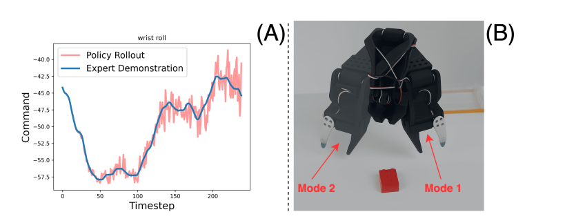
</p>

<p align="center">
  <strong>图 20</strong>｜逐点策略（point-wise policies）存在两处局限：（A）协变量偏移（covariate shift）；（B）对多模态示教数据拟合效果差。（A）微小的预测误差就可能让策略进入分布外状态，形成恶性循环，最终导致任务失败。（B）场景中伸向目标物体存在两种可行方式——先从左侧靠近或是先从右侧靠近，二者效果等价，因此在人类示教数据集里出现的概率相当，最终形成多模态示教样本。

</p>


<p align="center">
  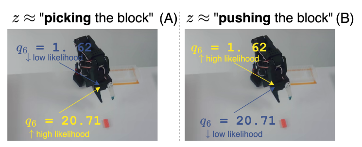
</p>

<p align="center">
  <strong>图 21</strong>｜直观来看，单一隐变量模型（single latent model）中的隐变量（latent variable）可以包含当前执行任务的相关信息；这会直接造成：对于两组不同任务，同一组观测‑动作对（observation-action pair）对应的似然（likelihood）并不相同。例如：（A）抓取方块时，夹爪张开幅度较大对应的似然，应当高于小幅张开；而（B）推动方块时，情况则恰好相反。

</p>

尽管在概念上十分简洁优美，但通过求解式 (18) 得到的点估计策略（point-estimate policies）$f: \mathcal{O} \mapsto \mathcal{A}$，存在两个已知缺陷：（1）误差累积（compounding errors）（Ross 等人，2011）；（2）难以拟合多模态分布（multimodal distributions）（Florence 等人，2022；Ke 等人，2020）。图 20 展示了这两个和显式策略学习相关的核心问题（Florence 等人，2022）。除数据集 $D$ 本身具有时序性之外，由协变量偏移（covariate shift）引发的误差累积可能带来严重后果：即便只是很小的预测误差 $0 < \|\mu(o_t) - a_t\| \le \epsilon$，也会很快让策略进入分布外（out-of-distribution）状态，生成结果的置信度随之下降，进而造成误差不断累积（图 20，左）。此外，点估计策略通常无法学习多模态目标；而在解决现实机器人任务的人类示教数据中，多模态目标十分常见——为实现同一个目标，可以存在多条效果等价的轨迹（例如对称抓取，见图 20，右）。具体而言，单模态回归器（unimodal regressors）倾向于对各个模态取平均，输出的控制指令犹豫不决，甚至存在安全隐患（Florence 等人，2022）。为解决多模态拟合效果差这一问题，Florence 等人（2022）提出不去显式学习预测函数 $f: a = f(o)$，而是学习数据集 $D$ 的样本背后的生成模型（generative model）$p(o,a)$。


## 4.1 A (Concise) Introduction to Generative Models

生成式模型（Generative Models, GMs）旨在学习采集数据背后用于生成样本的随机过程；通常的实现方式是拟合一个概率分布，用来逼近未知的数据分布 $p$。遵循生成式模型领域的行文习惯，记 $p(x) \leftarrow P(x),\; x \sim p$。

在行为克隆场景下，未知的数据分布 $p$ 可以表示专家在 $(o,a)$ 对上的联合分布。因此，给定由 $N$ 组样本对构成的有限数据集 $D = \{(o,a)_i\}_{i=0}^{N}$，将其作为模仿学习的目标（并假设样本独立同分布），生成式模型希望学到一个参数化分布 $p_\theta(o,a)$，满足两点要求：
（1）新采样得到的样本 $(o,a) \sim p_\theta(\cdot)$ 和数据集 $D$ 内的样本风格相近；
（2）对于无法直接观测的原始分布 $p$，在它那些已经被观测到的区域上赋予较高的似然。

基于似然的学习为同时达成上述两个目标提供了一套具备理论依据的训练目标，因此在生成式模型中得到广泛使用（Prince, 2023）。

<p align="center">
  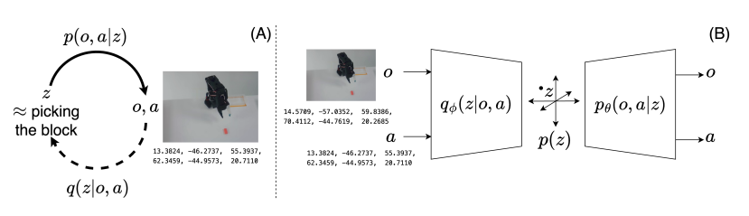
</p>

<p align="center">
  <strong>图 22</strong>｜（A）机器人应用中的隐变量模型（latent variable model）控制着可观测变量 $(o,a)$ 与不可观测隐变量（latent variable）之间的相互影响。（B）变分自编码器（VAEs）借助变分推断（variational inference）对精确隐变量模型做近似。

</p>


### 4.1.1 Variational Auto-Encoders

生成式模型（Generative Models, GMs）中一种常用的归纳偏置（inductive bias）假定：样本 $(o,a)$ 受到一个不可观测的隐变量 $z \in \mathcal{Z}$ 的影响，由此可得：

$$
p(o,a) = \int_{\mathrm{supp}(\mathcal{Z})} p(o,a \mid z)\, p(z) \tag{19}
$$

式 (19) 的含义：在隐变量空间的支撑集（support，$\mathrm{supp}(\mathcal{Z})$）上对隐变量 $z$ 积分，从而得到观测‑动作对的边缘分布 $p(o,a)$；其中 $p(z)$ 是隐变量的先验分布，$p(o,a\mid z)$ 为给定隐变量 $z$ 条件下观测与动作的条件分布。


直观而言，对于机器人任务中的观测‑动作对 $(o,a)$，$z$ 可以理解为人类示教者正在执行任务的某种高层表征。在这种设定下，将 $p(o,a)$ 看作完整联合分布 $p(o,a,z)$ 在 $\mathrm{supp}(\mathcal{Z})$ 上求边缘分布，能够自然刻画不同任务对观测‑动作对似然的影响。图 21 通过（A）抓取任务与（B）推动任务直观展示该思想：当靠近目标物体时，使夹爪张开的动作对应的似然（$q_6$ 越大，夹爪张开幅度越大）会随任务发生变化——在抓取任务中该似然较高，而在推动任务中较低。尽管隐空间 $\mathcal{Z}$ 的结构通常远比全部实际任务构成的集合更加丰富，式 (19) 依然提供了一套可靠框架，用于学习以那些不可观测但具备相关性的因素为条件的联合分布。图 22 在机器人应用场景下展示了这套隐变量框架：真实的、以 $z$ 为条件的生成过程会为每一组 $(o,a)$ 对赋予似然 $p((o,a)\mid z)$。借助贝叶斯定理（Bayes’ theorem），我们可以由似然 $p_\theta(o,a\mid z)$、先验 $p_\theta(z)$ 以及证据（evidence）$p_\theta(o,a)$，在 $\mathrm{supp}(\mathcal{Z})$ 上重建后验分布 $q_\theta(z\mid o,a)$。变分自编码器（VAEs）使用近似后验 $q_\phi(z\mid o,a)$ 逼近式 (19) 给出的隐变量模型，同时对参数化似然 $p_\theta(o,a\mid z)$ 的参数做回归（图 22）。

给定包含 $N$ 组独立同分布（i.i.d.）观测‑动作对的数据集 $D$，在参数 $\theta$ 下所有数据点的对数似然（在贝叶斯语境下，也称为证据 $p_\theta(D)$）可以写为：

$$
\begin{align}
\log p_\theta(\mathcal{D})
&= \log \sum_{i=0}^{N} p_\theta\big((o,a)_i\big) \tag{20} \\
&= \log \sum_{i=0}^{N} \int_{\mathrm{supp}(\mathcal{Z})} p_\theta\big((o,a)_i \mid z\big)\, p(z) \tag{21} \\
&= \log \sum_{i=0}^{N} \int_{\mathrm{supp}(\mathcal{Z})} \frac{q_\theta\big(z \mid (o,a)_i\big)}{q_\theta\big(z \mid (o,a)_i\big)} \cdot p_\theta\big((o,a)_i \mid z\big)\, p(z) \tag{22} \\
&= \log \sum_{i=0}^{N} \mathbb{E}_{z \sim q_\theta(\bullet \mid (o,a)_i)} \left[ \frac{p(z)}{q_\theta\big(z \mid (o,a)_i\big)} \cdot p_\theta\big((o,a)_i \mid z\big) \right], \tag{23}
\end{align}
$$

公式释义：
式 (20)：数据集 $\mathcal{D}$ 在参数 $\theta$ 下的对数似然，等于对全部样本点的似然之和取对数。
式 (21)：代入隐变量模型，对隐变量 $z$ 在其支撑集上积分（边缘化）。
式 (22)：引入提议分布 $q_\theta\big(z \mid (o,a)_i\big)$，做恒等变形，为重要性采样铺垫。
式 (23)：将积分改写为关于分布 $q_\theta\big(z \mid (o,a)_i\big)$ 的期望形式。


其中，我们在式 (20) 中代入了式 (19)；在式 (21) 里乘上恒等因子 $1=\dfrac{q_\theta\big(z\mid(o,a)_i\big)}{q_\theta\big(z\mid(o,a)_i\big)}$；并在式 (23) 使用了期望的定义。

在一种特殊情形下：若假设分布是可计算的（tractable），则 $p_\theta(\mathcal{D})$ 通常同样可计算；此时对 $\log p_\theta(\mathcal{D})$ 关于 $\theta$ 求极大，就为推断生成模型的未知参数 $\theta$（点估计）提供了一个自然目标。遗憾的是，如果使用神经网络这类逼近器对分布 $p$ 建模，式 (23) 几乎无法直接计算，针对高维、非结构化数据时更是如此。

在关于变分自编码器（VAEs）的开创性工作中，Kingma 与 Welling（2013）提出两项核心贡献，用以从非结构化数据中学习复杂隐变量生成式模型：（1）给出式 (23) 的一个可计算变分下界，将其作为优化目标，联合学习似然与后验；（2）采用高容量函数逼近器来建模似然 $p_\theta(o,a\mid z)$ 以及近似后验分布 $q_\phi(z\mid o,a) \approx q_\theta(z\mid o,a)$。

具体来说，对式 (23) 应用延森不等式（Jensen’s inequality，$\log \mathbb{E}[\bullet] \ge \mathbb{E}[\log(\bullet)]$），就可以推导出式 (23) 的下界，也就是证据下界（Evidence LOwer Bound，ELBO），结果如下：

$$
\begin{align}
\log p_\theta(\mathcal{D})
&\ge \sum_{i=0}^{N}\left(
\mathbb{E}_{z\sim q_\theta(\bullet\mid (o,a)_i)}
\big[\log p_\theta\big((o,a)_i \mid z\big)\big]
+
\mathbb{E}_{z\sim q_\theta(\bullet\mid (o,a)_i)}
\left[\log\left(\frac{p(z)}{q_\theta\big(z \mid (o,a)_i\big)}\right)\right]
\right) \tag{24}\\
&= \sum_{i=0}^{N}\left(
\mathbb{E}_{z\sim q_\theta(\bullet\mid (o,a)_i)}
\big[\log p_\theta\big((o,a)_i \mid z\big)\big]
-
D_{\mathrm{KL}}\big[q_\theta\big(z \mid (o,a)_i\big) \parallel p(z)\big]
\right) \tag{25}
\end{align}
$$

公式释义：
式 (24)：数据集对数似然的下界，第一项为重构期望，第二项为对数比值的期望。
式 (25)：利用 KL 散度（Kullback–Leibler divergence）改写，也就是标准证据下界（ELBO）：
- $\mathbb{E}_{z\sim q_\theta(\bullet\mid (o,a)_i)}\big[\log p_\theta\big((o,a)_i \mid z\big)\big]$：重构项，衡量在给定隐变量 $z$ 时重建观测‑动作样本的对数似然；
- $D_{\mathrm{KL}}\big[q_\theta\big(z \mid (o,a)_i\big) \parallel p(z)\big]$：正则项，衡量近似后验与隐变量先验之间的 KL 散度。


真实后验 $q_\theta(z \mid o,a)$ 通常无法直接求解，这使得我们不能计算式 (25) 中的期望项与 KL 散度项。因此 Kingma 和 Welling（2013）提出使用近似后验 $q_\phi(z \mid o,a)$ 推导证据下界（ELBO），从而得到最终可求解的 ELBO 目标函数：

$$
\mathrm{ELBO}_{\mathcal{D}}(\theta,\phi)
= \sum_{i=0}^{N}
\left(
\mathbb{E}_{z\sim q_\phi(\bullet\mid (o,a)_i)}
\big[\log p_\theta\big((o,a)_i \mid z\big)\big]
-
D_{\mathrm{KL}}\big[q_\phi\big(z \mid (o,a)_i\big) \parallel p(z)\big]
\right) \tag{26}
$$

公式释义：
式 (26) 就是在数据集 $\mathcal{D}$ 上、同时以生成参数 $\theta$ 与推断参数 $\phi$ 为变量的证据下界目标：
- $\mathbb{E}_{z\sim q_\phi(\bullet\mid (o,a)_i)}\big[\log p_\theta\big((o,a)_i \mid z\big)\big]$：重构似然期望，鼓励从采样得到的隐变量 $z$ 恢复出观测‑动作样本；
- $D_{\mathrm{KL}}\big[q_\phi\big(z \mid (o,a)_i\big) \parallel p(z)\big]$：KL 正则项，用来约束编码器输出的近似后验向预先设定的隐先验靠拢。

在训练时我们最大化该 ELBO，同步优化编码器参数 $\phi$（近似后验）和解码器参数 $\theta$（条件似然）。

由延森不等式（Jensen’s inequality）可知，最大化证据下界（ELBO）等价于最大化数据的对数似然，由此得到一个自然且可求解的优化目标。具体而言，式 (26) 内的期望可以基于学习得到的分布，采用蒙特卡洛估计（MC estimates）进行估算；而 KL 散度项通常能够求出闭式解，需要满足两个条件：（1）将 \(q_\phi\) 建模为高斯分布：\(q_\phi(z|o,a)=\mathcal{N}\big(\mu_\phi(o,a),\Sigma_\phi(o,a)\big)\)，其中均值向量 \(\mu_\phi(o,a)\) 和协方差矩阵 \(\Sigma_\phi(o,a)\) 均为可学习参数；（2）为隐空间设置标准高斯先验：\(p(z)=\mathcal{N}(\boldsymbol{0},\mathbf{I})\)。

如果转而最小化负证据下界（negative ELBO），就可以直观理解变分自编码器（VAE）的学习动态。该目标能够分解为物理意义清晰的两项（不失一般性，下文仅考虑单个样本 \((o,a)\sim \mathcal{D}\)）：

$$
\min_{\theta,\phi}-\mathrm{ELBO}_{(o,a)\sim\mathcal{D}}(\theta,\phi)
=\min_{\theta,\phi}\mathbf{L}^{\mathrm{rec}}(\theta)+\mathbf{L}^{\mathrm{reg}}(\phi), \tag{27}
$$
$$
\mathbf{L}^{\mathrm{rec}}(\theta)
=\mathbb{E}_{z\sim q_\phi(\bullet\mid o,a)}\big[\log p_\theta(o,a\mid z)\big], \tag{28}
$$
$$
\mathbf{L}^{\mathrm{reg}}(\phi)
=D_{\mathrm{KL}}\big[q_\phi(z\mid o,a)\parallel p(z)\big]. \tag{29}
$$

公式释义：
式 (27) 表示最小化负证据下界（negative ELBO）等价于最小化重构损失与正则损失之和，优化参数为生成参数 $\theta$ 和推断参数 $\phi$；
- $\mathbf{L}^{\mathrm{rec}}(\theta)$（式 28）：重构损失项，是隐变量 $z$ 采自近似后验 $q_\phi(\bullet\mid o,a)$ 时对数条件似然的期望，驱动模型根据隐变量重建观测‑动作对；
- $\mathbf{L}^{\mathrm{reg}}(\phi)$（式 29）：KL 正则项，代表近似后验 $q_\phi(z\mid o,a)$ 与隐先验 $p(z)$ 之间的 KL 散度，约束编码器输出的后验分布向预设隐先验对齐。

训练时最小化该联合目标，同步更新编码器参数 $\phi$ 与解码器参数 $\theta$。

对于任意给定的 $(o,a)$ 对，式 (28) 中的期望项一般通过蒙特卡洛估计（MC estimates）进行计算，于是得到

$$
-\mathbb{E}_{z\sim q_\phi(\bullet\mid o,a)}\big[\log p_\theta(o,a\mid z)\big]
=\mathbf{L}^{\mathrm{rec}}
\approx -\frac{1}{n}\sum_{i=0}^{n}\log p_\theta(o,a\mid z_i).
$$

公式释义：
该式为重构损失的蒙特卡洛近似形式；
- $\mathbb{E}_{z\sim q_\phi(\bullet\mid o,a)}\big[\log p_\theta(o,a\mid z)\big]$：从近似后验 $q_\phi(\bullet\mid o,a)$ 采样隐变量 $z$，求取对数条件似然的期望；
- $\mathbf{L}^{\mathrm{rec}}$：重构损失（reconstruction loss）；
- $-\dfrac{1}{n}\displaystyle\sum_{i=0}^{n}\log p_\theta(o,a\mid z_i)$：采用 $n$ 个独立采样样本 $z_i$，用样本均值对期望做蒙特卡洛估计，以此近似重构损失。

在实际计算时，我们通过有限数量的隐变量采样来逼近原本难以直接求解的期望。

假设 $p_\theta(o,a\mid z)$ 由各向同性高斯分布（isotropic Gaussian distribution）参数化，该分布的均值为 $\mu_\theta(z)\in\mathbb{R}^d$，方差为 $\sigma^2$，则对数似然可以简化为：

$$
\log p(o,a\mid z_i)
= -\frac{1}{2\sigma^2}\left\|(o,a)-\mu_\theta(z_i)\right\|_2^2
-\frac{d}{2}\log\big(2\pi\sigma^2\big)
\implies
\mathbf{L}^{\mathrm{rec}}
\approx \frac{1}{n}\sum_{i=0}^{n}\left\|(o,a)-\mu_\theta(z_i)\right\|_2^2
$$

公式释义：
该式为各向同性高斯假设下对数似然与重构损失的化简结果；
- $\displaystyle -\frac{1}{2\sigma^2}\left\|(o,a)-\mu_\theta(z_i)\right\|_2^2$：平方误差项，衡量网络输出均值 $\mu_\theta(z_i)$ 与真实观测‑动作对 $(o,a)$ 之间的 $L_2$ 距离；
- $\displaystyle -\frac{d}{2}\log\big(2\pi\sigma^2\big)$：高斯分布的常数熵项，与输入无关，优化时常可忽略；
- $\displaystyle \mathbf{L}^{\mathrm{rec}} \approx \frac{1}{n}\sum_{i=0}^{n}\left\|(o,a)-\mu_\theta(z_i)\right\|_2^2$：重构损失（reconstruction loss）最终退化为对采样得到的隐变量 $z_i$ 求取平均平方误差。

由此可见，在固定方差的各向同性高斯假设下，最大化对数似然等价于最小化观测‑动作对与解码器预测均值之间的均方误差。

在实际应用中，通常使用参数化分布（例如高斯分布）来近似学习得到的似然 $p_\theta(o,a\mid z)$；该分布的参数由从 $\mu_\theta(z)$ 导出的可学习系数向量给出，其中 $z \sim p(\cdot)$。在这一框架下，训练变分自编码器（VAE）等价于同时完成两项任务：（1）通过最小化重构损失 $\mathbf{L}^{\mathrm{rec}}$，对数据集 $\mathcal{D}$ 中的样本进行重构，这是回归任务中经典的有监督学习目标；（2）通过最小化正则项 $\mathbf{L}^{\mathrm{reg}}$，对隐表示施加正则约束。正则项的作用是实现信息压缩：若按惯例选取先验 $p(z)=\mathcal{N}(0,\mathbf{I})$（见式 29），该正则器会约束后验分布，进而限制 $q_\phi(z\mid o,a)$ 的表达能力。

### 4.1.2 Diffusion Models

变分自编码器（VAE）通过单隐变量模型对概率分布进行近似，它假设底层的未知分布可以按照式(19)进行分解，并求解变分推断（variational inference）问题，联合学习该模型下的似然 $p_\theta$ 以及（近似）后验 $q_\phi$。在该框架中，未知的数据分布 $p(o,a)$ 实际上通过 $\int_Z p(z)p_\theta(o,a\mid z)$ 来近似；底层生成过程可以拆解为两步：（1）采样一个隐变量；（2）学习将该隐变量解码为在（未知）$p(o,a)$ 下具有高似然的样本。扩散模型（Diffusion Models, DMs）（Ho 等人，2020）是另一类生成模型（GMs），同样用于近似底层未知数据分布，也就是变分推断问题。它可以看作是对 VAE 的拓展，适用于多个隐变量之间相互影响、并且共同决定 $o,a$ 的生成过程的场景。具体来说，扩散模型假定生成过程可以分解为一系列隐变量之间分段的（马尔可夫式，Markovian）交互过程（图23），由此得到

<p align="center">
  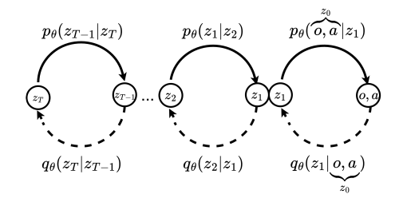
</p>

<p align="center">
  <strong>图 23</strong>｜分层马尔可夫隐变量（HMLV）模型假定：数据生成过程受一组具有马尔可夫依赖关系的隐变量序列影响，从后验分布采样得到的样本，对应层级会逐步升高。

</p>

$$
p(\underbrace{o,a}_{=z_0}) = \int_{\mathrm{supp}(Z_0)}\int_{\mathrm{supp}(Z_1)}\dots\int_{\mathrm{supp}(Z_T)} p(z_0,z_1,\dots,z_T) \tag{30}
$$

$$
p(z_0,z_1,\dots,z_T) = p(z_T)\prod_{t=1}^{T} p(z_{t-1}\mid z_t), \tag{31}
$$

公式释义：
式(30)：观测-动作对 $(o,a)$ 等价于 $z_0$；对所有隐变量 $z_0,z_1,\dots,z_T$ 的支撑集（support）做多重积分，积分联合分布 $p(z_0,z_1,\dots,z_T)$，得到 $(o,a)$ 的边缘分布。
式(31)：隐变量的联合分布按照马尔可夫反向过程分解：从最末时刻隐变量 $z_T$ 的先验分布 $p(z_T)$ 开始，连乘每一步的反向转移概率 $p(z_{t-1}\mid z_t)$，也就是扩散模型的反向生成过程。
- $\mathrm{supp}(\cdot)$：支撑集（support）
- $\prod$：连乘符号（product）

式(30)显式写出了对多个隐变量的边缘化（marginalization）操作，式(31)则利用了条件概率公式与马尔可夫性（Markov property）。此外，为简化记号，后文将观测-动作对 $o,a$ 记作 $z_0$。

与变分自编码器（VAE）类似，我们通常无法给隐变量赋予精确的物理解释。不过，从实际应用的角度可以得到一个直观理解：分层马尔可夫隐变量（Hierarchical Markov Latent Variable, HMLV）模型通过捕捉隐变量之间分层、解耦的相互作用，能够体现不同条件影响因子作用在不同粒度上的特性。例如在机器人场景中，可以很自然地区分高层轨迹规划（层级更高，对应 $t\to T$）和精细运动调整（更贴近真实观测，对应 $t\to 0$）。因此，分层马尔可夫隐变量模型提供了一套变分推断框架：它通过多步、依次从不同高层分布中采样完成推断，而不是使用单隐变量模型去近似生成过程。扩散模型（DMs）是分层马尔可夫隐变量模型的一种特例，其后验被固定为 $q(z_t \mid z_{t-1})=\mathcal{N}(z_t\sqrt{1-\beta_t},\beta_t \mathbf{I})$，其中给定 $\beta_t \in \mathbb{R}^+$。在实际使用中，$\beta_t$ 的作用是沿着隐变量层级逐步降低信噪比（signal-to-noise ratio），这和扩散过程改变物理系统信息的方式相似。和 VAE 一样，扩散模型也尝试基于一组独立同分布（i.i.d.）样本，学习还原底层数据分布 $p(o,a)$；这些样本用来近似假定生成原始数据的模型（式30）。同样和 VAE 类似，扩散模型通过两步近似从未知分布 $p(o,a)$ 采样的过程：（1）从一个易于采样的分布（例如高斯分布）中采样；（2）学习重构出在未知分布下具有高似然的样本。但二者存在显著区别：扩散模型所使用的这个易采样分布，不包含任何关于数据分布 $p(o,a)$ 的互信息。关键一点：模型假设样本 $(o,a)$（为简化记号，记为 $z_0\equiv(o,a)$）中的信息不会沿着隐变量链向前传递，因此扩散模型的后验 $q(z_t\mid z_{t-1})$ 拥有相对简单友好的结构，降低了求解复杂度。而真实的似然 $p(z_{t-1}\mid z_t)$ 一般采用参数化形式 $p_\theta(z_{t-1}\mid z_t)$ 来近似。在这套机制下，未知数据分布里的信息是通过如下过程重建的：从一个固定分布中取出样本，经过迭代变换，最终（理想情况下）得到在 $p(o,a)$ 下高似然的样本，这个过程就叫做去噪（denoising）。

在该模型下，我们可以写出任意样本 $z_0$ 的对数似然（log-likelihood）表达式：

$$
\begin{align*}
\log p_\theta(z_0) &= \log \int_{\mathrm{supp}(Z_1)\times\mathrm{supp}(Z_2)\times\cdots\times\mathrm{supp}(Z_T)} p_\theta(\underbrace{z_0,z_1,z_2,\dots,z_T}_{z_{0:T}}) \tag{32}\\
&= \log \int_{\mathrm{supp}(Z_{1:T})} \frac{p_\theta(z_{0:T}) \cdot q(z_{1:T}\mid z_0)}{q(z_{1:T}\mid z_0)} \tag{33}\\
&= \log \mathbb{E}_{z_{1:T}\sim q(\bullet\mid z_0)} \left[ \frac{p_\theta(z_{0:T})}{q(z_{1:T}\mid z_0)} \right] \tag{34}\\
&\ge \mathbb{E}_{z_{1:T}\sim q(\bullet\mid z_0)} \left[ \log \frac{p_\theta(z_{0:T})}{q(z_{1:T}\mid z_0)} \right] \tag{35}\\
&= \mathbb{E}_{z_{1:T}\sim q(\bullet\mid z_0)} \left[ \log \frac{p(z_T)\prod_{t=1}^{T} p_\theta(z_{t-1}\mid z_t)}{\prod_{t=1}^{T} q(z_t\mid z_{t-1})} \right] \tag{36}\\
&= \mathbb{E}_{z_{1:T}\sim q(\bullet\mid z_0)} \left[ \log \frac{p(z_T) \cdot p_\theta(z_0\mid z_1)\prod_{t=2}^{T} p_\theta(z_{t-1}\mid z_t)}{q(z_T\mid z_{T-1})\prod_{t=1}^{T-1} q(z_t\mid z_{t-1})} \right] \tag{37}\\
&= \mathbb{E}_{z_{1:T}\sim q(\bullet\mid z_0)} \left[ \log \frac{p(z_T) \cdot p_\theta(z_0\mid z_1)\prod_{t=1}^{T-1} p_\theta(z_t\mid z_{t+1})}{q(z_T\mid z_{T-1})\prod_{t=1}^{T-1} q(z_t\mid z_{t-1})} \right] \tag{38}\\
&= \mathbb{E}_{z_{1:T}\sim q(\bullet\mid z_0)} \left[ \log \frac{p(z_T) \cdot p_\theta(z_0\mid z_1)}{q(z_t\mid z_{t-1})} \right]
+ \mathbb{E}_{z_{1:T}\sim q(\bullet\mid z_0)} \left[ \log \prod_{t=1}^{T-1} \frac{p_\theta(z_t\mid z_{t+1})}{q(z_t\mid z_{t-1})} \right] \tag{39}\\
&= \mathbb{E}_{z_{1:T}\sim q(\bullet\mid z_0)} \big[\log p_\theta(z_0\mid z_1)\big]
+ \mathbb{E}_{z_{1:T}\sim q(\bullet\mid z_0)} \left[ \log \frac{p(z_T)}{q(z_T\mid z_{T-1})} \right]
+ \sum_{t=1}^{T-1}\mathbb{E}_{z_{1:T}\sim q(\bullet\mid z_0)} \left[ \log \frac{p_\theta(z_t\mid z_{t+1})}{q(z_t\mid z_{t-1})} \right] \tag{40}\\
&= \mathbb{E}_{z_1\sim q(\bullet\mid z_0)} \big[\log p_\theta(z_0\mid z_1)\big]
+ \mathbb{E}_{z_{T-1:T}\sim q(\bullet\mid z_0)} \left[ \log \frac{p(z_T)}{q(z_T\mid z_{T-1})} \right]
+ \sum_{t=1}^{T-1}\mathbb{E}_{z_{t-1:t+1}\sim q(\bullet\mid z_0)} \left[ \log \frac{p_\theta(z_t\mid z_{t+1})}{q(z_t\mid z_{t-1})} \right] \tag{41}\\
&= \mathbb{E}_{z_1\sim q(\bullet\mid z_0)} \log p_\theta(z_0\mid z_1)
- \mathbb{E}_{z_{T-1}\sim q(\bullet\mid z_0)} \big[ \mathrm{D}_\mathrm{KL}\big(q(z_T\mid z_{T-1}) \parallel p(z_T)\big) \big] \\
&\quad - \sum_{t=1}^{T-1}\mathbb{E}_{(z_{t-1},z_t,z_{t+1})\sim q(\bullet\mid z_0)} \big[ \mathrm{D}_\mathrm{KL}\big(q(z_t\mid z_{t-1}) \parallel p_\theta(z_t\mid z_{t+1})\big) \big] \tag{42}
\end{align*}
$$

公式释义
- 式(32)：对全部隐变量 $z_1,z_2,\dots,z_T$ 做积分，得到观测样本 $z_0$ 的对数似然；
- 式(33)：重要性采样（importance sampling）技巧，引入近似后验 $q(z_{1:T}\mid z_0)$；
- 式(34)：改写为期望形式；
- 式(35)：应用**琴生不等式（Jensen’s inequality）**，得到对数似然的下界，也就是证据下界 ELBO；
- 式(36)–(38)：代入马尔可夫链的联合分布分解，整理链式条件概率；
- 式(39)–(41)：对数运算拆分，把长期望拆成多项独立期望；
- 式(42)：利用KL散度（Kullback–Leibler divergence）定义 $\mathrm{D}_\mathrm{KL}(p\parallel q)=\mathbb{E}_p[\log\frac{p}{q}]$ 化简；
  第一项为重构项，后面所有KL项都是正则约束项。

符号说明：
- $\mathbb{E}$：期望（expectation）
- $\mathrm{D}_\mathrm{KL}(\cdot\parallel\cdot)$：KL散度
- $q(z_t\mid z_{t-1})$：扩散前向过程固定的加噪后验
- $p_\theta(z_{t-1}\mid z_t)$：可学习的反向转移分布

其中：式(33)利用了式(30)，并乘以 $1=\dfrac{q(z_{1:T}\mid z_0)}{q(z_{1:T}\mid z_0)}$；式(35)使用了琴生不等式（Jensen’s inequality）；式(36)对分子、分母同时运用条件概率公式；式(37)分别对分子、分母的连乘项做正向、反向整理；式(38)对连乘项进行下标重排；式(41)将不依赖期望内随机变量的项移出期望；式(42)使用KL散度（KL-divergence）的定义。相应地，式(42)给出了用于学习 $p_\theta$ 的优化目标，以此求解 $\max_\theta \log p_\theta(\mathcal{D})$。

Ho 等人（2020）在利用扩散模型开展变分推断的开创性工作中，针对求解 $\min_\theta -\log p_\theta(z_0)$ 提出了重要贡献。具体来说，Ho 等人（2020）直接采用固定的各向同性高斯后验，形式为 $q(z_t \mid z_{t-1})=\mathcal{N}\big(\sqrt{1-\beta_t}\,z_{t-1},\beta_t \mathbf{I}\big)$。选择高斯分布对所建模的生成过程有着深远影响。事实上，在一个较为宽松的假设（方差足够小，$\beta_t \le \eta,\ \eta\in\mathbb{R}^+$）下，Sohn 等人（2015）证明了似然 $p(z_{t-1}\mid z_t)$ 同样服从高斯分布。这一性质让近似似然可以很方便地参数化为 $p_\theta(z_{t-1}\mid z_t)=\mathcal{N}\big(\mu_\theta(z_t,t),\Sigma_\theta(z_t,t)\big),\ t\in[1,T]$，同时也使式(42)中的KL散度项具备闭式可计算性（closed-form tractability）。

此外，该后验的结构还允许我们解析写出第 $t$ 步隐变量的分布：$q(z_t\mid z_0)=\mathcal{N}\big(\sqrt{\bar{\alpha}_t}\,z_0,(1-\bar{\alpha}_t)\mathbf{I}\big)$，其中 $\alpha_t=1-\beta_t$，$\bar{\alpha}_t=\prod_{k=1}^{t}\alpha_k$。这一性质免去了迭代后验采样，简化了式(42)的计算。由此可得：

$$
\nabla_\theta \log p_\theta(z_0) = \mathbb{E}_{z_1\sim q(\bullet\mid z_0)} \nabla_\theta \log p_\theta(z_0\mid z_1) - \sum_{t=1}^{T-1} \mathbb{E}_{z_{t-1},z_t,z_{t+1}\sim q(\bullet\mid z_0)} \nabla_\theta D_{\mathrm{KL}}\big(q(z_t\mid z_{t-1}) \parallel p_\theta(z_t\mid z_{t+1})\big) \tag{43}
$$

公式释义
- $\nabla_\theta$：对参数 $\theta$ 求梯度（gradient）
- 左侧：目标对数似然 $\log p_\theta(z_0)$ 关于模型参数的梯度
- 第一项：重构项梯度，是在 $z_1$ 采样自前向分布 $q(z_1\mid z_0)$ 下，条件对数似然 $\log p_\theta(z_0\mid z_1)$ 的梯度期望
- 求和项：所有KL正则项梯度的累加，每一项对应一步隐变量之间KL散度 $D_{\mathrm{KL}}\big(q(z_t\mid z_{t-1}) \parallel p_\theta(z_t\mid z_{t+1})\big)$ 的梯度期望
- 该式直接给出了扩散模型训练时用于梯度下降的梯度表达式，对应优化目标 $\min_\theta -\log p_\theta(z_0)$

其中前一项等价于式(27)中的重构项（reconstruction term），后一项可以写成闭式（closed form）。

除了保证式(43)在数学上可求解之外，采用高斯后验还能让扩散模型（DM）的训练动态获得非常直观的物理解释（Permenter 和 Yuan，2024）。分层隐变量会不断叠加高斯噪声，噪声强度逐步升高；隐变量会逐步丢失原始未知样本 $z_0$ 的信息，最终收敛到标准高斯分布，此时不再携带任何有效信息（图24）。

图24在一个简化的二维观测-动作分布上展示了该过程：设定观测 $o=q_2$、动作 $a=q_{2h}$，其中 $q_2$ 代表机器人肘部弯曲驱动量，$q_{2h}$ 是对应的人类遥操作操作者肘部弯曲量。由于记录的行为来自遥操作，样本大多沿着 $a = o + \eta$ 分布，$\eta \sim \mathcal{N}(0,1)$，$\eta$ 的波动对应微小的控制不一致（图25）。可以观察到，加噪后的样本分布和最符合先验的结构 $a \simeq o$ 存在明显差异，这进一步说明扩散过程既会破坏单个样本，也会改变整体分布（图24左、中图）。

在这套框架下，使用高斯后验（也就是添加高斯噪声）本质上是对分布支撑集（图24中的 $O\times A$）内的样本做布朗运动模拟，信息从样本上逐步扩散流失。对比扩散后的样本与原始数据点，可以估计扩散过程带来的总偏移量；同时假设完全扩散后的样本在原始未知数据分布下的似然很低，那么我们就可以通过学习逆转该偏移，来近似这个未知分布。基于这一核心直观理解，我们可以写出简化的训练目标⁴：

$$
\mathcal{L}(\theta) = \mathbb{E}_{t,z_0,\epsilon}\Big[\big\|\epsilon - \epsilon_\theta\big(\sqrt{\bar{\alpha}_t}\,z_0 + \epsilon\sqrt{1-\bar{\alpha}_t},\,t\big)\big\|^2\Big],\quad t\sim \mathcal{U}(\{1,\dots,T\}),\ z_0\sim D,\ \epsilon\sim \mathcal{N}(0,\mathbf{I}) \tag{44}
$$

公式释义
- $\mathcal{L}(\theta)$：扩散模型简化后的损失函数（MSE 噪声预测损失）
- $\mathbb{E}_{t,z_0,\epsilon}$：对时间步 $t$、原始样本 $z_0$、噪声 $\epsilon$ 取期望
- $\epsilon$：真实高斯噪声
- $\epsilon_\theta(\cdot,t)$：带参数 $\theta$ 的噪声预测网络，输入为 $t$ 时刻的加噪样本 $z_t=\sqrt{\bar{\alpha}_t}z_0+\epsilon\sqrt{1-\bar{\alpha}_t}$ 与时间步 $t$，输出预测噪声
- $\|\cdot\|^2$：L2范数平方（均方误差）
- $t\sim \mathcal{U}(\{1,\dots,T\})$：时间步 $t$ 在 $1\sim T$ 上均匀采样
- $z_0\sim D$：原始样本从数据集 $D$ 中采样
- $\epsilon\sim \mathcal{N}(0,\mathbf{I})$：噪声采样自标准多元高斯分布
> 这就是DDPM经典的噪声预测损失，不再直接优化复杂ELBO，转而训练网络预测加入的高斯噪声。

我在做一个将英文机器人学习教程翻译为中文的一件事，请根据我给的图片或者文字帮我翻译成中文
要求：
- 要充分阅读英文中得内容，翻译详细一些，准确一些
- 逻辑清晰，专业术语也要翻译，可以将对应英文放在括号里注释，防止专业名字翻译为中文不准确
- 公式按照原格式输出就可以，顺序不要乱
- 输入的图片如果是公式，直接输出对应得公式就好
- 如果是图片，要严格按照原文得段落结构来输出，公式也不要乱
- 输出为markdown格式，内容放在markdown文本框里，方便我直接复制

要翻译的内容：
In this simplified (minimization) objective, the optimization process differs from eq. 42 in that, rather than maximizing
pθ directly, the parameters θ of the pairwise likelihood pθ (zt−1 |zt ) are adjusted to predict the total displacement ϵ for
a randomly long (t ∼ U ({1, . . . , T })) diffusion process starting from a sample of the target distribution.

<p align="center">
  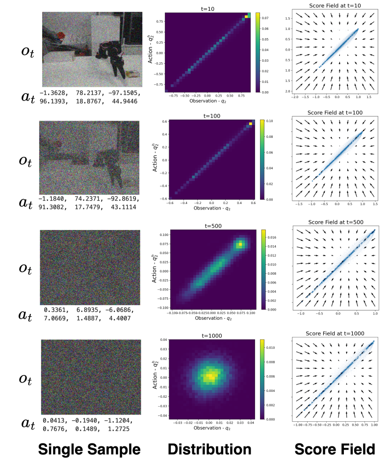
</p>

<p align="center">
  <strong>图 24</strong>｜扩散模型（DM）迭代式地对未知分布中的样本施加噪声（左图），将其逐步转化为近似标准高斯分布（中图）；同时学习位移场（右图），借助该位移场，对易于采样、可计算的分布样本反复去噪，从而还原出未知目标分布的样本。

</p>

<p align="center">
  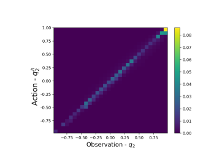
</p>

<p align="center">
  <strong>图 25</strong>｜联合动作-观测分布。本简化案例中，观测为SO-100机器人的肘部弯曲驱动量，动作是遥操作臂上同一关节记录的位置。由于记录的运动来自遥操作，样本点沿对角线分布。

</p>

通过学习扩散过程得到的、一般不携带有效信息的污染样本，以及来自未知分布的原始样本之间的总偏移量，Ho等人（2020）证明：我们可以通过逆转该偏移、对样本去噪，来逼近底层的数据分布。有意思的是，在真实世界数据都位于某个高维流形上这一假设（流形假设，Manifold Hypothesis）下，Permenter与Yuan（2024）指出：扩散模型学习的是距离函数的梯度，该梯度刻画了任意流形外点（例如被扰动、无信息的样本）到数据流形本身的距离。沿着这个梯度移动——也就是对来自无信息分布的样本做去噪——等价于将样本投影回流形；由此形成一套方法，可以借助欧氏投影，从未知分布中采样。事实上，在 $p_\theta(z_{t-1}\mid z_t)$ 服从高斯分布的前提下，采样 $z_{t-1}\sim p_\theta(\cdot\mid z_t)$ 等价于计算：

$$
z_{t-1} = \frac{1}{\sqrt{\bar{\alpha}_t}} \left(z_t - \frac{\beta_t}{\sqrt{1-\bar{\alpha}_t}} \epsilon_\theta(z_t,t)\right) + \sigma_t \epsilon,\quad \epsilon \sim \mathcal{N}(0,\mathbf{I}) \tag{45}
$$

公式释义
- $z_{t-1}$：逆扩散一步后的样本（去噪后）
- $z_t$：当前时间步 $t$ 的加噪样本
- $\bar{\alpha}_t$：累积扩散系数
- $\beta_t$：单步扩散系数（噪声调度）
- $\epsilon_\theta(z_t,t)$：噪声预测网络，输入 $z_t$ 与时间步 $t$，输出预测噪声
- $\sigma_t$：逆过程的噪声标准差
- $\epsilon \sim \mathcal{N}(0,\mathbf{I})$：新增的标准高斯噪声采样
> 该式是DDPM的逆扩散采样公式，从 $z_t$ 得到上一步 $z_{t-1}$，由预测噪声计算均值，再叠加随机噪声。

这说明，扩散模型（DM）中层级更低的隐变量，可以利用通过最小化式(44)训练得到的噪声回归器 $\epsilon_\theta(z_t,t)$，从高一级的隐变量中迭代去除噪声得到。

### 4.1.3 Flow Matching

扩散模型（DM）所采用的后验参数化方式在传统上被证明是有效的，但它在推理阶段的效率一直饱受争议：想要从目标分布中还原出一个样本，往往需要上百次计算开销巨大的去噪步骤。流匹配（Flow Matching, FM）（Lipman 等人，2023）将扩散模型拓展到任意似然与后验的通用场景，由此定义了一类更具优势的生成模型（GM），它提供了一套统一框架，用于学习分布之间的连续变换，扩散模型只是其包含的特例。

流匹配不再采用随机、离散、多步的去噪过程，而是学习一个确定性、连续且可微的流 $\psi: [0,1]\times\mathcal{Z} \mapsto \mathcal{Z}$。该流由一个（可随时间变化的）向量场 $v: [0,1]\times\mathcal{Z} \mapsto \mathcal{Z}$ 形式化定义：随着时间推移，向量场将简单先验分布 $p_0$（例如标准高斯分布）的样本输送到更复杂、通常未知的数据分布 $p_1$。在此框架下，流匹配可以适配任意中间分布，不再局限于后验和似然都为高斯分布这一特殊情形。

同时需要注意：流匹配中的时间 $t\in[0,1]$ 是连续变化的，样本从易于采样的分布 $p_0$ 逐步向未知数据分布 $p_1$ 迁移。推理时会生成一条连续（且确定性）的轨迹，相比扩散模型里的随机路径，实际效率更高。从数学形式上看，流匹配可以完全由常微分方程（ODE）描述，该方程把流的瞬时变化和底层向量场关联起来；对时间积分后，就能够得到分布支撑集上完整的样本迁移轨迹。

$$
\frac{d}{dt}\psi(z,t) = v\big(t,\psi(t,z)\big), \tag{46}
$$
$$
\psi(0,z) = z. \tag{47}
$$

公式释义
- $\psi(z,t)$：流函数（flow），代表初始样本 $z$ 随时间 $t$ 演化后的状态
- $v(t,\cdot)$：时间相关的向量场（vector field），决定样本在流上的瞬时移动速度
- $\displaystyle\frac{d}{dt}\psi(z,t)$：流对时间的导数，也就是样本的瞬时速度
- $\psi(0,z)=z$：初始条件，$t=0$ 时样本保持原样，即从先验分布 $p_0$ 出发

> 这是流匹配的核心常微分方程（ODE）；在推理时，从 $t=0$ 积分到 $t=1$，就可以把先验样本输送到目标数据分布 $p_1$。

在实际实现中，流模型会通过估计一个向量场 $v$ 来逼近真实但未知的向量场 $u$，由此得到的诱导流 $\psi$ 就能够近似理想轨迹 $\psi^*$。

<p align="center">
  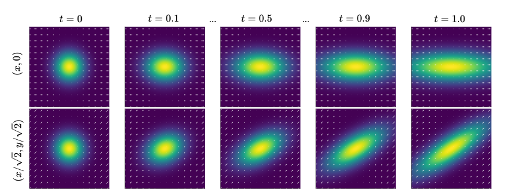
</p>

<p align="center">
  <strong>图 26</strong>｜不同的向量场会以不同方式改变概率分布，在同一个支撑集上诱导出不同的质量流（上方与下方分别使用两个不同的时不变二维向量场：$u_1(x,y)=(x,0)$ 和 $u_2(x,y)=(x/\sqrt{2},y/\sqrt{2})$）。注意时间在区间 $[0,1]$ 内连续流动。流匹配（FM）模型学习逼近目标向量场，从而对易于采样的初始分布实现任意的（目标）变换。

</p>

流匹配（FM）已经在各类应用中展现出优异效果，涵盖图像生成（Esser 等人，2024）、视频生成（Polyak 等人，2025）以及机器人控制（Black 等人，2024）。尤为重要的是，Lipman 等人（2023）在流匹配用于生成模型（GM）的奠基性工作中证明：扩散模型（DM）可以视作流匹配的一个特例，此时由噪声回归器 $\epsilon_\theta$ 学习得到的条件目标向量场 $v$ 满足：

$$
u(t,z|z_0)=\frac{\frac{d}{dt}\alpha(1-t)}{1-\big(\alpha(1-t)\big)^2}\big(\alpha(1-t)z-z_0\big),\quad \alpha(t)=e^{-\frac12\int_0^t\beta(s)ds},\quad \forall z_0\in \mathcal{D}. \tag{48}
$$
$u(t,z|z_0)$ 是扩散模型对应的条件向量场；$\alpha(t)$ 为扩散累积系数，$\beta(s)$ 是噪声调度函数，该式对数据集 $\mathcal{D}$ 中任意样本 $z_0$ 都成立。

条件向量场不仅由自变量 $z$ 和时间 $t$ 定义，还会随辅助变量 $z_0$ 发生变化，这把标准向量场的概念进行了扩展，以纳入额外的条件信息。需要注意，传统离散时间噪声调度序列 $\{\beta_t\}_{t=0}^T$ 在这里被推广为连续映射 $\beta: [0,1] \mapsto \mathbb{R}^+$。关键的是，Lipman 等人（2023）证明：仅针对数据集 $\mathcal{D}$ 里的单个数据点 $z_0$ 优化向量场，就可以得到最优流，该流能够将初始分布 $p_0$ 的全部支撑集变换为目标分布 $p_1$，且数据集 $\mathcal{D}$ 服从分布 $p_1$。

扩散模型的加噪调度会生成类似随机布朗运动的随机过程，而流匹配（FM）支持更通用的似然与后验参数化形式，这些形式可以是确定性的。在流匹配相关文献中，沿着HMLV模型定义的似然与后验概率密度通常被称为**概率路径（probability path）**；HMLV模型中相邻连续转移对应的分布，由二者之间（归一化后的）流建立联系（图26）。流匹配本身具备的灵活性，是它相较于扩散模型的核心优势之一，这使得模型有机会学习更高效的迁移路径。例如，可以借鉴最优传输（Optimal Transport, OT）来设计概率路径；最优传输是一套数学框架，用于刻画概率分布之间代价最低的变换方式。基于最优传输得到的概率路径通常比扩散路径更加平直（图27），这不仅能够带来更快、更稳定的训练效果，在实验上也可以用更少的推理去噪步骤生成质量更高的样本。具体来说，流匹配避开了扩散模型加噪、去噪过程自带随机性所带来的不必要来回折返，因此在保持生成效果相当的前提下，推理阶段的计算开销通常可以大幅降低（Lipman 等人，2023）。

<p align="center">
  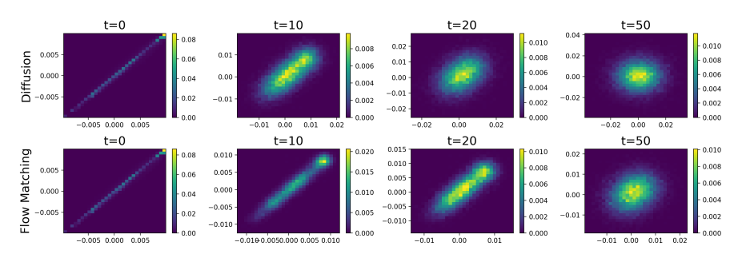
</p>

<p align="center">
  <strong>图 27</strong>｜相较于扩散模型，流匹配按照随机性更低的模式对分布进行变换，从而在源分布与目标分布之间实现更清晰的插值。该可视化展示了两种方法在机器人观测与动作的联合分布上的对比示例，总步数 $T=50$。

</p>

在实际应用中，流匹配（FM）可用于生成建模：训练向量场回归器 $v_\theta(z,t)$ 去逼近给定的目标向量场 $u(t,z)$。对于扩散模型这一特例，$u(t,z)$ 由式（48）定义；原则上，我们可以学习目标向量场来实现任意的概率质量迁移，也可以依据最优传输（OT）预先固定目标向量场。给定一个取自数据分布的样本 $z_1\sim p_1$ 和一个取自易采样先验分布的样本 $z_0\sim p_0$，条件流匹配（Conditional FM, CFM）利用样本之间的线性插值构造一条简单路径：$z_t = (1-t)z_0 + tz_1$，对应的目标向量场为 $u(t,z_t)=z_1-z_0$。随后流匹配模型可以使用如下简单的回归损失目标进行训练：

$$
\mathcal{L}(\theta)=\mathbb{E}_{t,z_0,z_1}\Big[\big\|v_\theta\big((1-t)z_0+tz_1,t\big)-(z_1-z_0)\big\|^2\Big], \quad t\sim \mathcal{U}\big([0,1]\big). \tag{49}
$$
$\mathcal{L}(\theta)$ 是条件流匹配（CFM）的训练损失；$\mathbb{E}$ 代表期望，$t$ 在区间 $[0,1]$ 上均匀采样，损失为模型预测向量场 $v_\theta$ 和目标向量场 $z_1-z_0$ 之间的均方误差。

其中 $z_0\sim p_0(\cdot)$，$z_1\sim p_1(\cdot)$。可以注意到，式（49）与式（44）的区别在于：时间被看作连续变量 $t\sim \mathcal{U}([0,1])$，而不是离散采样 $t\sim \mathcal{U}(\{0,\Delta t,2\Delta t,\dots,1\})$，这是基于流的模型的核心特性。

因此，式（49）的损失目标直接让学习到的向量场拟合连接先验样本与数据样本的简单直线路径，实现了无仿真的训练流程，训练过程稳定且高效。推理阶段，采样从 $z_0\sim p_0$ 开始，按照常微分方程 $\displaystyle \frac{dz}{dt}=v_\theta(z_t,t),\ t\in[0,1]$ 迭代演化；该过程可以使用标准常微分方程（ODE）求解器进行数值计算，工程上常采用前向欧拉法，在数十步去噪步长上完成数值积分。

## 4.2 Action Chunking with Transformers

虽然生成模型（GM）适合学习复杂、高维的多模态分布，但它本身无法解决在线序列预测建模中典型的误差累积问题。在《Action Chunking with Transformers》（ACT，基于Transformer的动作分块）工作中，Zhao等人（2023）将变分自编码器（VAE）应用于仅从离线轨迹数据学习的任务，并提出一种简单且有效的方法来缓解误差累积，通过行为克隆（BC）学习高保真的自主行为。受到人类会规划未来 $t{+}k$ 时刻的动作序列、而非只规划当前时刻 $t$ 的单个动作这一机制的启发，Zhao等人（2023）提出在示范数据集上训练生成模型，直接对多动作组成的动作块（chunk）进行建模。除了在高性能自主行为学习上的贡献之外，Zhao等人（2023）还推出了硬件方案：低成本双臂机器人平台ALOHA，该平台可以完成精细操作任务，例如开盖、将电池装入卡槽，甚至准备胶带以供使用。值得一提的是，这套ALOHA双臂平台的成本和单臂Franka机器人相当，并且可以使用容易采购到的零部件组装，具备更高的可落地性。

Zhao等人（2023）也为ALOHA平台的高性能自主行为合成带来了重要算法贡献：以Transformer作为主干网络，从示范数据中训练条件变分自编码器（Conditional VAE, CVAE，Sohn等人，2015）。条件变分自编码器是标准VAE的变体，在从隐空间先验采样时引入任意条件信息，用于建模隐变量与数据样本之间一对多的映射关系。此外，和之前的研究（Florence等人，2022；Janner等人，2022）有明显区别：Zhao等人（2023）不去学习观测与动作的完整联合分布 $p_\theta(o,a)$，而是聚焦于条件分布 $p_\theta(a|o)$。原则上策略分布 $p_\theta(a|o)$ 可以由联合分布 $p_\theta(o,a)$ 推导得到，但在使用函数近似器时条件分布通常难以直接计算：$p_\theta(a|o)=\frac{p_\theta(o,a)}{\int p_\theta(o,a)da}$，分母中的积分一般无法解析求解。因此Zhao等人（2023）没有使用普通VAE去拟合完整联合分布，而是直接训练条件变分自编码器来建模策略分布，也就是对 $p(a|o)$ 做近似。

在实际的示范学习场景中，使用条件变分自编码器只需要对式（26）中的VAE损失目标做小幅修改，修改后的形式为：

$$
\mathrm{ELBO}_{\mathcal{D}}(\theta,\phi,\omega)=\sum_{i=0}^{N}\Big(\mathbb{E}_{z\sim q_\phi(\cdot|o_i,a_i)}\big[\log p_\theta(a_i|z,o_i)\big] - D_{\mathrm{KL}}\big[q_\phi(z|o_i,a_i)\parallel p_\omega(z|o_i)\big]\Big) \tag{50}
$$
$\mathrm{ELBO}_{\mathcal{D}}(\theta,\phi,\omega)$ 是数据集 $\mathcal{D}$ 上条件变分自编码器（CVAE）的证据下界（Evidence Lower Bound, ELBO）；$\mathbb{E}$ 代表期望，$q_\phi(z|o_i,a_i)$ 是推理网络（编码器）的后验分布，$p_\theta(a_i|z,o_i)$ 是生成网络（解码器），$p_\omega(z|o_i)$ 是基于观测的隐变量先验分布，$D_{\mathrm{KL}}$ 为KL散度（Kullback-Leibler divergence），用来约束近似后验和条件先验之间的距离。

可以注意到，式（50）中我们额外针对隐空间的先验分布学习一组新参数 $\omega$。这一设置使得训练阶段（推理阶段也可）能够对隐空间采样（进而完成重构）施加条件约束，对于学习策略这类本质上属于条件分布的任务十分有用。此外，ACT 采用 $\beta$-CVAE（Higgins 等人，2017）进行训练，利用超参数 $\beta\in\mathbb{R}^+$ 对式（50）中的KL正则项加权，以此控制隐空间中压缩的信息量；$\beta$ 取值越大，隐空间的表达能力就越弱。

在该工作中，Zhao 等人（2023）做了消融实验，对比基于生成模型（GM）从人类示范中学习，和更简单的监督学习目标 $L_1(a,a')=\|a-a'\|_1$。一个有意思的结论是：在脚本示范数据上学习时，两种方法的性能接近。也就是说，当训练数据是执行预设指令序列 $[q_0^c,q_1^c,\dots]$ 采集得到时，生成模型相比普通监督学习并没有优势。
但如果学习数据来自人类示范，也就是由人类控制器下发指令 $[q_0^h,q_1^h,\dots]$ 采集得到的数据，Zhao 等人（2023）发现：相比表达能力更强、学习难度更高的变分目标，采用普通监督学习目标会让下游任务成功率大幅下降（降幅达33.3%）。这一消融结果体现了人类示范数据的多模态特性，也和 Florence 等人（2022）的结论保持一致。作者还针对动作分块（action chunking）范式开展消融实验，结果表明动作分块能够带来显著性能提升（无分块成功率1%，使用分块后44%）。为降低开环执行带来的问题，Zhao 等人（2023）还设计了对应的推理流程：在每个时间步 $t$ 都执行一次推理，再对重叠的动作块使用指数移动平均（Exponential Moving Average, EMA）融合多个动作块的输出。

在 ACT（图30）中，给定观测 $o\in\mathcal{O}$ 的推理流程为：(1) 定义隐变量 $z$ 的条件先验 $p_\omega(z|o)$；(2) 从采样得到的隐变量 $z\sim p_\omega(\cdot|o)$ 解码出一个动作块。该过程和标准VAE的采样方式类似，区别在于普通VAE一般设置 $p(z|o)\equiv p(z)\sim\mathcal{N}(0,I)$，因此不需要步骤(1)。

不过作者提出，使用确定性方式得到 $z$ 更有利于策略评估，因此在推理阶段完全不再使用条件先验，CVAE框架仅用来训练表达能力更强的解码器。在测试阶段，Zhao 等人（2023）直接取 $z=0$，这是因为训练时 $z$ 的条件先验被设置为标准高斯分布。同时，测试时向解码器 $p_\theta(a|z,o)$ 显式输入本体感知（proprioceptive）观测和视觉观测，以此引入观测 $o$ 的条件信息。推理时虽然 $z$ 从标准高斯分布采样，但训练阶段的 $z$ 是从近似后验分布 $q_\phi(z|o,a)$ 采样；出于效率考虑，该后验在构造观测 $o$ 时只使用本体感知状态，不使用图像观测。

<p align="center">
  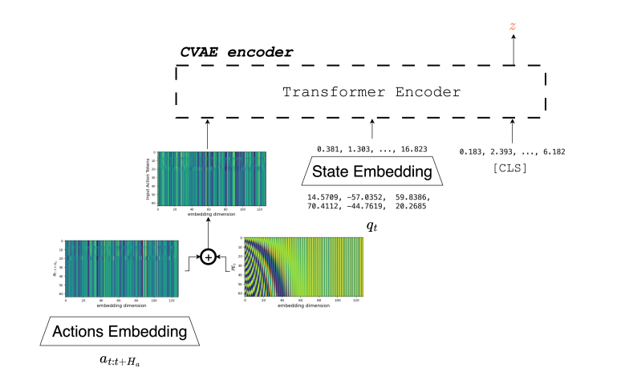
</p>

<p align="center">
  <strong>图 28</strong>｜ACT 中使用的条件变分自编码器（CVAE）编码器：输入动作块首先进行嵌入，并与位置编码（positional embeddings）融合；随后和本体感知信息的嵌入一同送入网络，同时引入一个可学习的 [CLS] token 对输入层面信息进行聚合，用于预测风格变量 $z$。该编码器仅用于训练解码器，在推理阶段会被完全舍弃。

</p>

<p align="center">
  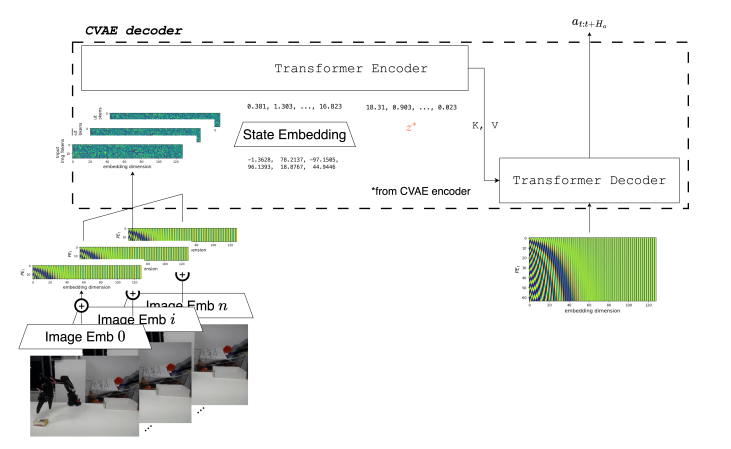
</p>

<p align="center">
  <strong>图 29</strong>｜ACT 所使用的条件变分自编码器（CVAE）解码器，整体采用完整的编码器-解码器Transformer架构。来自全部 $n$ 个相机视角的图像观测，首先通过预训练视觉编码器完成嵌入，之后与对应的位置编码（positional embeddings）融合。接着，本体感知信息以及从CVAE编码器得到的风格变量 $z$，一同送入编码器-解码器Transformer中进行推理。该Transformer的编码器向解码器提供键矩阵 $\boldsymbol{K}$、值矩阵 $\boldsymbol{V}$，训练目标是将固定位置编码解码为动作块。

</p>

<p align="center">
  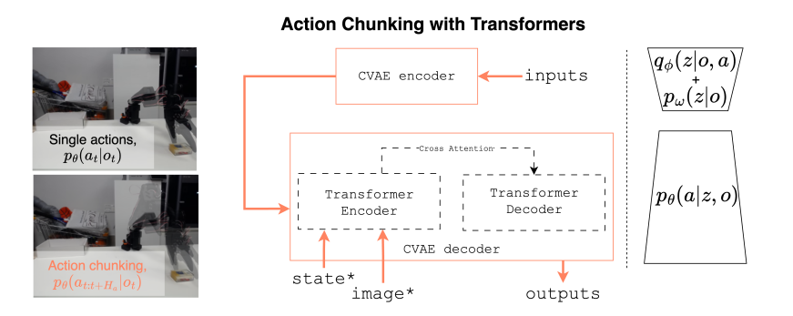
</p>

<p align="center">
  <strong>图 30</strong>｜基于Transformer的动作分块（Action Chunking with Transformer，ACT），出自Zhao等人（2023）的工作。ACT提出了动作分块范式，用于处理高维多模态示范数据，并采用基于Transformer的条件变分自编码器（CVAE）架构。
</p>

### 4.2.1 Code Example: Training and Using ACT in Practice

> Code 7: Training ACT
https://github.com/fracapuano/robot-learning-tutorial/snippets/ch4/01_training_act.py

```python
from pathlib import Path

import torch

from lerobot.configs.types import FeatureType
from lerobot.datasets.lerobot_dataset import LeRobotDataset, LeRobotDatasetMetadata
from lerobot.datasets.utils import dataset_to_policy_features
from lerobot.policies.act.configuration_act import ACTConfig
from lerobot.policies.act.modeling_act import ACTPolicy
from lerobot.policies.factory import make_pre_post_processors


def make_delta_timestamps(delta_indices: list[int] | None, fps: int) -> list[float]:
    if delta_indices is None:
        return [0]

    return [i / fps for i in delta_indices]


output_directory = Path("outputs/robot_learning_tutorial/act")
output_directory.mkdir(parents=True, exist_ok=True)

# Select your device
device = torch.device("mps")  # or "cuda" or "cpu"

dataset_id = "lerobot/svla_so101_pickplace"

# This specifies the inputs the model will be expecting and the outputs it will produce
dataset_metadata = LeRobotDatasetMetadata(dataset_id)
features = dataset_to_policy_features(dataset_metadata.features)

output_features = {key: ft for key, ft in features.items() if ft.type is FeatureType.ACTION}
input_features = {key: ft for key, ft in features.items() if key not in output_features}

cfg = ACTConfig(input_features=input_features, output_features=output_features)
policy = ACTPolicy(cfg)
preprocessor, postprocessor = make_pre_post_processors(
    cfg, dataset_stats=dataset_metadata.stats
)

policy.train()
policy.to(device)

# To perform action chunking, ACT expects a given number of actions as targets
delta_timestamps = {
    "action": make_delta_timestamps(cfg.action_delta_indices, dataset_metadata.fps),
}

# add image features if they are present
delta_timestamps |= {
    k: make_delta_timestamps(cfg.observation_delta_indices, dataset_metadata.fps)
    for k in cfg.image_features
}

# Instantiate the dataset
dataset = LeRobotDataset(dataset_id, delta_timestamps=delta_timestamps)

# Create the optimizer and dataloader for offline training
optimizer = cfg.get_optimizer_preset().build(policy.parameters())
batch_size = 32
dataloader = torch.utils.data.DataLoader(
    dataset,
    batch_size=batch_size,
    shuffle=True,
    pin_memory=device.type != "cpu",
    drop_last=True,
)

# Number of training steps and logging frequency
training_steps = 1
log_freq = 1

# Run training loop
step = 0
done = False
while not done:
    for batch in dataloader:
        batch = preprocessor(batch)
        loss, _ = policy.forward(batch)
        loss.backward()
        optimizer.step()
        optimizer.zero_grad()

        if step % log_freq == 0:
            print(f"step: {step} loss: {loss.item():.3f}")
        step += 1
        if step >= training_steps:
            done = True
            break

# Save the policy checkpoint, alongside the pre/post processors
policy.save_pretrained(output_directory)
preprocessor.save_pretrained(output_directory)
postprocessor.save_pretrained(output_directory)

# Save all assets to the Hub
policy.push_to_hub("fracapuano/robot_learning_tutorial_act_example_model")
preprocessor.push_to_hub("fracapuano/robot_learning_tutorial_act_example_pipeline")
postprocessor.push_to_hub("fracapuano/robot_learning_tutorial_act_example_pipeline")
```

> Code 8: Using ACT
https://github.com/fracapuano/robot-learning-tutorial/snippets/ch4/02_using_act.py

```python
import torch

from lerobot.cameras.opencv.configuration_opencv import OpenCVCameraConfig
from lerobot.datasets.lerobot_dataset import LeRobotDatasetMetadata
from lerobot.policies.act.modeling_act import ACTPolicy
from lerobot.policies.factory import make_pre_post_processors
from lerobot.policies.utils import build_inference_frame, make_robot_action
from lerobot.robots.so100_follower.config_so100_follower import SO100FollowerConfig
from lerobot.robots.so100_follower.so100_follower import SO100Follower

device = torch.device("mps")  # or "cuda" or "cpu"
model_id = "fracapuano/robot_learning_tutorial_act_example_model"
model = ACTPolicy.from_pretrained(model_id)

dataset_id = "lerobot/svla_so101_pickplace"
# This only downloads the metadata for the dataset, ~10s of MB even for large-scale datasets
dataset_metadata = LeRobotDatasetMetadata(dataset_id)
preprocess, postprocess = make_pre_post_processors(
    model.config, dataset_stats=dataset_metadata.stats
)

# # find ports using lerobot-find-port
follower_port = ...  # something like "/dev/tty.usbmodem58760431631"

# # the robot ids are used the load the right calibration files
follower_id = ...  # something like "follower_so100"

MAX_EPISODES = 5
MAX_STEPS_PER_EPISODE = 20

# Robot and environment configuration
# Camera keys must match the name and resolutions of the ones used for training!
# You can check the camera keys expected by a model in the info.json card on the Hub
camera_config = {
    "side": OpenCVCameraConfig(index_or_path=1, width=640, height=480, fps=30),
    "up": OpenCVCameraConfig(index_or_path=1, width=640, height=480, fps=30),
}

robot_cfg = SO100FollowerConfig(port=follower_port, id=follower_id, cameras=camera_config)
robot = SO100Follower(robot_cfg)
robot.connect()

for _ in range(MAX_EPISODES):
    for _ in range(MAX_STEPS_PER_EPISODE):
        obs = robot.get_observation()
        obs_frame = build_inference_frame(obs, dataset_metadata.features, device)

        obs = preprocess(obs_frame)

        action = model.select_action(obs)
        action = postprocess(action)

        action = make_robot_action(action, dataset_metadata.features)

        robot.send_action(action)

    print("Episode finished! Starting new episode...")
```

## 4.3 Diffusion Policy

